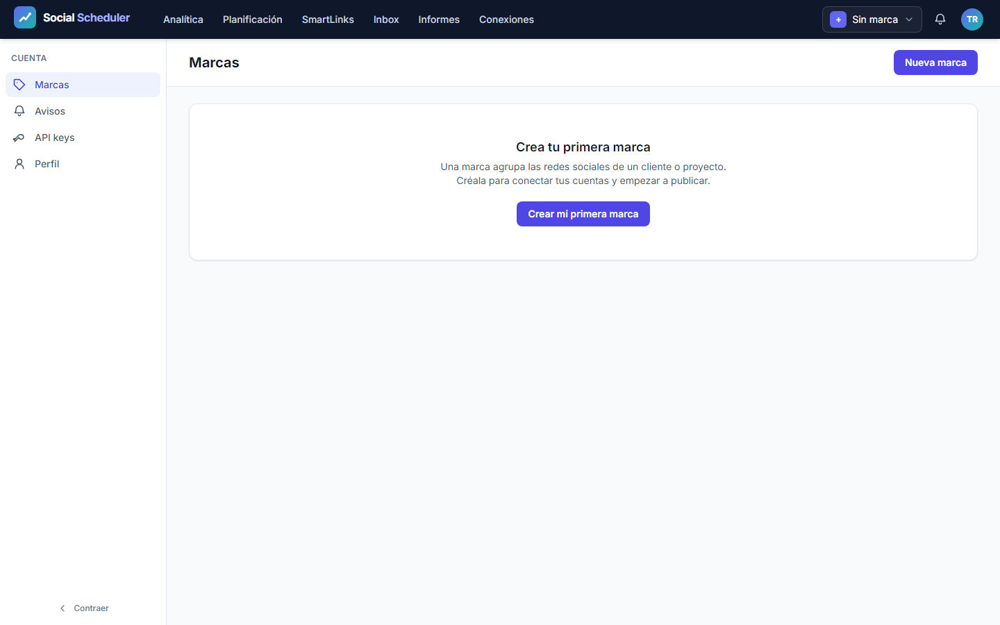
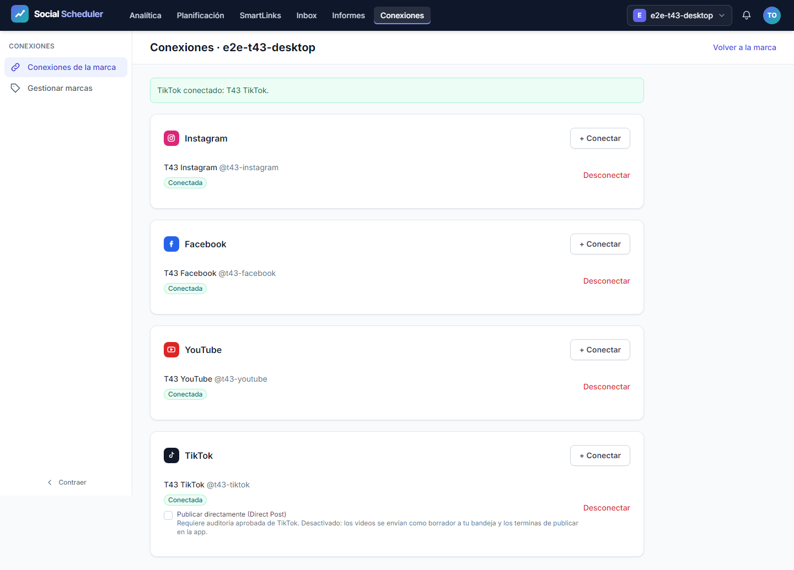
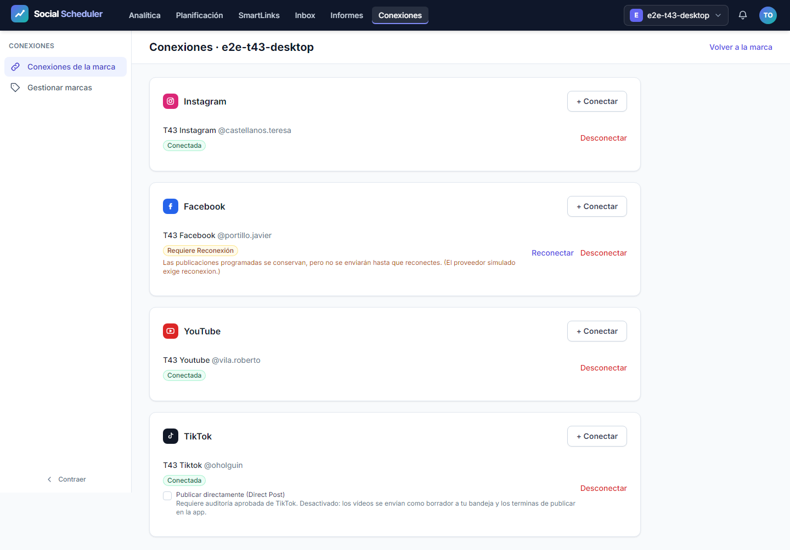
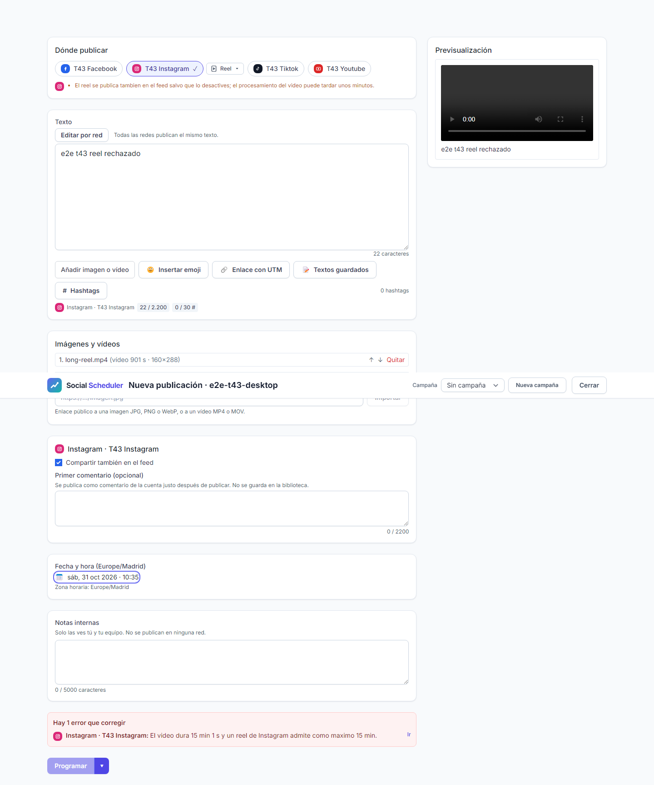
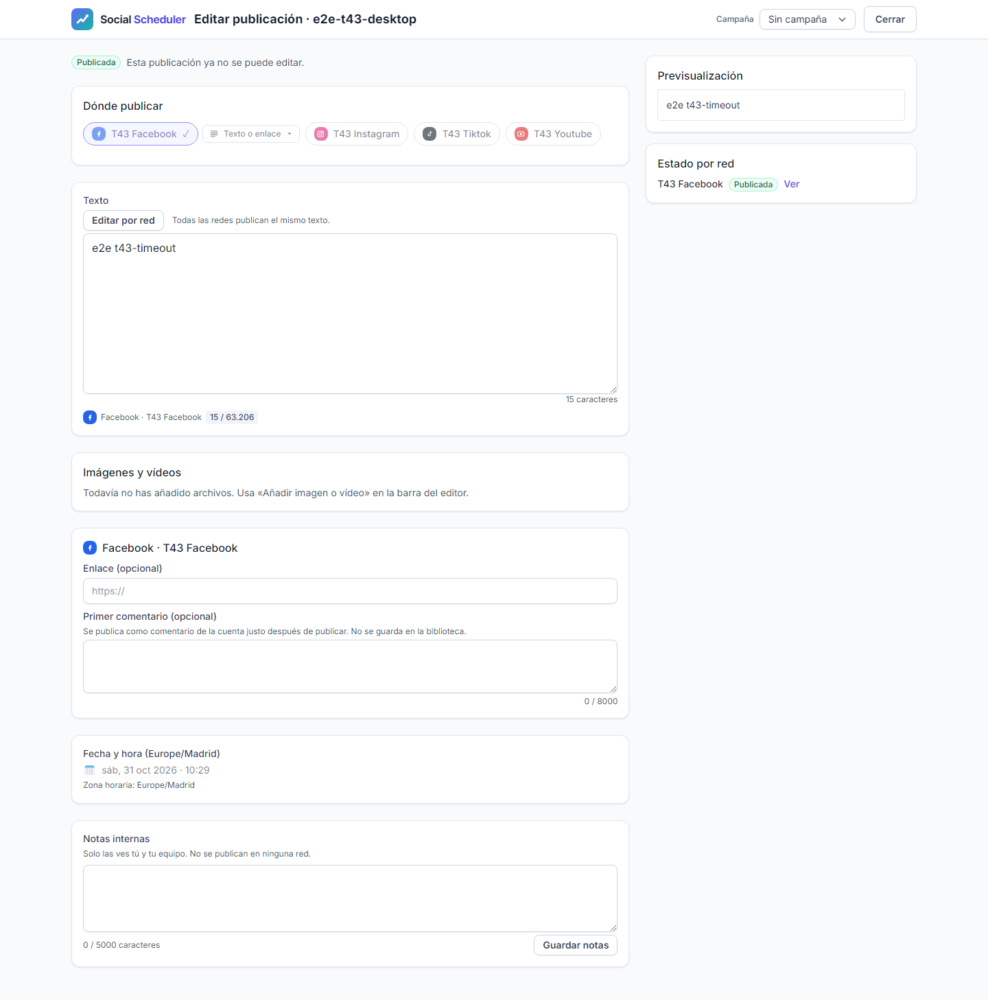
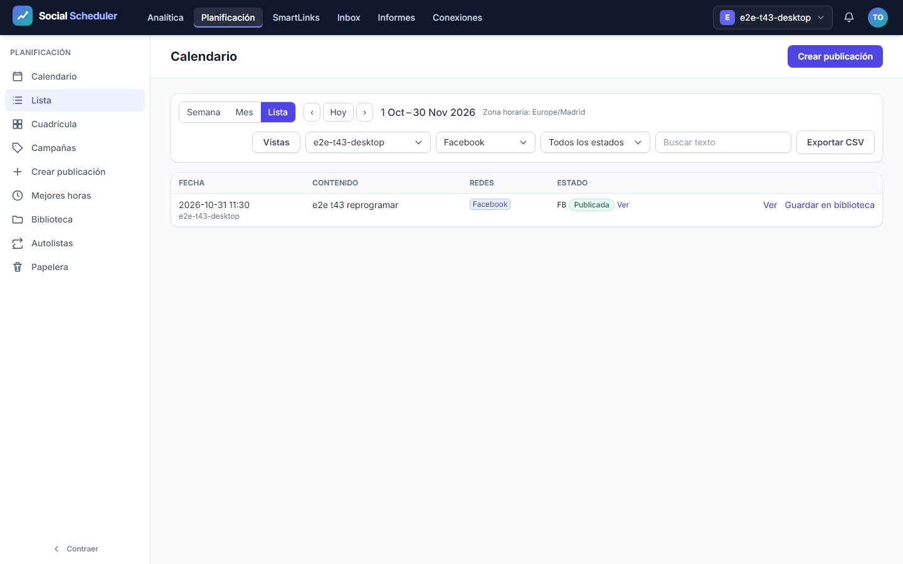
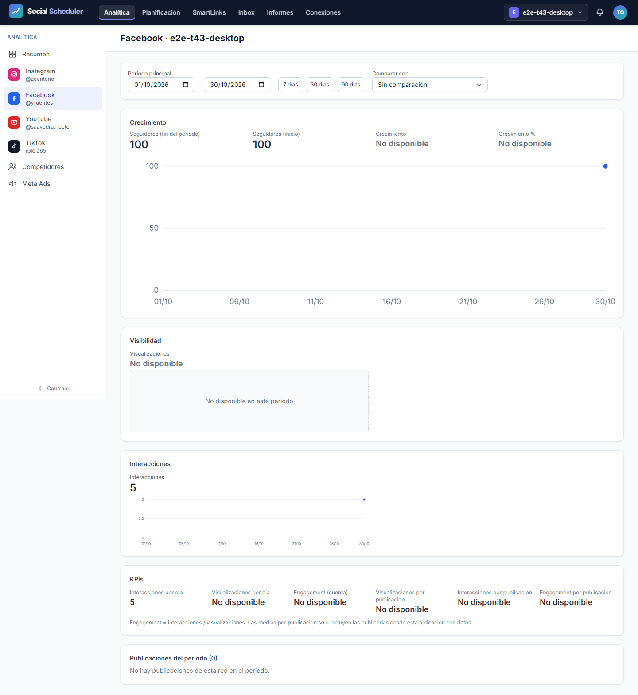
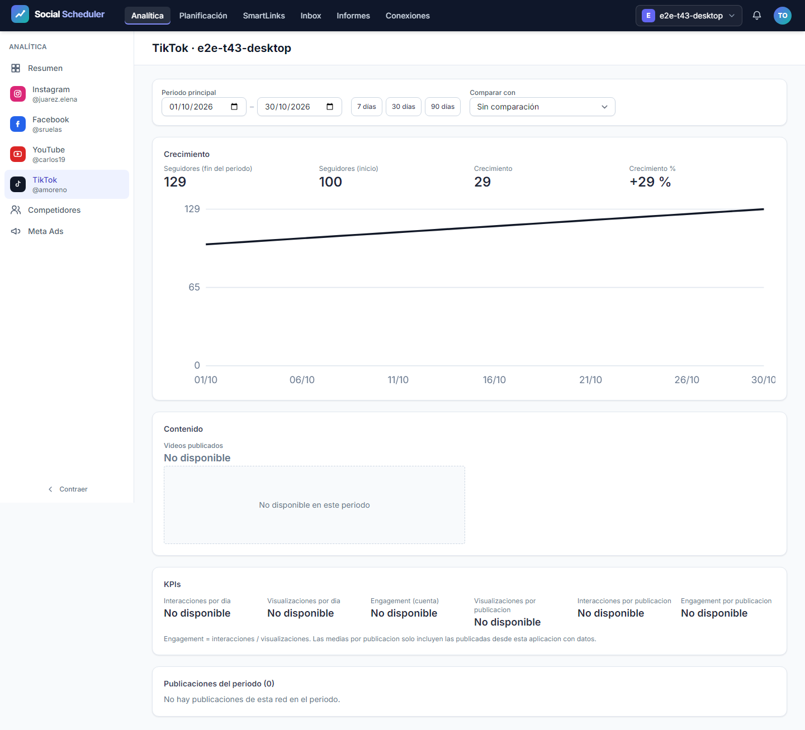
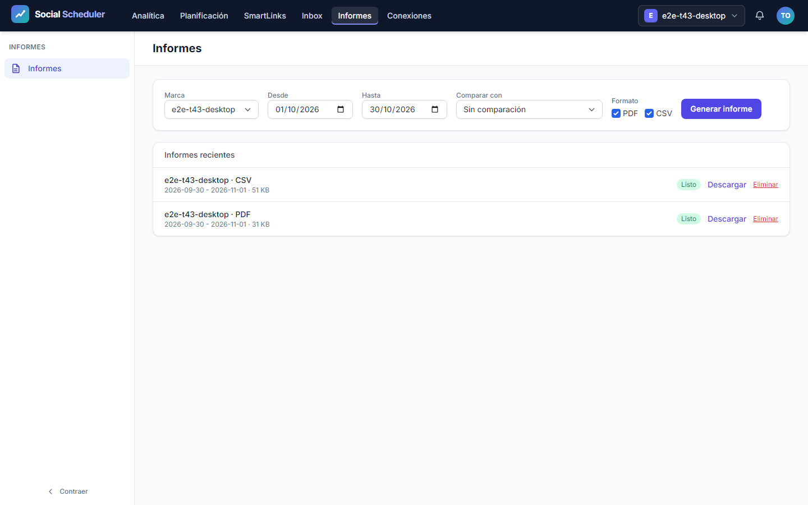
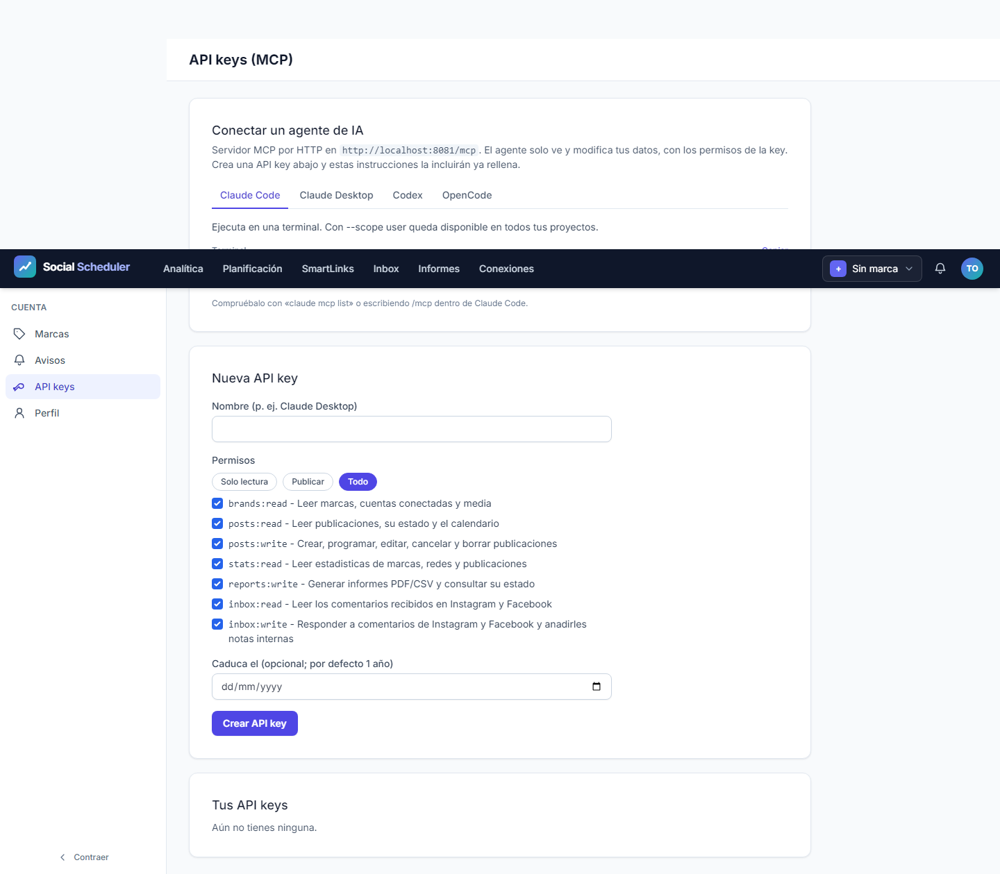

# Informe de QA — Social Scheduler, validación integrada T-43

| Campo | Estado |
|---|---|
| Fecha | 2026-10-31 |
| Estado de la parte automática | **VERDE**, `qa-gate.py` exit 0: 57 pasan, 0 fallos, 0 flaky, 0 omitidos |
| Estado de la entrega completa | No completada: M-01 a M-04 pendientes |
| URL autorizada | `http://localhost:8081`, servidor de la configuración aislada T-43 |
| Plan | [Plan](../improvement-plan.md) · [Pruebas](../test-plan.md) · [Ledger](../tasks.md) |

## Alcance y aislamiento

Esta auditoría cubre los doce escenarios originales E2E-01 a E2E-12, los tres bloques API y las comprobaciones de seguridad del harness. Los perfiles previstos son `desktop`, `mobile` y `mobile-360` en Chromium.

El runner específico crea una base SQLite, media, caché, vistas, sesiones y correo bajo un directorio desechable de T-43. Solo utiliza usuarios `e2e-sec-roadmap-*`; no carga la sesión demo ni los bookends de la batería general. El router y la CLI de pruebas simulan las redes sociales y rechazan HTTP no simulado. Los controladores, servicios, dispatcher, jobs, worker y generadores PDF/CSV son los de la aplicación. Los resultados no acreditan publicaciones ni OAuth en redes reales.

## Veredicto automático

Ejecución independiente completada, sin limitar proyectos y con cero reintentos:

```powershell
npx playwright test -c playwright.roadmap.config.ts
```

Inicio del runner: **2026-10-31T09:28:01.054Z**. Duración: **249,57 segundos**. Resultado terminal del proceso: **exit 0, 57 passed**. Los perfiles `desktop` (1440 × 900), `mobile` (375 × 812) y `mobile-360` (360 × 740) ejecutaron **19 casos cada uno**: 12 E2E de navegador, 3 API y 4 comprobaciones del harness.

Se ejecutó `qa-gate.py raw/results.json` sobre la copia exacta del reporter JSON; devolvió **exit 0**. Salida íntegra:

```json
{
  "verdict": "VERDE",
  "counts": {
    "passed": 57,
    "failed": 0,
    "flaky": 0,
    "skipped": 0,
    "interrupted": 0
  },
  "flaky_sin_justificar": [],
  "flaky_justificados": {},
  "threshold": "verde ⟺ 0 failed, 0 flaky sin justificar, 0 interrumpidos y ≥1 test ejecutado"
}
```

La [evidencia JSON](raw/results.json) conserva los 57 resultados y las rutas originales; no es una salida de descubrimiento `--list`. SHA-256 de origen y copia: `ac554df539a373dbca70f3bc5065da457a7d7ac20cb26c740c76545283b95e6a`. [Metadatos](raw/run-metadata.json), [resumen por caso](raw/case-summary.json), [salida del gate](raw/qa-gate.json) y [huella](raw/results.sha256) permiten comprobar la procedencia.

El primer intento dentro del sandbox terminó con exit 1 y `spawn EPERM` antes de arrancar la batería. Tras comprobar que ese proceso había terminado, se ejecutó la corrida anterior con acceso al host y un directorio nuevo. No hubo reinicios por timeouts de observación ni repeticiones para ocultar fallos; el run válido no tiene errores del runner ni casos flaky.

## Puertas documentales P1

Ejecutadas el 2026-10-31 con Python 3.13 y el bundle `custom-agents` 1.21.1:

- `ledger-lint.py tasks.md`: exit 0, **0 incoherencias y 0 avisos**.
- `coverage-check.py tasks.md test-plan.md spec.md`: exit 0, **0 referencias rotas**, ningún escenario huérfano y ningún CA sin referencia literal.
- Los avisos de tareas sin escenario declarado son T-01 a T-06 y T-10. T-01 a T-05 corresponden al spike y a la decisión manual M-05; T-06 al esqueleto/CI y T-10 a infraestructura/M-04. No son escenarios de UI omitidos. El gate de referencias no prueba por sí mismo la ejecución ni las aserciones de los escenarios.

## Resultados automáticos de navegador

**36/36 ejecuciones E2E pasan**: los doce escenarios se comprobaron en los tres perfiles. La accesibilidad con axe y el desbordamiento horizontal se comprueban en los puntos de cierre definidos por `finish()`; las capturas de registro, recuperación y acceso denegado documentan además sus estados específicos.

| Escenario | Requisito observable | Tareas | Resultado |
|---|---|---|---|
| E2E-01 | Registro, verificación, panel vacío, login y recuperación de contraseña | T-07 | PASA 3/3 |
| E2E-02 | Dos sesiones: marca ajena inaccesible y ausencia de datos ajenos | T-08 | PASA 3/3 |
| E2E-03 | OAuth local simulado de Instagram, Facebook, YouTube y TikTok; desconexión y credenciales retiradas | T-11 a T-15 | PASA 3/3 |
| E2E-04 | Renovación por job, reconexión tras rechazo y conservación de publicaciones pendientes | T-15, T-16 | PASA 3/3 |
| E2E-05 | Vídeo real fuera del límite de duración de reel: error visible y publicación no guardada | T-18, T-23 | PASA 3/3 |
| E2E-06 | Compositor programa; dispatcher y worker publican con ID y enlace externo simulados | T-17, T-19 a T-23, T-26, T-27 | PASA 3/3 |
| E2E-07 | Error transitorio y timeout tras enviar: reintentos con una sola publicación externa | T-20, T-25 | PASA 3/3 |
| E2E-08 | Filtros del calendario, reprogramación de pendiente y bloqueo de publicada | T-24 | PASA 3/3 |
| E2E-09 | Jobs de snapshots: segunda ejecución idempotente y métricas no disponibles como null | T-31 a T-34, T-36 | PASA 3/3 |
| E2E-10 | Treinta días de histórico: métricas y gráficos, cambio de red/periodo y «no disponible» | T-35, T-37 | PASA 3/3 |
| E2E-11 | Generación por cola y descarga de informes PDF/CSV con datos propios y sin datos ajenos | T-38 a T-40 | PASA 3/3 |
| E2E-12 | API key mostrada una sola vez, revocada en UI y rechazada por MCP | T-28 | PASA 3/3 |

Se conservan **45 capturas** (15 por perfil) en `screenshots/`. Los artefactos originales, incluidos **tres PDF y tres CSV descargados**, están en `raw/artifacts/`. E2E-11 comprobó encabezado PDF, tamaño y texto extraído con `pdftotext`: marca, seguidores, publicaciones destacadas y publicación propia presentes; marcador del otro usuario ausente. El CSV se comprobó igualmente contra los datos propios y el marcador ajeno.

## API

| Bloque | Comprobación | Resultado |
|---|---|---|
| API-01 | `initialize`, catálogo y flujo de herramientas con key válida | PASA 3/3 |
| API-02 | Key inválida: 401 sin herramientas ni datos | PASA 3/3 |
| API-03 | Lectura MCP de marca ajena: rechazo sin revelar datos | PASA 3/3 |

Los tres bloques se ejecutaron contra el servidor loopback con usuarios y tokens desechables. El [resumen API](raw/api-summary.json) conserva sus nueve ejecuciones. Se presentan separados de los doce escenarios de navegador; el JSON combinado del runner y el gate incluyen ambos grupos y las comprobaciones del harness.

## Aislamiento del harness y revisión previa

**12/12 comprobaciones pasan**: cada perfil ejecutó rechazo de entorno de producción, rechazo de una base fuera del directorio desechable, creación exclusiva de usuarios dedicados y separación de caché/locks entre dos runs.

Las dos lentes de revisión del intento 2 confirmaron la corrección de B1: las rutas de caché y locks se fijan antes de que los providers puedan resolver las instancias compartidas. La documentación se corrigió de tres a cuatro comprobaciones del harness. Esta auditoría se ejecutó después de esas correcciones, sin modificaciones de aplicación o harness durante la corrida.

## Evidencia PHP existente

El [JUnit del pase completo](raw/phpunit-final.xml), copiado desde `storage/framework/testing/t43/phpunit-final.xml`, declara **2458 tests, 14489 aserciones, 0 errores, 0 fallos y 0 omitidos**. Se ha leído su cabecera; esta auditoría no ha repetido la suite PHP. Su procedencia se distingue de la nueva ejecución independiente de navegador.

Después de esta QA de navegador, el refuerzo literal de Bluesky añade tres pruebas sin modificar producción ni el harness. La nueva regresión completa del orquestador pasa **2461 tests y 14549 aserciones**, sin errores, fallos ni omitidos, en 159907 ms. Se conserva por separado su [JUnit final](raw/phpunit-final-p3.xml); la evidencia anterior no se sobrescribe. Las lentes A y B verificaron esos casos de grafemas, reducción de cuatro imágenes, reconciliación entre dos jobs y comentarios persistidos.

El orquestador comunica además las comprobaciones estáticas del árbol actual: `npx tsc --noEmit -p .` y `php vendor/bin/pint --test` terminan con exit 0; Pint devuelve `result: passed`. Estas comprobaciones pertenecen al orquestador y complementan la nueva ejecución independiente de Playwright.

## Checklist manual

- [ ] **M-01 — Publicación real:** los tipos soportados se publican en las cuentas reales con enlace/ID y visibilidad conforme a G1. Pendiente del usuario.
- [ ] **M-02 — OAuth real:** conectar, desconectar y reconectar las cuatro redes y comprobar renovación y cifrado de tokens. Pendiente del usuario.
- [ ] **M-03 — Dashboard y PDF:** queda la revisión con datos de cuentas reales. El usuario aprueba expresamente el diseño y las secciones de T-41 el 2026-10-31 sobre el PDF de muestra; no se atribuye a esa aprobación una validación de métricas reales.
- [ ] **M-04 — VPS:** cron/Hestia, workers systemd y recuperación de publicaciones vencidas tras una caída. El usuario indica que realizará estas pruebas. Las observaciones operativas del orquestador no cierran este manual ni despliegan el código local.
- [x] **M-05 — Spike y G1:** evidencia histórica del 2026-10-19 reconciliada el 2026-10-31. El [informe del spike](../spike-report.md#decisión-g1) registra YouTube A, TikTok D + B y continuar con Meta; T-05 ya estaba completada. No es una nueva prueba de plataformas reales.

Aunque la parte automática termine en verde, T-43 permanece abierta mientras no se verifiquen los manuales exigidos. Este informe no cambia el estado del plan ni de la spec.

## Capturas por escenario

Cada bloque muestra una captura de escritorio y enlaza las otras dos anchuras. Las imágenes son de usuarios y cuentas simulados dentro del run desechable.

### E2E-01 · registro, verificación, panel vacío, login y recuperación — PASA 3/3


[Móvil 375 px](screenshots/mobile/e2e-01-recuperacion.png) · [Móvil 360 px](screenshots/mobile-360/e2e-01-recuperacion.png)

### E2E-02 · aislamiento de una marca entre dos sesiones reales — PASA 3/3


[Móvil 375 px](screenshots/mobile/e2e-02-marca-ajena.png) · [Móvil 360 px](screenshots/mobile-360/e2e-02-marca-ajena.png)

### E2E-03 · OAuth local de Instagram, Facebook, YouTube y TikTok y desconexión — PASA 3/3


[Móvil 375 px](screenshots/mobile/e2e-03-cuentas-conectadas.png) · [Móvil 360 px](screenshots/mobile-360/e2e-03-cuentas-conectadas.png)

### E2E-04 · job de renovación y reconexión conserva las publicaciones pendientes — PASA 3/3


[Móvil 375 px](screenshots/mobile/e2e-04-requiere-reconexion.png) · [Móvil 360 px](screenshots/mobile-360/e2e-04-requiere-reconexion.png)

### E2E-05 · reel demasiado largo rechazado sin guardar publicación — PASA 3/3


[Móvil 375 px](screenshots/mobile/e2e-05-duracion-rechazada.png) · [Móvil 360 px](screenshots/mobile-360/e2e-05-duracion-rechazada.png)

### E2E-06 · compositor programa, dispatcher y worker publican con enlace — PASA 3/3


[Móvil 375 px](screenshots/mobile/e2e-06-publicada.png) · [Móvil 360 px](screenshots/mobile-360/e2e-06-publicada.png)

### E2E-07 · reintento transitorio y timeout tras enviar no duplican la publicación — PASA 3/3


[Móvil 375 px](screenshots/mobile/e2e-07-idempotencia.png) · [Móvil 360 px](screenshots/mobile-360/e2e-07-idempotencia.png)

### E2E-08 · calendario filtra y reprograma pendientes, bloquea las publicadas — PASA 3/3


[Móvil 375 px](screenshots/mobile/e2e-08-calendario.png) · [Móvil 360 px](screenshots/mobile-360/e2e-08-calendario.png)

### E2E-09 · snapshots reales por job son idempotentes y conservan null — PASA 3/3


[Móvil 375 px](screenshots/mobile/e2e-09-snapshot.png) · [Móvil 360 px](screenshots/mobile-360/e2e-09-snapshot.png)

### E2E-10 · dashboard de treinta días cambia red y periodo con gráficos y no disponible — PASA 3/3


[Móvil 375 px](screenshots/mobile/e2e-10-dashboard.png) · [Móvil 360 px](screenshots/mobile-360/e2e-10-dashboard.png)

### E2E-11 · informes PDF y CSV generados por la cola y descargados con datos propios — PASA 3/3


[Móvil 375 px](screenshots/mobile/e2e-11-informes-listos.png) · [Móvil 360 px](screenshots/mobile-360/e2e-11-informes-listos.png)

### E2E-12 · API key visible una vez, revocada en UI y rechazada por MCP — PASA 3/3


[Móvil 375 px](screenshots/mobile/e2e-12-key-revocada.png) · [Móvil 360 px](screenshots/mobile-360/e2e-12-key-revocada.png)

## Informes descargados y conservados

| Perfil | PDF | CSV |
|---|---|---|
| desktop | [PDF, 31777 bytes](raw/downloads/desktop/informe.pdf) | [CSV, 52518 bytes](raw/downloads/desktop/informe.csv) |
| mobile | [PDF, 31770 bytes](raw/downloads/mobile/informe.pdf) | [CSV, 52517 bytes](raw/downloads/mobile/informe.csv) |
| mobile-360 | [PDF, 31804 bytes](raw/downloads/mobile-360/informe.pdf) | [CSV, 52521 bytes](raw/downloads/mobile-360/informe.csv) |

[Manifiesto de tamaños y huellas de los seis informes](raw/downloads.json). Las copias enlazadas tienen el mismo SHA-256 que sus artefactos originales.

Se inspeccionaron visualmente capturas representativas del dashboard en escritorio y del listado de informes a 360 px: contenido legible, gráficos presentes y botones accesibles sin recortes observados. Esta inspección de QA no es la aprobación del usuario exigida por M-03.
