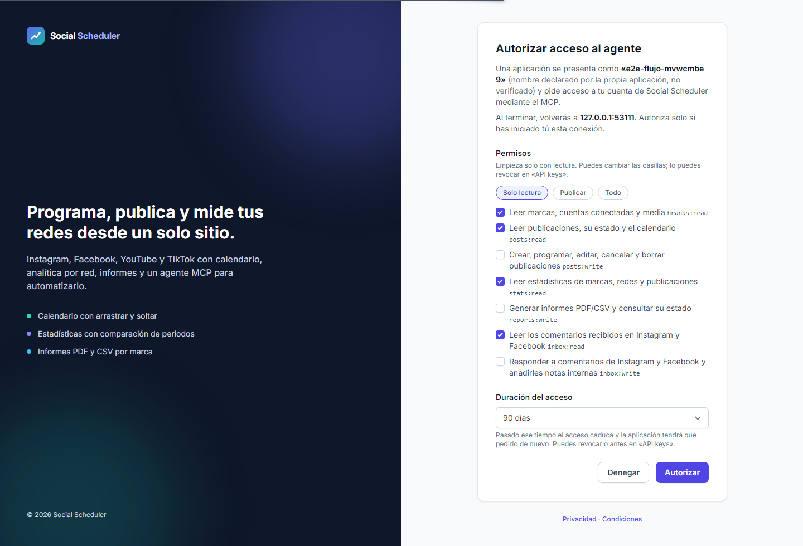
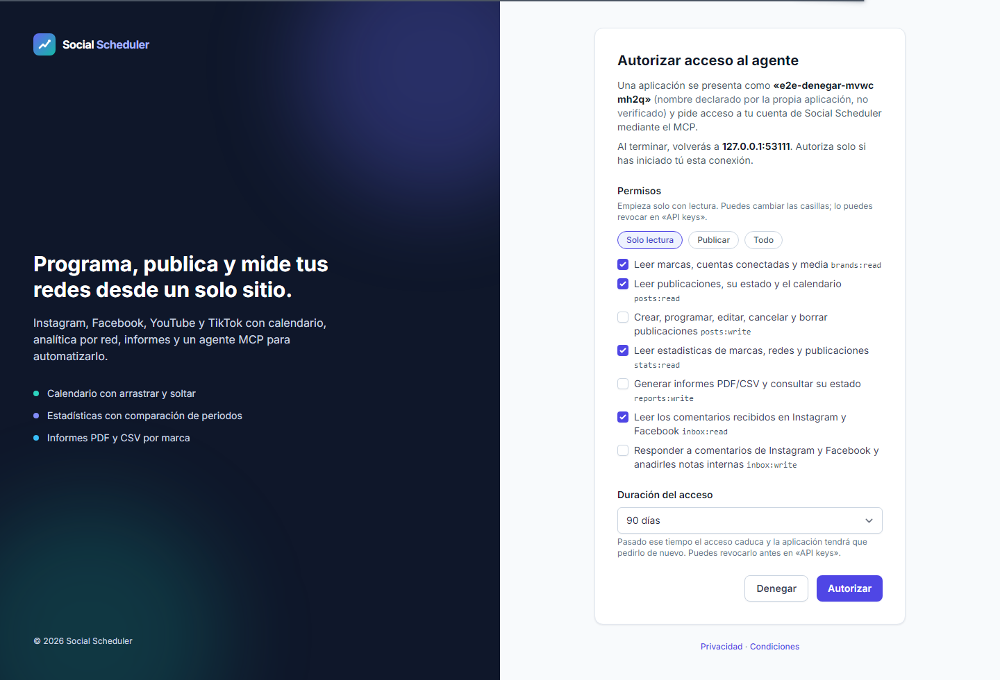
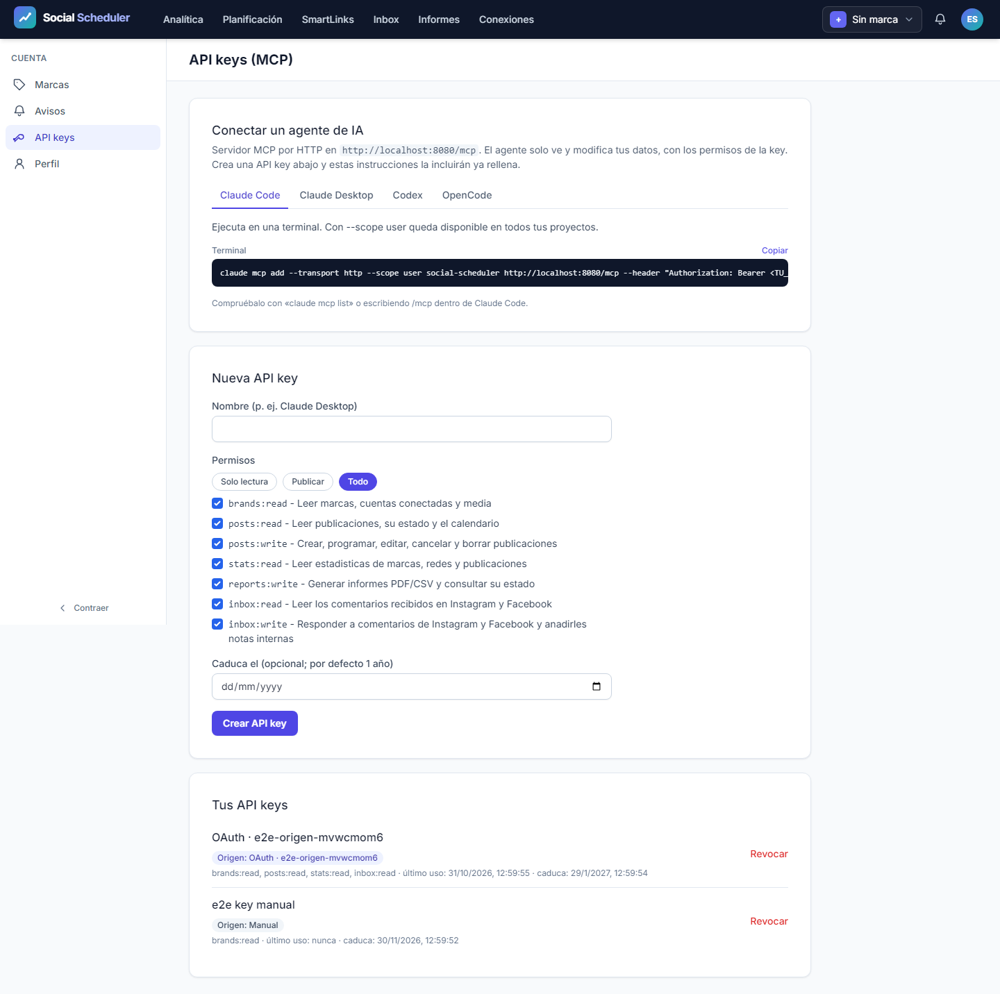

# Informe de QA - T-77, segundo intento de regresión general

| Campo | Resultado |
|---|---|
| Fecha | 2026-10-31 |
| Automáticos | **VERDE**; Playwright exit 0; qa-gate exit 0 |
| Entrega completa | Abierta: manuales M-01 a M-05; T-30, T-64 y T-77 no se cierran |
| Entorno | http://localhost:8080, servidor propio gestionado y SQLite desechable |
| Fuentes | [Plan](../../improvement-plan.md), [test-plan](../../test-plan.md), [ledger](../../tasks.md) |

## Veredicto del gate

Salida íntegra de qa-gate.py sobre la copia exacta del reporter:

```json
{
  "verdict": "VERDE",
  "counts": {
    "passed": 502,
    "failed": 0,
    "flaky": 0,
    "skipped": 2,
    "interrupted": 0
  },
  "flaky_sin_justificar": [],
  "flaky_justificados": {},
  "threshold": "verde ⟺ 0 failed, 0 flaky sin justificar, 0 interrumpidos y ≥1 test ejecutado"
}
```

**502/504 pasan**, 0 fallos, 0 flaky, 2 skipped y 0 interrupted. Errores top-level: 0.
El veredicto automático no acredita publicaciones, OAuth, métricas ni IA reales, ni completa la QA global del roadmap.

## Alcance, procedencia y ejecución

La configuración general conserva los **498 casos originales** y añade **6 ejecuciones** de dos regresiones de fecha (mismo mes y cruce de mes) en los tres perfiles: **504 casos, 168 por proyecto**. Son 21 specs, Chromium, workers=1 y retries=0. No se aplica grep ni se restringen proyectos.

```powershell
npx.cmd playwright test --max-failures=1
```

`--max-failures=1` detiene el intento ante el primer fallo; no convierte lo no ejecutado en aprobado. El primer fallo, si lo hay, se notifica desde el mismo handle. No se reinicia el proceso por timeouts de observación.
Inicio 2026-10-31T11:49:16.5247356Z; fin 2026-10-31T12:31:52.3253078Z. Duración reporter **2554.57 s**. Raíz nueva: `C:\laragon\www\metricool\storage\framework\testing\t43\run-general-23f21d13-7032-4ba1-926b-c00d16c1cb0a`.
Base: HEAD c344866 más diff local revisado, sin desplegar. A/B aprobaron el fix de prueba antes del GO. La causa del primer rojo fue una aserción que buscaba el día del mes anterior en un calendario que solo renderiza el mes actual; el fix modifica la prueba, no producción. La evidencia previa recibida es 81 casos de compositor correctos (27 por perfil, cero fallos/omitidos/flaky/errores), sin repetirla desde QA.
El servidor usa localhost:8080, reuseExistingServer=false y no utiliza E2E_NO_SERVER. PHP recibe únicamente el manifiesto fake explícito del harness. SQLite, media, sesiones/auth, vistas, correo y cachés viven bajo la raíz UUID. Redes externas simuladas y HTTP no simulado bloqueado. No se carga .env real ni se actúa sobre cuentas reales, DEMO real o VPS. Guardrail local: exit 0.
Se capturaron hashes antes y después: **16 archivos sin cambios y 0 cambiados**. Incluyen los 13 del runner/config, composer.spec.ts, ApiKeyController y el manifiesto build.

## Resultado por proyecto

| Proyecto | Total | Pasan | Fallan | Flaky | Skipped |
|---|---:|---:|---:|---:|---:|
| desktop | 168 | 168 | 0 | 0 | 0 |
| mobile | 168 | 167 | 0 | 0 | 1 |
| mobile-360 | 168 | 167 | 0 | 0 | 1 |

Desglose skipped: **2 históricos** del shell de escritorio en móvil y **0 otros no ejecutados/omitidos**. Los históricos están en pages.spec.ts:50 (mobile y mobile-360): la barra lateral de escritorio no existe en esos perfiles. No se cuentan como aprobados.

## Resultado por spec

| Spec | Pasan | Fallan | Flaky | Skipped |
|---|---:|---:|---:|---:|
| a11y.spec.ts | 105 | 0 | 0 | 0 |
| all-brands.spec.ts | 3 | 0 | 0 | 0 |
| bluesky.spec.ts | 12 | 0 | 0 | 0 |
| calendar-views.spec.ts | 9 | 0 | 0 | 0 |
| campaigns.spec.ts | 6 | 0 | 0 | 0 |
| composer.spec.ts | 81 | 0 | 0 | 0 |
| csv-export.spec.ts | 3 | 0 | 0 | 0 |
| first-comment.spec.ts | 18 | 0 | 0 | 0 |
| flows.spec.ts | 12 | 0 | 0 | 0 |
| gif-picker.spec.ts | 9 | 0 | 0 | 0 |
| hashtags.spec.ts | 9 | 0 | 0 | 0 |
| inbox-notes.spec.ts | 3 | 0 | 0 | 0 |
| instagram-grid.spec.ts | 3 | 0 | 0 | 0 |
| media-import.spec.ts | 39 | 0 | 0 | 0 |
| natural-schedule.spec.ts | 15 | 0 | 0 | 0 |
| oauth.spec.ts | 15 | 0 | 0 | 0 |
| pages.spec.ts | 94 | 0 | 0 | 2 |
| saved-texts.spec.ts | 6 | 0 | 0 | 0 |
| security.spec.ts | 24 | 0 | 0 | 0 |
| social.spec.ts | 21 | 0 | 0 | 0 |
| threads.spec.ts | 15 | 0 | 0 | 0 |

Trazabilidad del inventario: **498 originales** (496 correctos y 2 omitidos), más **6 nuevas regresiones de fecha**, todas con resultado: expected. Los casos «ayer es inaccesible en Auckland: mismo mes» y «cambio de mes» están en composer.spec.ts:328 y pasan en desktop, mobile y mobile-360. El caso integrado anterior pasa ahora en composer.spec.ts:350 en los tres perfiles.
[Detalle de los 504 casos](raw/case-summary.json): títulos, fichero/línea, proyecto, duración, estados, errores y adjuntos. El [JSON original](raw/results.json) no se transforma.

## Escenarios del plan y trazabilidad

| Escenario | Tareas | Specs ejecutadas | Resultado |
|---|---|---|---|
| E2E-01 | T-03, T-06 | inbox-notes.spec.ts | 3/3 pasan |
| E2E-02 | T-10, T-13 | calendar-views.spec.ts | 9/9 pasan |
| E2E-03 | T-20, T-28 | bluesky.spec.ts | 12/12 pasan |
| E2E-04 | T-32, T-35 | all-brands.spec.ts | 3/3 pasan |
| E2E-05 | T-39, T-41 | csv-export.spec.ts | 3/3 pasan |
| E2E-06 | T-44, T-47 | hashtags.spec.ts | 9/9 pasan |
| E2E-07 | T-50, T-52 | natural-schedule.spec.ts | 15/15 pasan |
| E2E-08 | T-60, T-62 | threads.spec.ts, bluesky.spec.ts | 27/27 pasan |
| E2E-09 | T-66, T-70 | gif-picker.spec.ts | 9/9 pasan |

Accesibilidad: los escenarios existentes incorporan axe y aserciones de desbordamiento. El test-plan no define bloques API-xx/A11Y-xx separados; no se atribuyen smokes curl adicionales.

## Fallos y errores

No hay fallos/flaky/interrumpidos de casos en el reporter de este intento.

## Puertas P1 y límites

Ledger-lint:
```text
⚠️  T-30: campo **Changelog** VACÍO — escribe una frase (qué cambia para quien USA el proyecto) o quita el campo
⚠️  T-64: campo **Changelog** VACÍO — escribe una frase (qué cambia para quien USA el proyecto) o quita el campo
ledger-lint: 0 incoherencias · 2 avisos (tasks.md)
```

Coverage-check (salida literal):
```text
⚠️  T-01: sin cobertura declarada (si es tarea de UI, es un criterio huérfano → NO verde)
⚠️  T-02: sin cobertura declarada (si es tarea de UI, es un criterio huérfano → NO verde)
⚠️  T-04: sin cobertura declarada (si es tarea de UI, es un criterio huérfano → NO verde)
⚠️  T-05: sin cobertura declarada (si es tarea de UI, es un criterio huérfano → NO verde)
⚠️  T-07: sin cobertura declarada (si es tarea de UI, es un criterio huérfano → NO verde)
⚠️  T-08: sin cobertura declarada (si es tarea de UI, es un criterio huérfano → NO verde)
⚠️  T-09: sin cobertura declarada (si es tarea de UI, es un criterio huérfano → NO verde)
⚠️  T-11: sin cobertura declarada (si es tarea de UI, es un criterio huérfano → NO verde)
⚠️  T-12: sin cobertura declarada (si es tarea de UI, es un criterio huérfano → NO verde)
⚠️  T-14: sin cobertura declarada (si es tarea de UI, es un criterio huérfano → NO verde)
⚠️  T-15: sin cobertura declarada (si es tarea de UI, es un criterio huérfano → NO verde)
⚠️  T-16: sin cobertura declarada (si es tarea de UI, es un criterio huérfano → NO verde)
⚠️  T-18: sin cobertura declarada (si es tarea de UI, es un criterio huérfano → NO verde)
⚠️  T-19: sin cobertura declarada (si es tarea de UI, es un criterio huérfano → NO verde)
⚠️  T-21: sin cobertura declarada (si es tarea de UI, es un criterio huérfano → NO verde)
⚠️  T-22: sin cobertura declarada (si es tarea de UI, es un criterio huérfano → NO verde)
⚠️  T-23: sin cobertura declarada (si es tarea de UI, es un criterio huérfano → NO verde)
⚠️  T-24: sin cobertura declarada (si es tarea de UI, es un criterio huérfano → NO verde)
⚠️  T-25: sin cobertura declarada (si es tarea de UI, es un criterio huérfano → NO verde)
⚠️  T-26: sin cobertura declarada (si es tarea de UI, es un criterio huérfano → NO verde)
⚠️  T-27: sin cobertura declarada (si es tarea de UI, es un criterio huérfano → NO verde)
⚠️  T-29: sin cobertura declarada (si es tarea de UI, es un criterio huérfano → NO verde)
⚠️  T-31: sin cobertura declarada (si es tarea de UI, es un criterio huérfano → NO verde)
⚠️  T-33: sin cobertura declarada (si es tarea de UI, es un criterio huérfano → NO verde)
⚠️  T-34: sin cobertura declarada (si es tarea de UI, es un criterio huérfano → NO verde)
⚠️  T-36: sin cobertura declarada (si es tarea de UI, es un criterio huérfano → NO verde)
⚠️  T-37: sin cobertura declarada (si es tarea de UI, es un criterio huérfano → NO verde)
⚠️  T-38: sin cobertura declarada (si es tarea de UI, es un criterio huérfano → NO verde)
⚠️  T-40: sin cobertura declarada (si es tarea de UI, es un criterio huérfano → NO verde)
⚠️  T-42: sin cobertura declarada (si es tarea de UI, es un criterio huérfano → NO verde)
⚠️  T-43: sin cobertura declarada (si es tarea de UI, es un criterio huérfano → NO verde)
⚠️  T-45: sin cobertura declarada (si es tarea de UI, es un criterio huérfano → NO verde)
⚠️  T-46: sin cobertura declarada (si es tarea de UI, es un criterio huérfano → NO verde)
⚠️  T-48: sin cobertura declarada (si es tarea de UI, es un criterio huérfano → NO verde)
⚠️  T-51: sin cobertura declarada (si es tarea de UI, es un criterio huérfano → NO verde)
⚠️  T-53: sin cobertura declarada (si es tarea de UI, es un criterio huérfano → NO verde)
⚠️  T-54: sin cobertura declarada (si es tarea de UI, es un criterio huérfano → NO verde)
⚠️  T-55: sin cobertura declarada (si es tarea de UI, es un criterio huérfano → NO verde)
⚠️  T-56: sin cobertura declarada (si es tarea de UI, es un criterio huérfano → NO verde)
⚠️  T-57: sin cobertura declarada (si es tarea de UI, es un criterio huérfano → NO verde)
⚠️  T-58: sin cobertura declarada (si es tarea de UI, es un criterio huérfano → NO verde)
⚠️  T-59: sin cobertura declarada (si es tarea de UI, es un criterio huérfano → NO verde)
⚠️  T-61: sin cobertura declarada (si es tarea de UI, es un criterio huérfano → NO verde)
⚠️  T-63: sin cobertura declarada (si es tarea de UI, es un criterio huérfano → NO verde)
⚠️  T-65: sin cobertura declarada (si es tarea de UI, es un criterio huérfano → NO verde)
⚠️  T-67: sin cobertura declarada (si es tarea de UI, es un criterio huérfano → NO verde)
⚠️  T-68: sin cobertura declarada (si es tarea de UI, es un criterio huérfano → NO verde)
⚠️  T-69: sin cobertura declarada (si es tarea de UI, es un criterio huérfano → NO verde)
⚠️  T-71: sin cobertura declarada (si es tarea de UI, es un criterio huérfano → NO verde)
⚠️  T-72: sin cobertura declarada (si es tarea de UI, es un criterio huérfano → NO verde)
⚠️  T-73: sin cobertura declarada (si es tarea de UI, es un criterio huérfano → NO verde)
⚠️  T-74: sin cobertura declarada (si es tarea de UI, es un criterio huérfano → NO verde)
⚠️  T-75: sin cobertura declarada (si es tarea de UI, es un criterio huérfano → NO verde)
⚠️  T-76: sin cobertura declarada (si es tarea de UI, es un criterio huérfano → NO verde)
⚠️  T-77: sin cobertura declarada (si es tarea de UI, es un criterio huérfano → NO verde)
{"applies": true, "defined": ["E2E-01", "E2E-02", "E2E-03", "E2E-04", "E2E-05", "E2E-06", "E2E-07", "E2E-08", "E2E-09", "M-01", "M-02", "M-03", "M-04", "M-05"], "referenced": ["E2E-01", "E2E-02", "E2E-03", "E2E-04", "E2E-05", "E2E-06", "E2E-07", "E2E-08", "E2E-09", "M-01", "M-02", "M-03", "M-04", "M-05"], "broken_refs": 0, "tasks_sin_cobertura": ["T-01", "T-02", "T-04", "T-05", "T-07", "T-08", "T-09", "T-11", "T-12", "T-14", "T-15", "T-16", "T-18", "T-19", "T-21", "T-22", "T-23", "T-24", "T-25", "T-26", "T-27", "T-29", "T-31", "T-33", "T-34", "T-36", "T-37", "T-38", "T-40", "T-42", "T-43", "T-45", "T-46", "T-48", "T-51", "T-53", "T-54", "T-55", "T-56", "T-57", "T-58", "T-59", "T-61", "T-63", "T-65", "T-67", "T-68", "T-69", "T-71", "T-72", "T-73", "T-74", "T-75", "T-76", "T-77"], "tests_sin_referencia": [], "gwt_cubiertos": ["CA-01", "CA-02", "CA-03", "CA-04", "CA-05", "CA-06", "CA-07", "CA-08", "CA-09", "CA-10", "CA-11", "CA-12", "CA-13", "CA-14", "CA-15", "CA-16", "CA-17"], "gwt_sin_cubrir": [], "gwt_sin_id": 0, "test_plan_na": false, "marcador_no_canonico": null}
```

Exit ledger-lint: 0; exit coverage-check: 0. Las puertas comprueban coherencia y referencias literales; no prueban por sí solas UI ni ejecutan los smokes reales. Se conservan los avisos tasks_sin_cobertura y los manuales asociados a tareas de interfaz. El resultado automático no los cierra.

## Checklist manual pendiente

- [ ] **M-01 / T-30, T-68:** Bluesky real: app password, texto/enlaces/menciones, cuatro imágenes, vídeo, GIF, idempotencia, métricas, renovación y errores reales.
- [ ] **M-02 / T-64:** Threads real: OAuth/cancelación, texto/emojis, imagen, vídeo, carrusel, cuota, métricas, renovación y funcionamiento como tester.
- [ ] **M-03 / T-66, T-75:** términos de Giphy sobre republicación del MP4 y atribución visible/legible en móvil.
- [ ] **M-04:** juicio visual y UX de inbox/notas, vistas, Todas las marcas, hashtags, Escribe cuándo, GIF y Bluesky; español, estados vacíos/error, foco y tabulación.
- [ ] **M-05 / T-49, T-50:** IA real: frases, zona horaria, límite diario y coste por llamada.
T-77 depende de T-30/T-64; no se cierra ni se declara QA global del roadmap completa.

## Evidencia previa y primer intento

- Pest completo previo: **2461 tests, 14549 aserciones**; [JUnit estable](../../../2026-10-19-social-scheduler/testing/raw/phpunit-final-p3.xml). No repetido aquí.
- QA aislada de T-43: **57 casos correctos**, gate exit 0; [informe separado](../../../2026-10-19-social-scheduler/testing/report.md). No sustituye la regresión general.
- [Primer informe rojo intacto](../report.md): 442 correctos, tres fallos de fecha, 51 no ejecutados y dos omitidos históricos; su JSON y PDF permanecen en el directorio original. Los recuentos provisionales del primer intento fueron corregidos en ese informe y no se reutilizan como evidencia.

## Capturas y procedencia

SHA-256 origen `B7DB16DE01B7BDF7CD240CE03F0E6D9159D72471090B22BA4595BAC88776CE7E`; copia `B7DB16DE01B7BDF7CD240CE03F0E6D9159D72471090B22BA4595BAC88776CE7E`; coinciden: **True**.
[Log](raw/playwright-full.log), [exit real](raw/playwright-exit.json), [metadatos](raw/run-metadata.json), [gate](raw/qa-gate.json), [hashes](raw/results-sha256.json), [manifiesto previo](raw/frozen-files-before.json) y [comparación final](raw/frozen-files-final.json).
Se conservan los adjuntos del reporter en screenshots/ y raw/artifacts/. No todos los escenarios producen capturas positivas inicial/final; no se inventan ni se presenta una imagen como evidencia de una aserción que no cubre. La revisión visual humana M-04 sigue abierta.







Total de capturas conservadas: 81. Relación completa por caso en case-summary.json.

## Cierre

Solo se escriben artefactos de QA. No se cambian fuentes, configuración, spec ni ledger; el orquestador gestiona estados y continuidad. Informe local, sin publicación en Confluence.
