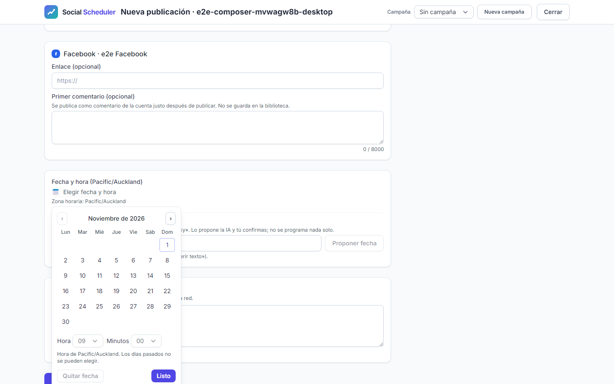
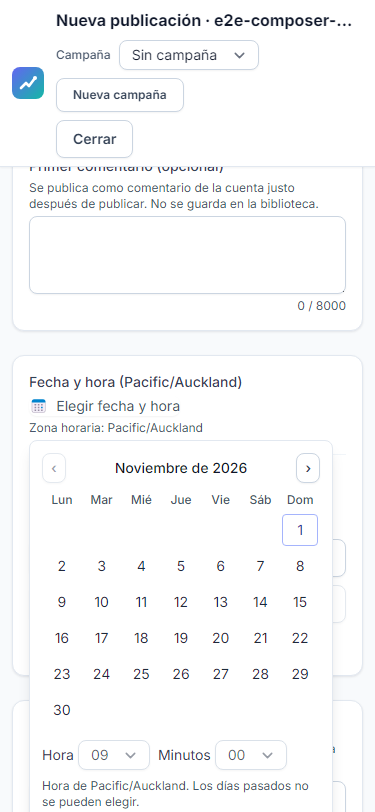
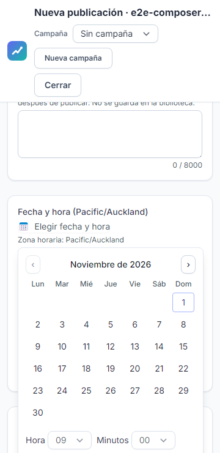
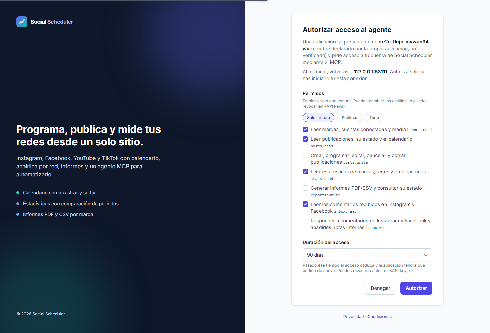
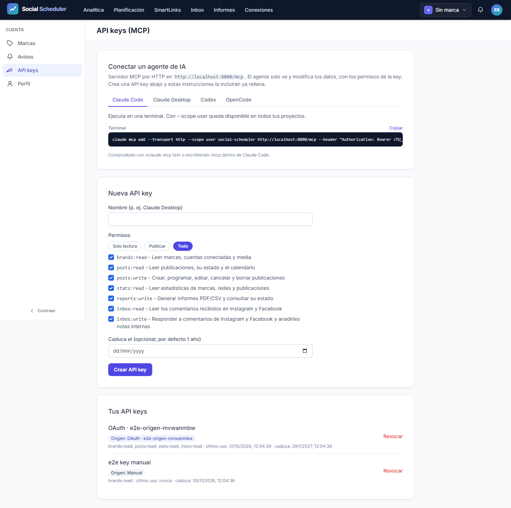

# Informe de QA - Regresión general T-77, paridad Metricool tercera ola

| Campo | Resultado |
|---|---|
| Fecha | 2026-10-31 |
| Parte automática | **NO-VERDE**, Playwright exit 1, qa-gate exit 1 |
| Entrega completa | Abierta: T-30, T-64 y T-77 permanecen en-progreso; manuales sin ejecutar |
| URL autorizada | http://localhost:8080, servidor propio gestionado, sin reutilización |
| Plan | [Plan](../improvement-plan.md), [test-plan](../test-plan.md), [ledger](../tasks.md) |

## Veredicto automático (qa-gate)

Salida íntegra de `qa-gate.py raw/results.json`:

```json
{
  "verdict": "NO-VERDE",
  "counts": {
    "passed": 442,
    "failed": 3,
    "flaky": 0,
    "skipped": 53,
    "interrupted": 0
  },
  "flaky_sin_justificar": [],
  "flaky_justificados": {},
  "threshold": "verde ⟺ 0 failed, 0 flaky sin justificar, 0 interrumpidos y ≥1 test ejecutado"
}
```

**442/498 pasan**, 3 fallos, 0 flaky, 53 omitidos, 0 interrumpidos.
El verde del gate describe esta batería automática; no cierra los smokes reales ni acredita QA global completa del roadmap.

## Ejecución y aislamiento

```powershell
$env:E2E_GENERAL_RUN_ROOT = "<raíz desechable UUID nuevo>"
npx.cmd playwright test
```

Inicio **2026-10-31T10:55:28.3871736Z**; fin **2026-10-31T11:32:52.1333298Z**. Duración reporter: **2242.66 segundos**. Raíz de ejecución: `C:\laragon\www\metricool\storage\framework\testing\t43\run-general-624d0e64-a610-4b7f-9a85-d829fa0584c2`.
Configuración general por defecto: 21 specs, tres proyectos Chromium, workers=1, retries=0. Se mantuvieron los 498 casos originales; no se aplicaron grep, exclusiones adicionales, reintentos ni nuevos skips deliberados. El servidor gestionado usa localhost:8080 y reuseExistingServer=false; E2E_NO_SERVER no se utilizó. No se reinició el proceso por timeouts de observación. Base: HEAD c344866 más diff local sin desplegar.
La SQLite, almacenamiento, media, sesiones/auth, vistas, correo y cachés son desechables bajo la raíz del run. El entorno de PHP recibe el manifiesto fake explícito del harness; las redes externas se simulan y HTTP no simulado está bloqueado. La cuenta readonly, marcas y conexiones son ficticias y separadas de los usuarios mutables. No se operó sobre .env real, cuentas reales, DEMO real ni VPS.
El guardrail `guardrail_assert http://localhost:8080` devolvió exit 0 con Bash del host. La primera comprobación dentro del sandbox falló por ACL Win32 error 5; se repitió solo el guardrail en host. La batería completa se lanzó una sola vez con acceso autorizado a los procesos locales Chromium/PHP.

## Resultado por proyecto

| Proyecto | Descubiertos | Pasan | Fallan | Flaky | Omitidos |
|---|---:|---:|---:|---:|---:|
| desktop | 166 | 148 | 1 | 0 | 17 |
| mobile | 166 | 147 | 1 | 0 | 18 |
| mobile-360 | 166 | 147 | 1 | 0 | 18 |

**Desglose de los 53 skipped del reporter:** 2 omitidos históricos y **51 casos did not run** (17 de compositor por proyecto) tras fallar un caso de su grupo serial. Estos 51 no ejecutados no son aprobados ni omitidos históricos. El gate agrupa ambos conceptos como skipped; interrupted=0 no significa que se ejecutaran los 498.
Los dos omitidos históricos corresponden a `pages.spec.ts:50`, «el shell enlaza los módulos nuevos», en mobile y mobile-360: la barra lateral de escritorio no existe en móvil.
Los mensajes provisionales de progreso contaban líneas del log sin distinguir el estado y sobreestimaron los aprobados. Las cifras finales de este informe proceden del reporter JSON y corrigen esos mensajes.

## Resultado por spec

| Spec | Pasan | Fallan | Flaky | Omitidos |
|---|---:|---:|---:|---:|
| a11y.spec.ts | 105 | 0 | 0 | 0 |
| all-brands.spec.ts | 3 | 0 | 0 | 0 |
| bluesky.spec.ts | 12 | 0 | 0 | 0 |
| calendar-views.spec.ts | 9 | 0 | 0 | 0 |
| campaigns.spec.ts | 6 | 0 | 0 | 0 |
| composer.spec.ts | 21 | 3 | 0 | 51 |
| csv-export.spec.ts | 3 | 0 | 0 | 0 |
| first-comment.spec.ts | 18 | 0 | 0 | 0 |
| flows.spec.ts | 12 | 0 | 0 | 0 |
| gif-picker.spec.ts | 9 | 0 | 0 | 0 |
| hashtags.spec.ts | 9 | 0 | 0 | 0 |
| inbox-notes.spec.ts | 3 | 0 | 0 | 0 |
| instagram-grid.spec.ts | 3 | 0 | 0 | 0 |
| media-import.spec.ts | 39 | 0 | 0 | 0 |
| natural-schedule.spec.ts | 15 | 0 | 0 | 0 |
| oauth.spec.ts | 15 | 0 | 0 | 0 |
| pages.spec.ts | 94 | 0 | 0 | 2 |
| saved-texts.spec.ts | 6 | 0 | 0 | 0 |
| security.spec.ts | 24 | 0 | 0 | 0 |
| social.spec.ts | 21 | 0 | 0 | 0 |
| threads.spec.ts | 15 | 0 | 0 | 0 |

El [detalle por cada caso](raw/case-summary.json) incluye proyecto, fichero, línea, título, resultados, errores y enlaces a adjuntos conservados. El [reporter original](raw/results.json) se mantiene sin transformación.

## Escenarios E2E del plan y trazabilidad

La tabla agrupa las specs existentes que ejercitan cada bloque. La ejecución se mantiene tal como está definida en la configuración general; no se inventan capturas inicial/final que los tests no producen.

| Escenario | Tareas | Evidencia de ejecución | Resultado |
|---|---|---|---|
| E2E-01 | T-03, T-06 | inbox-notes.spec.ts (3 casos, tres perfiles) | 3/3 pasan |
| E2E-02 | T-10, T-13 | calendar-views.spec.ts (9 casos, tres perfiles) | 9/9 pasan |
| E2E-03 | T-20, T-28 | bluesky.spec.ts (12 casos, tres perfiles) | 12/12 pasan |
| E2E-04 | T-32, T-35 | all-brands.spec.ts (3 casos, tres perfiles) | 3/3 pasan |
| E2E-05 | T-39, T-41 | csv-export.spec.ts (3 casos, tres perfiles) | 3/3 pasan |
| E2E-06 | T-44, T-47 | hashtags.spec.ts (9 casos, tres perfiles) | 9/9 pasan |
| E2E-07 | T-50, T-52 | natural-schedule.spec.ts (15 casos, tres perfiles) | 15/15 pasan |
| E2E-08 | T-60, T-62 | threads.spec.ts, bluesky.spec.ts (27 casos, tres perfiles) | 27/27 pasan |
| E2E-09 | T-66, T-70 | gif-picker.spec.ts (9 casos, tres perfiles) | 9/9 pasan |

Accesibilidad: las specs existentes ejecutan axe y comprobaciones de desbordamiento en sus escenarios. El plan no define bloques API-xx ni A11Y-xx separados; no se atribuyen nuevos smokes curl ni un gate adicional.

## Fallos, errores y omisiones

### desktop - composer.spec.ts:313 - E2E-04 · panel único de errores, botón dividido con teclado y selector de fecha con la zona de la marca

Resultado: unexpected. Aserción fallida en composer.spec.ts:373:64.
Tras esperar 10000 ms, el selector del diálogo «Elegir fecha y hora» para data-date="2026-10-31" no encuentra el elemento que se esperaba deshabilitado. La misma aserción falla en los tres perfiles. El grupo serial deja 17 casos posteriores sin ejecutar por perfil. El diagnóstico causal y la corrección quedan pendientes; no se modifica el código desde QA.


[Traza desktop](raw/artifacts/142-trace.zip)

### mobile - composer.spec.ts:313 - E2E-04 · panel único de errores, botón dividido con teclado y selector de fecha con la zona de la marca

Resultado: unexpected. Aserción fallida en composer.spec.ts:373:64.
Tras esperar 10000 ms, el selector del diálogo «Elegir fecha y hora» para data-date="2026-10-31" no encuentra el elemento que se esperaba deshabilitado. La misma aserción falla en los tres perfiles. El grupo serial deja 17 casos posteriores sin ejecutar por perfil. El diagnóstico causal y la corrección quedan pendientes; no se modifica el código desde QA.


[Traza mobile](raw/artifacts/167-trace.zip)

### mobile-360 - composer.spec.ts:313 - E2E-04 · panel único de errores, botón dividido con teclado y selector de fecha con la zona de la marca

Resultado: unexpected. Aserción fallida en composer.spec.ts:373:64.
Tras esperar 10000 ms, el selector del diálogo «Elegir fecha y hora» para data-date="2026-10-31" no encuentra el elemento que se esperaba deshabilitado. La misma aserción falla en los tres perfiles. El grupo serial deja 17 casos posteriores sin ejecutar por perfil. El diagnóstico causal y la corrección quedan pendientes; no se modifica el código desde QA.


[Traza mobile-360](raw/artifacts/192-trace.zip)

- Omitido histórico: mobile - pages.spec.ts:50 - el shell enlaza los módulos nuevos.
- Omitido histórico: mobile-360 - pages.spec.ts:50 - el shell enlaza los módulos nuevos.

## Puertas P1 y límites de cobertura

Ledger-lint:
```text
⚠️  T-30: campo **Changelog** VACÍO — escribe una frase (qué cambia para quien USA el proyecto) o quita el campo
⚠️  T-64: campo **Changelog** VACÍO — escribe una frase (qué cambia para quien USA el proyecto) o quita el campo
ledger-lint: 0 incoherencias · 2 avisos (tasks.md)
```

Coverage-check (salida JSON literal):
```json
{"applies": true, "defined": ["E2E-01", "E2E-02", "E2E-03", "E2E-04", "E2E-05", "E2E-06", "E2E-07", "E2E-08", "E2E-09", "M-01", "M-02", "M-03", "M-04", "M-05"], "referenced": ["E2E-01", "E2E-02", "E2E-03", "E2E-04", "E2E-05", "E2E-06", "E2E-07", "E2E-08", "E2E-09", "M-01", "M-02", "M-03", "M-04", "M-05"], "broken_refs": 0, "tasks_sin_cobertura": ["T-01", "T-02", "T-04", "T-05", "T-07", "T-08", "T-09", "T-11", "T-12", "T-14", "T-15", "T-16", "T-18", "T-19", "T-21", "T-22", "T-23", "T-24", "T-25", "T-26", "T-27", "T-29", "T-31", "T-33", "T-34", "T-36", "T-37", "T-38", "T-40", "T-42", "T-43", "T-45", "T-46", "T-48", "T-51", "T-53", "T-54", "T-55", "T-56", "T-57", "T-58", "T-59", "T-61", "T-63", "T-65", "T-67", "T-68", "T-69", "T-71", "T-72", "T-73", "T-74", "T-75", "T-76", "T-77"], "tests_sin_referencia": [], "gwt_cubiertos": ["CA-01", "CA-02", "CA-03", "CA-04", "CA-05", "CA-06", "CA-07", "CA-08", "CA-09", "CA-10", "CA-11", "CA-12", "CA-13", "CA-14", "CA-15", "CA-16", "CA-17"], "gwt_sin_cubrir": [], "gwt_sin_id": 0, "test_plan_na": false, "marcador_no_canonico": null}
```

Ambas puertas devuelven exit 0. Ledger sin incoherencias duras; los dos avisos corresponden al Changelog vacío de T-30/T-64. No hay referencias rotas, escenarios sin referencia ni CA sin referencia literal. La lista tasks_sin_cobertura se conserva íntegra arriba: el parser de referencias no prueba ejecución/aserciones de UI. El test-plan también mapea tareas de interfaz a manuales M-03/M-04/M-05; esos manuales permanecen pendientes. Estos avisos y límites impiden presentar la entrega completa como QA global verde.

## Checklist manual pendiente

- [ ] **M-01 / T-30, T-68 - Bluesky real:** app password, texto/enlaces/hashtag/mención, cuatro imágenes y reducción, vídeo, GIF, idempotencia, métricas, renovación y errores reales. Registrar fecha, pasos y enlaces.
- [ ] **M-02 / T-64 - Threads real:** OAuth y cancelación, texto/emojis al límite, imagen, vídeo, carrusel, cuota, métricas, renovación y funcionamiento como tester sin App Review. Registrar errores y límites reales.
- [ ] **M-03 / T-66, T-75 - Giphy:** revisar términos sobre republicación del MP4 y atribución visible/legible en móvil.
- [ ] **M-04 - Revisión visual y UX:** inbox/notas, vistas, Todas las marcas, hashtags, Escribe cuándo, GIF y Bluesky; español, estados vacíos/error, foco y tabulación.
- [ ] **M-05 / T-49, T-50 - IA real:** frases reales, zona horaria de marca, límite diario y coste por llamada.
Los cinco bloques están pendientes; esta ejecución no gastó cupo ni publicó en redes reales. T-77 depende además de T-30/T-64 y no se cierra aunque la batería automática pase.

## Evidencia previa recibida (no repetida)

- Pest completo previo del orquestador: **2461 tests y 14549 aserciones**, sin fallos; [JUnit estable](../../2026-10-19-social-scheduler/testing/raw/phpunit-final-p3.xml).
- QA independiente de T-43: **57 casos pasan**, tres perfiles de 19, gate exit 0; [informe separado](../../2026-10-19-social-scheduler/testing/report.md). Esta evidencia no sustituye los 498 casos generales y no se repitió aquí.
- El orquestador comunicó build exit 0 (893 módulos, 8.29s), TypeScript exit 0, Pint global exit 0 y guardia estática correcta antes del GO. Son resultados recibidos, no ejecuciones de este agente.

## Evidencias y procedencia

SHA-256 origen: `4A0EB5024F3BCDD6136A67BB21A33359DC28FBFC464CEB820389441B317B19C3`. Copia: `4A0EB5024F3BCDD6136A67BB21A33359DC28FBFC464CEB820389441B317B19C3`. Coinciden: **True**.
[Log stdout/stderr](raw/playwright-full.log), [exit real](raw/playwright-exit.json), [metadatos](raw/run-metadata.json), [gate](raw/qa-gate.json), [exit del gate](raw/qa-gate-exit.txt), [hashes](raw/results-sha256.json), [ledger-lint](raw/ledger-lint.txt), [coverage-check](raw/coverage-check.txt).
Los adjuntos que el reporter conserva se copiaron a rutas estables dentro de testing/. Las capturas en cuerpo de JSON se extrajeron sin alterar el JSON original. No hay capturas inicial/final de cada E2E: screenshot=only-on-failure y los escenarios nuevos no adjuntan positivos; esta limitación visual queda abierta para M-04.

[Huellas durante ejecución](raw/frozen-files-during.json) y [comparación final](raw/frozen-files-final.json): los 15 archivos (13 del runner/configuración, ApiKeyController y manifiesto build) conservan sus hashes. La primera captura se hizo durante el run, con hora real; no es un hash previo al arranque.

## Capturas conservadas







Se conservan 84 capturas en screenshots/. Las seis primeras, si existen, se muestran como muestra; el detalle completo y la relación con cada caso está en case-summary.json.

## Cierre

Este informe no modifica fuentes, configuración, spec ni ledger. No se cierran T-30/T-64/T-77 ni se hace handoff documental de iniciativa completada. El orquestador conserva la gestión de estados y revisiones independientes. Informe solo local, sin publicación a Confluence.
