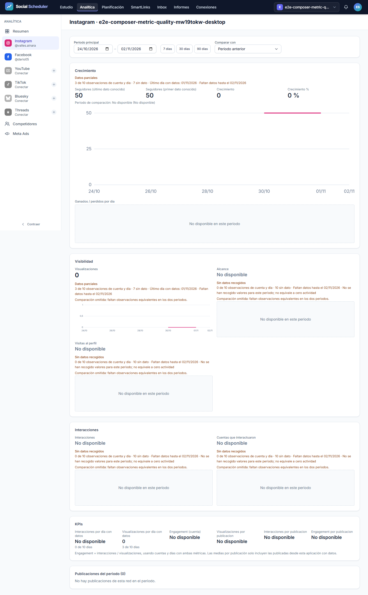
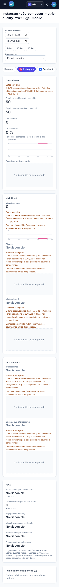
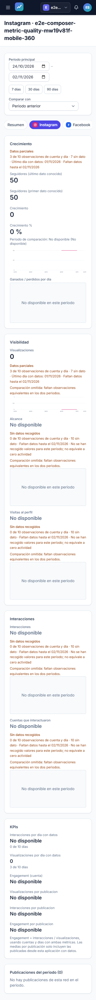
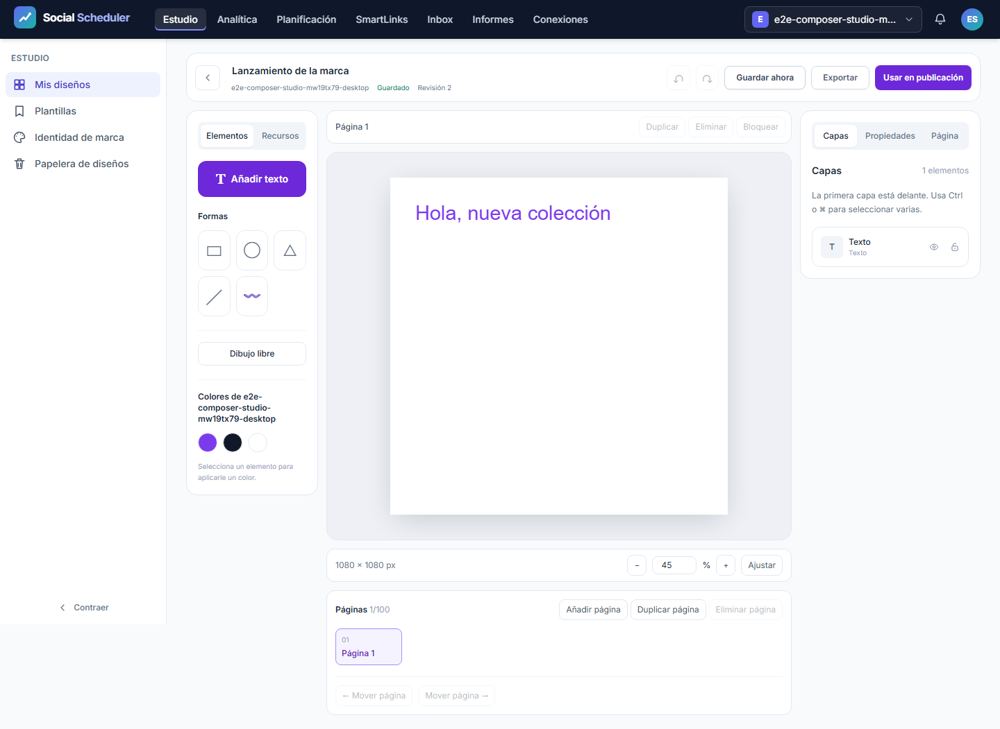
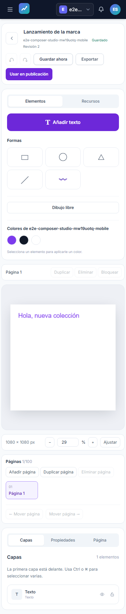
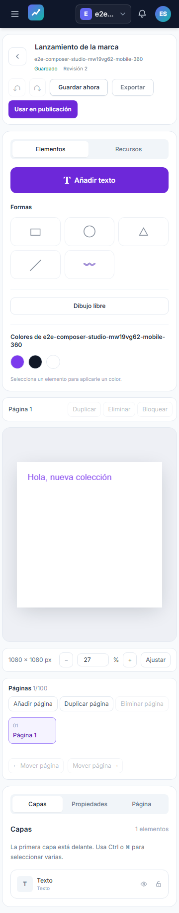

# Informe de QA — bloque de fundamentos, métricas y marca

Fecha: 2026-11-03T23:42:06+01:00.

**Estado del bloque: VERDE.** URL auditada: `http://localhost:8080`. Chromium en escritorio 1440×900, móvil 375×812 y móvil 360×740.

Plan: [improvement-plan.md](../../improvement-plan.md) · [test-plan.md](../../test-plan.md). Alcance: T-03, T-04–08 y coherencia de marca de T-21; T-09–20, gestión avanzada de Ads y constructor avanzado de informes permanecen pendientes. La iniciativa global sigue en progreso.

## Veredicto determinista

```json
{
  "verdict": "VERDE",
  "counts": {
    "passed": 18,
    "failed": 0,
    "flaky": 0,
    "skipped": 0,
    "interrupted": 0
  },
  "flaky_sin_justificar": [],
  "flaky_justificados": {},
  "threshold": "verde ⟺ 0 failed, 0 flaky sin justificar, 0 interrumpidos y ≥1 test ejecutado"
}
```

Automáticos: 18/18 pasan. Fallos: 0; flaky: 0; omitidos: 0. Se ejecutaron los 18 casos canónicos, con un worker y sin reintentos automáticos.

## Cobertura y entorno

`ledger-lint.py`: 0 incoherencias y 0 avisos. `coverage-check.py`: 0 referencias rotas, 0 tests sin referencia y 0 criterios GWT huérfanos. Los avisos restantes corresponden a T-01–02 (investigación/contrato, sin E2E propio) y T-09–20 (trabajo futuro declarado fuera de esta tanda). No se presenta cobertura E2E del alcance futuro. Evidencia textual completa en `raw/ledger-lint.txt` y `raw/coverage-check.txt`.

Guardrail local ejecutado antes de las pruebas, exit 0. Cada tanda dispone de SQLite, caché, sesión, almacenamiento y cuatro identidades desechables propios. El bootstrap impide llamadas HTTP externas y utiliza conectores de prueba. La publicación comprobada es un borrador; no se envió a redes. No se arrancó worker ni se accedió al VPS.

La compilación Vite y renderer pasó; conserva el aviso de tamaño de chunk >500KB. Los SHA-256 de tests y artefactos compilados figuran en `raw/final-input-hashes.json`. Las pruebas PHP/Node y OpenAPI pertenecen a las verificaciones del coordinador, no se contabilizan como ejecutadas por esta tanda. No hay bloques API-xx/A11Y-xx en este test-plan.

## Resultados E2E

| Escenario | Dispositivo | Resultado | Duración |
|---|---|---|---:|
| E2E-01 | desktop | PASA | 4.2 s |
| E2E-01 | mobile | PASA | 3.7 s |
| E2E-01 | mobile-360 | PASA | 4.0 s |
| E2E-02 | desktop | PASA | 7.6 s |
| E2E-02 | mobile | PASA | 7.5 s |
| E2E-02 | mobile-360 | PASA | 6.9 s |
| E2E-03 | desktop | PASA | 5.9 s |
| E2E-03 | mobile | PASA | 5.8 s |
| E2E-03 | mobile-360 | PASA | 5.8 s |
| E2E-04 | desktop | PASA | 5.7 s |
| E2E-04 | mobile | PASA | 5.7 s |
| E2E-04 | mobile-360 | PASA | 5.7 s |
| E2E-05 | desktop | PASA | 6.7 s |
| E2E-05 | mobile | PASA | 6.6 s |
| E2E-05 | mobile-360 | PASA | 6.6 s |
| E2E-06 | desktop | PASA | 5.6 s |
| E2E-06 | mobile | PASA | 5.3 s |
| E2E-06 | mobile-360 | PASA | 5.1 s |

E2E-01 comprueba cero real, cobertura, fecha, comparación desigual y denominador diario. E2E-02 persiste el documento, verifica PNG 1080² y el adjunto del borrador. E2E-03 verifica historial, páginas y archivos JPEG/WebP/SVG/PDF reales; PDF con dos páginas. E2E-04 conserva trabajo local ante 409 y recupera la revisión guardada. E2E-05 registra PNG/JPEG/WebP fraccionarios (41² × 0,5 → 21²). E2E-06 conserva la marca al navegar Ads → informes y al generar el informe.

Todos los casos Studio vigilan excepciones y errores de consola y comprueban overflow; únicamente se acepta el 409 deliberado del caso de revisión y su endpoint exacto. Métricas y marca también vigilan errores y overflow. No se excluyen errores de conexión.

## Evidencia visual y artefactos

Las capturas de Editor y métricas se revisaron visualmente en escritorio y móvil. El editor mantiene lienzo y herramientas dentro del ancho; en móvil apila las herramientas y requiere desplazamiento vertical. Las tarjetas muestran cero, ausencia de datos y cobertura parcial de forma diferenciada. Esta inspección no certifica toda la accesibilidad.













Los archivos de exportación, las capturas de fallo y el contexto de error se conservan en `raw/final/artifacts/`; hashes en `raw/final/sha256.json`. El JSON real del reporter permanece íntegro en `raw/final/results.json` y se duplica en `results.json`. No se copian SQLite, cookies, contraseñas ni estados de sesión. Las trazas originales con cabeceras y cookies permanecen únicamente en el runner local aislado; `network-failures.json` conserva diagnóstico de red saneado (URL sin query, estado y error).

## Primer intento y repetición

El intento 1 completó 18 casos: 9 pasan y 9 fallan, 0 flaky/omitidos. `raw/attempt-1/qa-gate.json` da NO-VERDE. Dos casos fallaron por etiqueta de marca; otros detectaron rechazos de conexión en precargas JS del servidor local. Se conservan el JSON original, capturas, exportaciones y diagnóstico saneado. La etiqueta explícita se corrigió antes de repetir toda la tanda; el primer intento coincidió parcialmente con una nueva compilación. No se justificó ningún flaky ni se eliminaron fallos del JSON.

El intento 2 con build estable terminó con 14/18 aprobados y 4 fallos de conexión; se conserva en `raw/attempt-2/`. Uno de los fallos afectó al PATCH de guardado y otro al dashboard. El coordinador aisló la conexión IPv4 rechazada mientras PHP escuchaba solo en IPv6 (`../debug-loopback/before.json`); al forzar IPv4 apareció además agotamiento de sockets por respuestas PHP sin keep-alive. El runner ahora usa un frontend Node privado en 127.0.0.1:8080 con conexiones persistentes y PHP en un puerto loopback efímero, y resuelve localhost de Chromium a 127.0.0.1. Se conserva el origen HTTP localhost y cada petición de aplicación sigue llegando a PHP. No se desactivó prefetch ni se filtraron errores. El diagnóstico del coordinador conservó 3/3 repeticiones y 0 errores de conexión con 6 conexiones TCP por caso (`../debug-loopback/keepalive.json`).

Esta tanda final ejecuta los mismos 18 casos canónicos con ese runner. QA ejecutó además los guardrails Node: 3/3 pasan, cero fallos/omitidos; incluyen aislamiento del entorno y reutilización de un socket para 20 recursos, preservando Host, cookies y POST al backend; también prueban la terminación de una respuesta si PHP corta el stream. Salida real en `raw/node-guardrails.txt`. La corrección afecta solo al entorno de pruebas; la compilación de la aplicación permanece estable.

El intento 3 con keep-alive ya pasó 18/18 casos, conservados en raw/attempt-3/. La revisión posterior encontró un manejo incompleto de streams PHP interrumpidos en el runner. Tras corregirlo y verificar su regresión Node, esta ejecución final repite los 18 casos completos sobre el helper definitivo; no cuenta pases de ejecuciones anteriores.

## Trazabilidad

| Tarea | Escenarios | Límite |
|---|---|---|
| T-03 | E2E-01; M-01 | Recolección real del VPS pendiente |
| T-04 | E2E-02, E2E-04 | E2E del flujo integrado; ownership en pruebas de servicio aparte |
| T-05 | E2E-03 | No valida capacidades avanzadas de T-09–20 |
| T-06 | E2E-02, E2E-03, E2E-04 | Tres viewports |
| T-07 | E2E-02, E2E-03, E2E-05; M-03 | Linux/R2 pendiente |
| T-08 | E2E-02–05 | API/MCP y contratos se verifican aparte |
| T-21 | E2E-06 | Solo coherencia de marca de este bloque |

## Checklist manual pendiente

- [ ] **M-01 — Usuario:** scheduler/worker del VPS, heartbeat y capturas recientes del periodo cerrado.
- [ ] **M-02 — Usuario:** publicación real por red y smokes Bluesky/Threads pendientes.
- [ ] **M-03 — Desarrollo + usuario:** renderer de producción con Node/Chromium/fuentes/cola media y archivo real con imagen/vídeo local y R2.
- [ ] **M-04 — Usuario, aplazado:** Claude Desktop.

No se solicita SSH ni se ejecutan estas verificaciones externas. El bloque local no certifica operación en producción ni paridad completa.

## PDF

Se aplica el flujo de la skill `to-pdf` con su tema CSS: Markdown → HTML mediante League/CommonMark instalado → Chromium de Playwright instalado. Sustitución local del adaptador Puppeteer/markdown-it sin instalar dependencias; mismas capturas embebidas y contenido del informe. `render-report.php` y `render-report.mjs` permiten reproducirlo.
