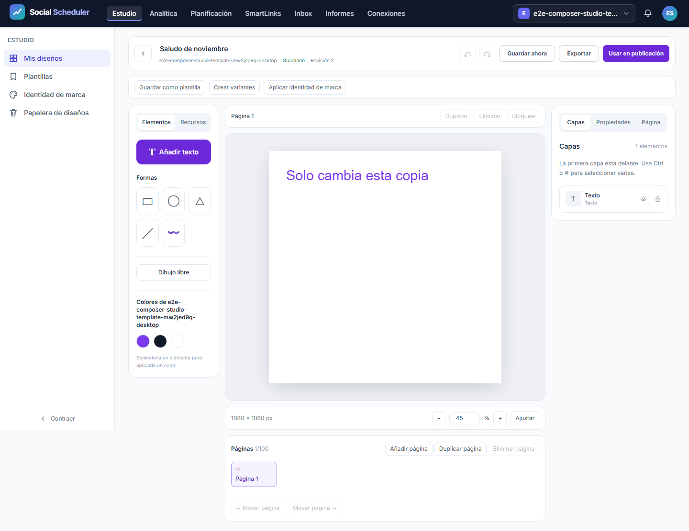
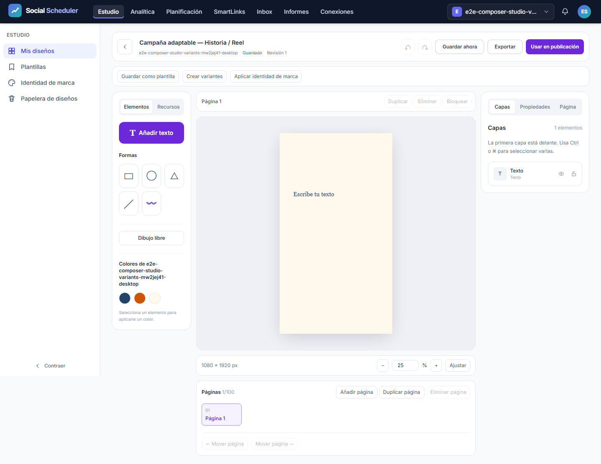
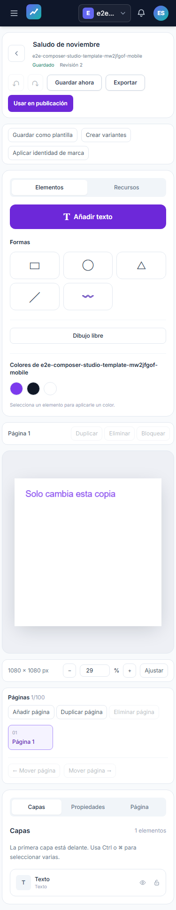
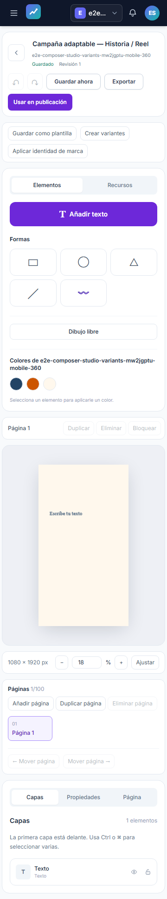
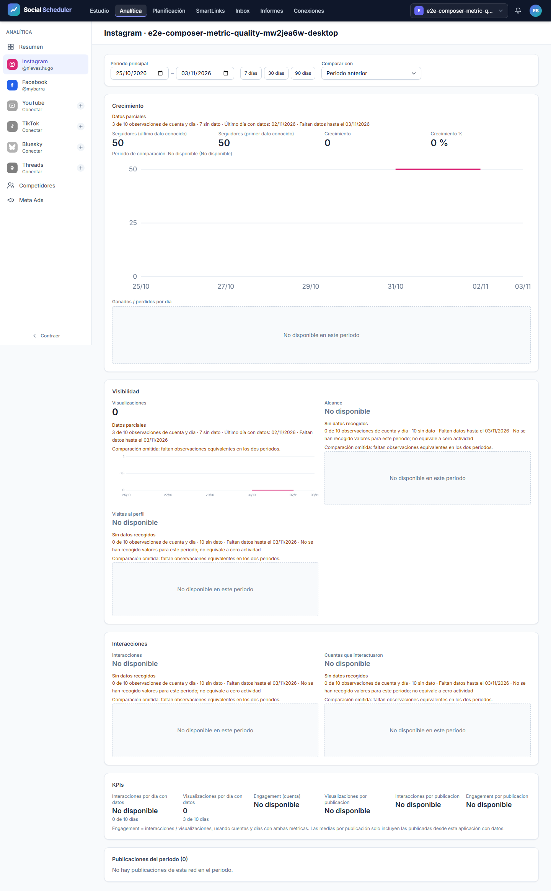
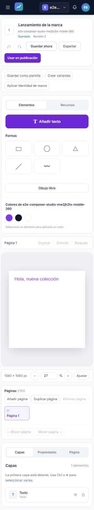

# Informe de QA — automatización del estudio y regresión de fundamentos

Fecha: 2026-11-04T20:59:25+01:00.

| Campo | Resultado |
|---|---|
| Estado del bloque auditado | **VERDE** |
| URL | `http://localhost:8080`, servidor gestionado y desechable |
| Dispositivos | Chromium 1440×900, 375×812 y 360×740 |
| Plan | [Plan](../../../improvement-plan.md) · [Pruebas](../../../test-plan.md) |

Alcance: E2E-01–08, T-09 y regresión de T-03/T-04–08/coherencia de marca T-21. La iniciativa completa continúa en progreso: este informe no certifica las funciones futuras, el VPS ni las autorizaciones reales de los proveedores.

## Veredicto determinista

```json
{
  "verdict": "VERDE",
  "counts": {
    "passed": 24,
    "failed": 0,
    "flaky": 0,
    "skipped": 0,
    "interrupted": 0
  },
  "flaky_sin_justificar": [],
  "flaky_justificados": {},
  "threshold": "verde ⟺ 0 failed, 0 flaky sin justificar, 0 interrumpidos y ≥1 test ejecutado"
}
```

Automáticos: **24/24 aprobados**; 0 fallos, 0 flaky, 0 omitidos y 0 interrumpidos. Una única ejecución integrada, un worker y cero reintentos. No se justifican flaky ni se excluyen fallos.

## Puertas de entrada y cobertura

`guardrail_assert http://localhost:8080`: exit 0. `ledger-lint.py`: **0 incoherencias, 17 avisos** de Changelog en tareas aún abiertas. `coverage-check.py`: **0 referencias rotas**, 0 tests sin referencia y 0 criterios GWT huérfanos. Los ocho E2E y cuatro manuales están definidos y referenciados.

El script lista sin cobertura T-01/T-02 (investigación/contrato, sin UI propia), T-10–17/T-19–20 (capacidades de UI futuras fuera de esta tanda) y T-18 (redes/opciones futuras y correcciones de servicio/OAuth, sin nueva UI auditada). Esas tareas no tienen verde global por este informe. Las correcciones de reconexión de T-18 se verifican por separado con PHP y sondas de revisión; no se presentan como una autorización externa E2E. Véanse las salidas completas en [ledger-lint](raw/ledger-lint.txt) y [coverage-check](raw/coverage-check.txt).

El runner creó SQLite, almacenamiento, sesión, caché e identidades desechables propios. Los conectores de prueba impiden llamadas a redes. Crear la publicación comprobada significa guardar un borrador. No se utilizó la base MySQL del usuario, no se editaron credenciales ni `.env` y no se accedió al VPS. No existen bloques API-xx/A11Y-xx en este test-plan; no se instala ni se atribuye una auditoría axe. No hay gate de cobertura unitaria configurado que informar.

## Resultados automáticos

| Escenario | Dispositivo | Resultado | Duración |
|---|---|---|---:|
| E2E-01 | desktop | PASA | 4.0 s |
| E2E-01 | mobile | PASA | 3.6 s |
| E2E-01 | mobile-360 | PASA | 3.5 s |
| E2E-02 | desktop | PASA | 6.3 s |
| E2E-02 | mobile | PASA | 6.4 s |
| E2E-02 | mobile-360 | PASA | 6.2 s |
| E2E-03 | desktop | PASA | 5.3 s |
| E2E-03 | mobile | PASA | 5.6 s |
| E2E-03 | mobile-360 | PASA | 5.2 s |
| E2E-04 | desktop | PASA | 5.1 s |
| E2E-04 | mobile | PASA | 5.2 s |
| E2E-04 | mobile-360 | PASA | 5.1 s |
| E2E-05 | desktop | PASA | 6.4 s |
| E2E-05 | mobile | PASA | 5.7 s |
| E2E-05 | mobile-360 | PASA | 5.6 s |
| E2E-06 | desktop | PASA | 5.2 s |
| E2E-06 | mobile | PASA | 4.7 s |
| E2E-06 | mobile-360 | PASA | 4.6 s |
| E2E-07 | desktop | PASA | 7.5 s |
| E2E-07 | mobile | PASA | 8.2 s |
| E2E-07 | mobile-360 | PASA | 7.6 s |
| E2E-08 | desktop | PASA | 11.4 s |
| E2E-08 | mobile | PASA | 10.9 s |
| E2E-08 | mobile-360 | PASA | 11.1 s |

## Aserciones verificadas

| ID | Comportamiento comprobado |
|---|---|
| E2E-01 | Cero real, cobertura parcial, fecha antigua, comparación desigual omitida y denominador diario. |
| E2E-02 | Crear, editar, guardar, reabrir, PNG 1080² con firma/dimensiones reales y borrador con adjunto en su marca. |
| E2E-03 | Undo/redo, orden de páginas, JPEG/WebP/SVG reales y PDF de dos páginas; SVG conserva el texto. |
| E2E-04 | Conflicto 409 conserva el trabajo local; descarga JSON y recuperación de la revisión del servidor. |
| E2E-05 | PNG/JPEG/WebP de diseño 41² a escala 0,5 se registran como imágenes 21². |
| E2E-06 | Ads e informes conservan la marca seleccionada al navegar y generar un informe. |
| E2E-07 | Guardar plantilla crea otra entidad; original sigue sin ser plantilla. Campos `$&` y `{{otro}}` son literales. Editar la instancia no cambia la plantilla; reapertura y PNG 1080² real. |
| E2E-08 | Subida real de logo PNG, registro en marca y selección en kit; cambio Arial→Georgia, undo/redo de documento y referencia, reaplicación posterior del kit, resize 540×1080, dos variantes independientes, reapertura y PNG 1080×1920 real. |

Las cuatro suites vigilan errores JavaScript/consola y desbordamiento. Solo el test de conflicto acepta su 409 deliberado en el endpoint exacto. Los demás errores, incluidos los de conexión, hacen fallar la prueba. Las duraciones y errores originales permanecen en [results.json](raw/results.json).

## Evidencia visual

Se revisaron las doce capturas de esta ejecución: editor base, instancia de plantilla, variante vertical y métricas en los tres tamaños. En móvil las herramientas se apilan y requieren desplazamiento vertical; no hay desbordamiento horizontal. La inspección visual se limita a estas capturas y no certifica todas las pantallas o criterios de accesibilidad de la aplicación.













## Trazabilidad

| Tarea | Evidencia de navegador | Límite |
|---|---|---|
| T-03 | E2E-01 | Recolección real del VPS pendiente. |
| T-04–06 | E2E-02–04 | Documento, editor y conflicto en tres viewports. |
| T-07 | E2E-02/03/05 | Exportación local real; Linux/R2 de producción pendiente. |
| T-08 | Flujos integrados E2E-02–05 | API/MCP y contratos se verifican en pruebas de servicio aparte. |
| T-09 | E2E-07/08 | Plantillas, kit, copia independiente, resize, variantes y archivos reales. |
| T-18 | No incluido como OAuth externo | Pruebas PHP y revisión independientes; proveedor/VPS no observado. |
| T-21 | E2E-06 | Solo coherencia de marca; Ads/reporting ampliados siguen abiertos. |

## Checklist manual pendiente

- [ ] **M-01 — Usuario:** scheduler/worker del VPS, heartbeat y capturas recientes del periodo cerrado.
- [ ] **M-02 — Usuario:** publicación real por red y smokes Bluesky/Threads pendientes.
- [ ] **M-03 — Desarrollo + usuario:** Node/Chromium/fuentes/cola media y render real con almacenamiento local/R2 del servidor.
- [ ] **M-04 — Usuario, aplazado:** Claude Desktop.

No se solicita SSH ni se sustituyen esos manuales por conectores simulados.

## Artefactos y reproducibilidad

[JSON del reporter](raw/results.json), [qa-gate](raw/qa-gate.json), [hashes de entrada](raw/input-hashes.json), [inventario de artefactos](raw/artifact-manifest.json) y [consola del runner](raw/playwright-console.txt). Los hashes se comprueban antes/después. Se copian únicamente imágenes y exportaciones de prueba conocidas; las trazas ZIP, sesiones, cookies, cabeceras y bases SQLite permanecen fuera de esta entrega.

El PDF aplica el tema de la skill `to-pdf`: Markdown → League/CommonMark ya instalado → HTML → Chromium de Playwright ya instalado. Se reutiliza ese adaptador local porque el cache de Puppeteer/markdown-it/mammoth no está instalado; no se descargan dependencias. El HTML comprueba que todas las imágenes cargan antes de generar el PDF. La firma y el número de páginas del PDF se verifican con pdf-lib. La vista HTML de impresión se inspecciona visualmente; no se atribuye rasterización independiente del PDF al no estar disponible Poppler/PyMuPDF.
