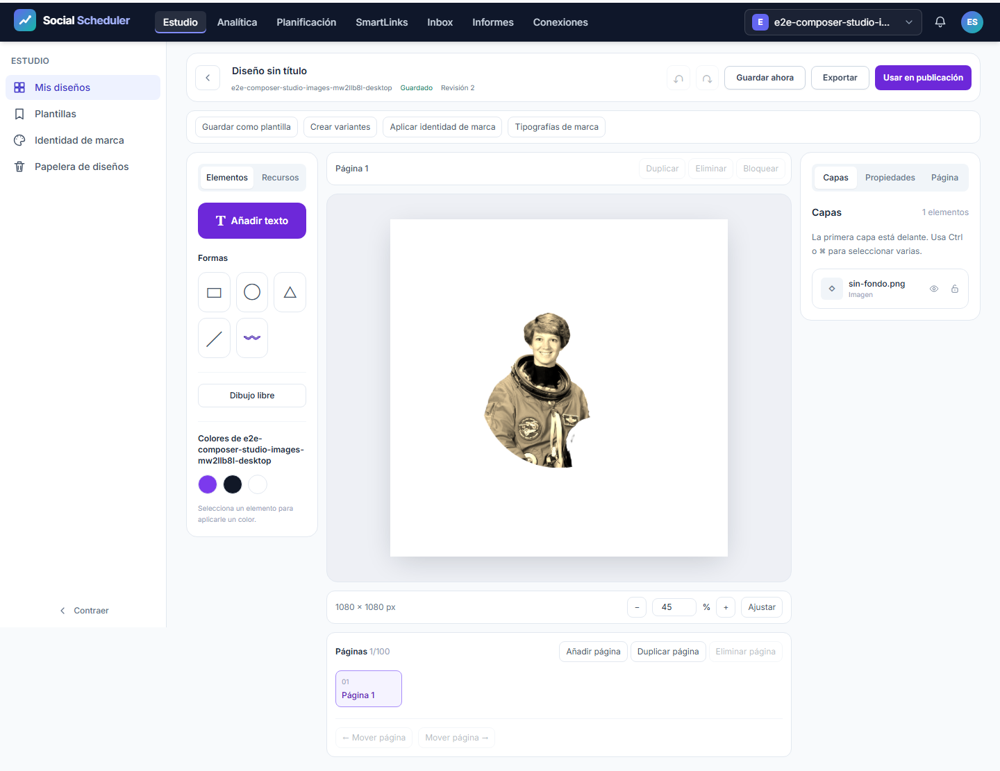

# Revisión y desarrollo de T-10

2026-11-04. Base `94e17d7`, cambios de T-10 todavía sin commit. Este informe registra progreso y revisión; **no es el informe de QA final**.

## Verificación disponible

| Prueba | Resultado y alcance |
|---|---|
| Suite PHP completa posterior a las correcciones | **2655/2655, 15800 aserciones**, sin fallos/errores/omitidos. [JUnit](raw/phpunit-reviewed.xml). |
| Frontend y Chromium | **43/43**, sin fallos/omitidos. Incluye WOFF2 real, píxeles de filtros/máscaras/recorte y exportaciones multipágina. [TAP](raw/frontend-reviewed.tap). |
| Límite efectivo de memoria y preflight tipográfico | **3/3** (`28fb67`); observa el kernel desde el entrypoint, sin cargar ONNX ni reservar 6 GiB. |
| Instalación atómica y checksum | **3/3** (`1f175a`), confirmado por A2. Modelo y licencia locales verificados; no descarga automática durante peticiones. |
| Nuevos E2E de desarrollo | **6/6** en 1440×900,375×812 y360×740, antes del límite de memoria y fixes de revisión. No sustituyen QA posterior. |
| Alcance | 79 archivos, ninguno fuera de alcance ni advertencias en la ejecución registrada. [JSON](raw/scope-reviewed.json). Documentación/evidencia posterior también declarada bajo `docs/**`. |

La primera suite PHP global produjo 2654 PASS / 1 ERROR por `framework/cache` ausente en la raíz desechable. Se corrigió la preparación del comando; la repetición completa pasó. No se desactivaron claves foráneas ni se alteró el test para ocultar la cascada defectuosa encontrada antes.

## Revisión de dos lentes — intento 1

Se revisó el inventario congelado de 75 archivos incluyendo nuevos, contra contrato, spec y ledger. Las cuatro lentes comprobaron cero discrepancias de hashes. `scope-check` pasó sin avisos; OpenAPI lint/diff contra la base pasó con cero errores y cero cambios rompedores (tres avisos opcionales previos).

| Lente | Resultado | Evidencia y escenario |
|---|---|---|
| A | Important A1 | El worker ONNX no aplicaba el presupuesto de memoria exigido por el contrato. No se afirmó un OOM medido en esta revisión. |
| B | Important B1 | JPEG codificado400×300, EXIF 6: salida correcta300×400 rechazada al compararse con dimensiones codificadas. Reproducción con inferencia real. |
| C | Sin hallazgos | Consultas de propietario/marca, permisos, comandos mediante arrays, mapa cerrado y archivos/modelo verificados. No auditoría global ni certificación del VPS. |
| D | Important D1 | 20 páginas, primera Arial y19 con la misma fuente de49256 B:19 GET,935864 B y≈2,2 s con latencia100 ms, tanto PNG como PDF. |

## Revisión de dos lentes — intento 2

Se conservan los criterios aprobados y se revisan las correcciones y su delta.

| Gap | Corrección | Verificación independiente |
|---|---|---|
| A1 | Límite OS6 GiB aplicado antes de procesar; CPU80 s en Linux, timeout85 s en PHP; BLAS1/ORT4 y arena/patrón desactivados. | A2 observa **6442450944 B** desde el kernel; memoria1/1, preflight2/2, instalador3/3. La adecuación real al modelo queda pendiente. |
| B1 | Validar dimensiones orientadas; orientación entera1–8 del runtime y fallbackEXIF acotado. | B2 **2/2,4 aserciones**: acepta300×400 y rechaza400×300; sonda del productor con doble ONNX comprueba orientación6 sin inferencia pesada. |
| D1 | Retener registro de fuentes acotado durante toda la exportación y liberarlo al terminar. | D2 **2/2**,1 GET por fuente y 0 FontFaces propias tras PNG/PDF;32 MiB/64 caras admitidos, excesos rechazados. |
| Delta de seguridad | Módulo de límites local fijo; no rutas ni parámetros de límites controlados por consumidores. | C2 sin hallazgos; consulta ligera del kernel1/1. |

**Cero gaps de corrección pendientes en A/B/C/D. T-10 permanece abierta por validación y QA pendientes.**

## Puerta de inferencia pendiente

Antes de añadir el techo, la inferencia real sobre `astronaut.png` conservó sujeto/original y produjo alpha medido. Tras aplicar límites se comprobó que **2 GiB y4 GiB no bastan** para este modelo1024². La variante sin arena también excede4 GiB. Picos y asignaciones se registran en el ledger; el tamaño de pesos224005088 B no describe el pico de RAM.

El código actual fija **6 GiB**, pero todavía no se ha demostrado inferencia exitosa dentro de ese techo. La prueba del kernel no sustituye ese resultado. La revisión automática rechazó una sonda8 GiB por riesgo de presión de RAM. Consulta de capacidad:32 GiB totales y≈10,8 GiB libres. Una alternativa limitada a6 GiB, con mínimo10 GiB libres antes de iniciar, piso4 GiB y deadline30 s, se negó antes de arrancar al observar≈8 GiB libres. La autorización solicitada al usuario sigue pendiente; no se relanza la prueba por otra vía ni se bajan las protecciones por silencio.

Después de resolver esta puerta: ejecutar inferencia real y sus regresiones, revisión suplementaria si cambia el código, QA independiente de los30 recorridos integrados en tres viewports, revisión visual/artefactos y gate. Entonces actualizar ledger, documentación, commits/push y PR#19 existente. No se fusiona, despliega ni publica en redes automáticamente.

## Capturas de desarrollo anteriores a los fixes

Son datos desechables y fixtures públicas, sin cookies, trazas ni bases de datos. No acreditan el comportamiento posterior al límite.

