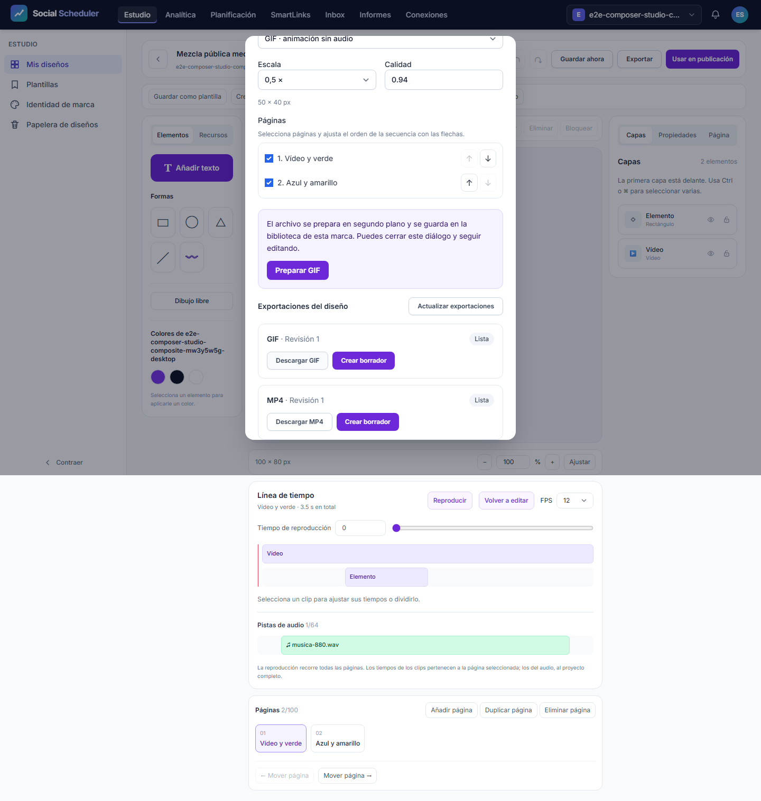
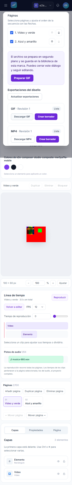
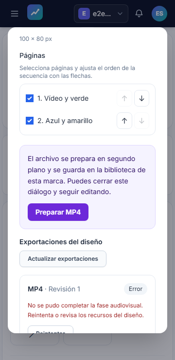

# Informe de QA — T11 audiovisual, aceptación local independiente

| Campo | Resultado |
|---|---|
| Fecha | 2026-11-05 |
| Estado automático del alcance | **NO-VERDE**, qa-gate exit 1 |
| Aceptación completa T11 | **NO COMPLETA: C18 incluye subtítulos sin implementación/evidencia encontrada** |
| URL auditada | http://localhost:8080, listener privado propio |
| Automáticos | 62/63 pasan, 3 viewports |
| Fuentes | 806 SHA256 antes/después; 0 cambios |
| Sesión / PID | 8134; helper 31664, Playwright 25744 |
| Plan | [Plan](../../../improvement-plan.md) · [Escenarios](../../../test-plan.md) · [Contrato temporal](../../../t11-contract.md) · [Contrato jobs](../../../t11-job-contract.md) |

## Veredicto (qa-gate)

```json
{
  "verdict": "NO-VERDE",
  "counts": {
    "passed": 62,
    "failed": 1,
    "flaky": 0,
    "skipped": 0,
    "interrupted": 0
  },
  "flaky_sin_justificar": [],
  "flaky_justificados": {},
  "threshold": "verde ⟺ 0 failed, 0 flaky sin justificar, 0 interrumpidos y ≥1 test ejecutado"
}
```

Una única pasada independiente, sin reintentos ni repeticiones por timeout de observación. Exit Playwright 1; errores runner 0; resultados con retry>0: 0. JSON íntegro en [raw/results.json](raw/results.json). No se transformaron ni excluyeron casos para obtener el gate. Duración del runner: 618.23s. Desktop 1440×900, mobile375×812 y mobile-360360×740: desktop 21, mobile 21, mobile-360 21 casos.

**No hay evidencia suficiente para cerrar T11:** falla la aceptación compuesta mobile-360 y la matriz C18 incluye subtítulos sin capacidad dedicada ni prueba de importar/editar/exportar encontrada. Los overlays de texto temporal no demuestran ese flujo. Las capacidades y viewports que pasan mantienen su evidencia concreta, sin convertirla en aceptación completa. Tampoco se acredita un límite RSS, multimedia Linux, VPS ni R2 real. No se modifica ni cierra aquí tarea, spec ni iniciativa; roadmap 7/23 al inicio y16 tareas abiertas. No se afirma paridad Metricool/Canva.

### Fallo E2E-21 en mobile-360

Exportación 131, revisión 1: la UI muestra procesamiento 90,91 % y después estado Error con «No se pudo completar la fase audiovisual. Reintenta o revisa los recursos del diseño». El test esperaba Lista y agotó10000 ms. No llegó a descargar/medir el compuesto en 360 px. Desktop y375px sí completaron ese mismo recorrido. El flujo nativo más pequeño y su historial pasan también en 360 px. No se ha probado una causa raíz ni se clasifica el fallo como fluctuación de entorno. No se justificó como flaky, no se reintentó ni se cambió ninguna aserción.

Evidencia: `raw/artifacts/studio-av-composite-Studio-368ce--through-download-and-draft-mobile-360/` contiene error-context.md, captura y trace.zip; detalle íntegro en results.json. La carpeta logs del runtime estaba vacía al inspeccionarla. Corresponde al orquestador investigar y corregir antes de una nueva QA coordinada; este es intento 1/3.

## Guardrail, aislamiento y estabilidad de fuentes

Guardrail oficial `lib-guardrail.sh` sobre localhost:8080: exit0. Bash inicial en sandbox falló CreateFileMapping/Win32error5; la ejecución específica escalada autorizada pasó. El puerto estaba libre; el runner exige `reuseExistingServer:false` e inicia sus listeners propios. No se reutiliza ningún servidor ajeno.

Raíz real: `C:\laragon\www\metricool\storage\framework\testing\t43\run-general-2d90a00c-beeb-4866-833d-5c94848817ec`. Inicio 2026-11-05T19:35:50.167006+00:00, fin 2026-11-05T19:46:08.975870+00:00. SQLite, storage, usuarios y servicios sociales falsos pertenecen al UUID desechable. No se ejecutó ONNX, test_background, studio-imaging, MySQL, VPS, buckets ni publicación social. La configuración explícita del runner evita leer .env para este servidor. Se conserva el proceso original hasta su terminación, sin reiniciarlo al vencer una observación.

[sources-before](raw/sources-before.json) y [sources-after](raw/sources-after.json) incluyen código/dependencias T11, contratos, criterios/ledger/test-plan, tests/helpers de audio `.mjs` y `.d.mts`, runner y76 artefactos de public/build. Los 806 SHA coinciden. El helper solo escribió evidencias/temporales propios y el UUID autorizado por el runner.

## Cobertura y ledger

Ledger-lint exit0:0 incoherencias/16 avisos Changelog, sin errores duros. Coverage-check exit0: 0 referencias rotas, 0 tests sin referencia y ningún criterio GWT huérfano. T11 declara E2E-11–22 y M-03. IDs20=flujo nativo,21=compuesto,22=historial; no hay duplicados en la tabla actual. El hallazgo inicial de trazabilidad fue corregido por el orquestador antes de congelar y ejecutar; se preservan las dos salidas.

Las tareas sin cobertura declarada en la puerta de iniciativa son **T-01, T-02, T-12, T-13, T-14, T-15, T-16, T-17, T-18, T-19, T-20**. Se mantienen abiertas y fuera de esta QA de T11: no reciben exención ni aprobación global. E2E-09/10 de T10 están declarados pero **no ejecutados**, por su bloqueo de memoria vigente. M-03 de T11 permanece manual para servidor real. No hay bloques API-xx/A11Y-xx en el plan; esta pasada no añade auditoría axe independiente. No hay `tests.coberturaMinima` configurado; no se inventa porcentaje unitario.

Salidas literales y códigos: [gates.json](raw/gates.json), [ledger-lint](raw/ledger-lint-final.txt), [coverage-check](raw/coverage-check-final.txt). Porcentaje E2E observado:98.41% de esta pasada; no es cobertura de código ni del roadmap.

## Tabla de aceptación T11

| Criterio | Evidencia | Alcance/veredicto |
|---|---|---|
| v2, ventanas, corte/división, página2, undo/redo y persistencia | E2E-11–13,17–18; JSON real | PASA en3 viewports |
| Reloj y preparación/cancelación sin consumir clip ni mutar documento | E2E-11–15,17 | PASA en3 viewports; no sustituye revisión humana audiovisual |
| Audio privado binario, probe/rangos, recurso de marca y exclusión social | E2E-16–17 | PASA, recurso real local |
| Trim/rate/loop/mute/volumen/envolvente y edición de pistas | E2E-17–18; E2E-21 distingue trim/loop/rampas en salida | PASA, sin atribuir velocidad de pista a la fixturecompuesta |
| Fotograma temporal estático y original intacto | E2E-19 | PASA, PNG medido y options.frame_times |
| Composición vídeo móvil/overlays/fade, MP4/GIF reales | E2E-21, probes y píxeles abajo | PASA desktop/375; **FALLA360**, sin resultado compuesto descargable |
| Selección/orden/escala y formatos estáticos conservados | E2E-20,21 y E2E-02–05 | PASA; calidad codificada no comparada subjetivamente |
| Cola real, progreso, cancel/retry, historial/recarga/paginación | E2E-20/22 | PASA,55exportaciones paginadas, sin trabajos al consultar |
| Revisión fijada frente a edición posterior | E2E-21 revision1/current2, MP4/GIF conservan1 | PASA desktop/375; no completado360 |
| Descarga privada y borrador de marca con medio exacto | E2E-20/21, aserciones brand_id/status/media_ids | PASA; borrador sin envío social |
| API/MCP/permisos/recuperación detallada | Backend histórico369/2046,8nativos;46fuentesPHP idénticas | Evidencia previa root+revisión, no nueva suite independiente |
| Presupuesto OS/tiempo y cierre de descendientes | Contrato jobs, evidencia previa av-managed/av-linux y runtime nativo actual | Windows COMMIT agregado 3 GiB; **RSS no medido**; Linux multimedia/VPS pendientes |
| Subtítulos, alcance C18 de la matriz | reference-inventory.md:69 asigna timeline/audio/transiciones/subtítulos a T11; búsqueda dirigida Studio/app/UI/MCP/tests sin capacidad dedicada encontrada | **GAP de alcance: T11 abierta**, sin aceptación automática ni manual suficiente |

### Brecha C18 descubierta durante la pasada

[reference-inventory.md:69](../../../reference-inventory.md) asigna subtítulos a T11. La búsqueda dirigida `subtitle/caption/subtítulo/subtitulo/webvtt/.srt` en servicios Studio, MCP, editor y tests no encontró importación, edición ni exportación de subtítulos dedicada. Esta ausencia de coincidencias no es por sí sola una prueba formal de ausencia de toda capacidad posible; junto a la falta de contratos y escenarios aporta una brecha verificable de cobertura y aceptación. El overlay temporal de texto no prueba importar SRT/WebVTT, editar cues ni exportar subtítulos. No se presupone autocaption IA, vinculada también a T14.

El hallazgo no invalida las63 pruebas de capacidades existentes y no motivó repetir ni detener su ejecución. [Búsqueda y fila de matriz](raw/subtitles-scope.txt). La matriz se descubrió después del arranque y no formaba parte de los806 hashes iniciales: se conserva un [hash suplementario con momento real](raw/supplemental-inventory-hash.json), sin presentarlo como captura anterior a la pasada. Debe definirse/probarse este alcance antes del cierre de T11.

## Medición audiovisual independiente

Se volvieron a decodificar los **archivos descargados de esta pasada** con ffprobe/FFmpeg después de terminar la suite, sin repetir recorridos UI ni crear nuevas exportaciones. Hay 2 muestras compuestas: desktop y375px; **360px no produjo descarga compuesta aceptada**. Los MP4 descargados tienen H264 100×80,42 frames,3,500 s yAAC48000 Hz/2 canales. Sus GIF tienen50×40,42 frames,3,500 s y una sola pista visual; no hay pista de audio. GIF se solicita con escala0,5. Probes íntegros por viewport en samples/.

| Viewport | Revisión fijada → actual | Movimiento RMS | Overlayverde | Fade | Azulfinal | DiferenciaL/R RMS |
|---|---|---|---|---|---|---|
| desktop | 1 → 2 | 28.457 | [0, 255, 0] | [127, 0, 126] | [0, 0, 254] | 0.000001640 |
| mobile | 1 → 2 | 28.457 | [0, 255, 0] | [127, 0, 126] | [0, 0, 254] | 0.000001640 |

Movimiento RMS>5; píxeles con tolerancia18/255. El fondo final azul conserva la revisión 1; la edición posterior del documento actual lo cambia a verde en revisión 2. Las aserciones de borrador exigen brand_id de la fixture, status=borrador y media_ids exactamente iguales a los del MP4 ready; no se toma un borrador genérico como evidencia.

La comprobación siguiente se calculó nuevamente con Python sobre PCM float32 estéreo 48000 Hz decodificado del MP4, aparte del helper JS del test. Cada canal debe tener440/880 en meseta0,04–0,06, ataque/salida0,015–0,025,440 tras vídeo<0,002,1760 fuera del trim<0,003 y cola RMS<0,002; diferencia L/R<0,001. El880a 2,1 s confirma continuidad de música cuando el vídeo ya terminó. La fixture incluye1760 fuera[0,25,1,25] para discriminar eltrim. No se confunden estos tonos sintéticos con aceptación musical humana.

| Viewport/canal | 440 | 880 | Ataque | Salida | 440 tras vídeo | Marcador1760 | ColaRMS |
|---|---|---|---|---|---|---|---|
| desktop left | 0.049847 | 0.049994 | 0.019968 | 0.019963 | 0.00000010 | 0.000025 | 0.000000 |
| desktop right | 0.049847 | 0.049994 | 0.019968 | 0.019963 | 0.00000010 | 0.000025 | 0.000000 |
| mobile left | 0.049847 | 0.049994 | 0.019968 | 0.019963 | 0.00000010 | 0.000025 | 0.000000 |
| mobile right | 0.049847 | 0.049994 | 0.019968 | 0.019963 | 0.00000010 | 0.000025 | 0.000000 |

Medidas originales y recálculo: [composite-audit](raw/composite-audit.json); `samples/<viewport>/measurements.json`, `independent-probes.json`, `independent-audio.json`, MP4/GIF y fotogramas. Las siete unitarias del oráculo y la pasada desktop focal previas son del root, no se añaden al conteo independiente 63.

## Resultados automáticos por escenario

Los 21 escenarios se ejecutan una vez en cada viewport; el detalle de63 resultados, errores yretries está en [test-index](raw/test-index.json). Los nombres completos permiten contrastar cada fila con el JSON sin depender de IDs reutilizados en otros planes.

| Archivo/caso | Desktop | Mobile 375 | Mobile 360 |
|---|---|---|---|
| all-brands.spec.ts — E2E-04 · Todas las marcas: totales, tabla por marca, gráfica y cambio de periodo | PASA | PASA | PASA |
| brand-reporting.spec.ts — Ads and reports retain the selected brand across navigation and report creation | PASA | PASA | PASA |
| metrics-quality.spec.ts — Metrics: zero activity retains partial coverage, stale dates and suppressed unequal comparison | PASA | PASA | PASA |
| studio-audio-editor.spec.ts — upload, add, trim, split, undo, play, persist and reopen a private brand track | PASA | PASA | PASA |
| studio-audio-editor.spec.ts — decimal page duration uses document bounds rather than rounded frame bounds | PASA | PASA | PASA |
| studio-audio-resources.spec.ts — Studio audio resources API: private binary upload, byte ranges and native browser playback | PASA | PASA | PASA |
| studio-automation.spec.ts — Studio automation: own template substitutes literal fields in an independent branded design and exports | PASA | PASA | PASA |
| studio-automation.spec.ts — Studio automation: brand styles, proportional resize and independent variants persist and export | PASA | PASA | PASA |
| studio-av-composite.spec.ts — Studio composite export: public uploads and revision preserve moving video overlays transition and measured two-tone audio through download and draft | PASA | PASA | NO PASA |
| studio-frame-export.spec.ts — Studio frame export: choose a local page time, export real pixels and retain it with the private brand output | PASA | PASA | PASA |
| studio-native-export.spec.ts — Studio native export: order pages, resume history, cancel retry and download real MP4 GIF before a brand draft | PASA | PASA | PASA |
| studio-native-export.spec.ts — Studio native history: paginate real exports in one request per page and reopen without creating work | PASA | PASA | PASA |
| studio-timeline.spec.ts — edit windows, split, persist and run a common playhead without changing the document | PASA | PASA | PASA |
| studio-timeline.spec.ts — an uploaded real video with an open source end can be split and previewed | PASA | PASA | PASA |
| studio-timeline.spec.ts — splitting the second page uses local clip time and survives undo and redo | PASA | PASA | PASA |
| studio-timeline.spec.ts — buffering never consumes a short clip before playback starts | PASA | PASA | PASA |
| studio-timeline.spec.ts — closing while media buffers cancels the pending playback | PASA | PASA | PASA |
| studio.spec.ts — fractional exports round to 21 pixels and register PNG JPEG WebP in the brand library | PASA | PASA | PASA |
| studio.spec.ts — design persists, exports real PNG and starts a publication in its brand | PASA | PASA | PASA |
| studio.spec.ts — undo, page ordering and portable JPEG/WebP/SVG/PDF exports retain the design | PASA | PASA | PASA |
| studio.spec.ts — a stale revision preserves local edits and can recover the server version | PASA | PASA | PASA |

## Capturas e inspección visual

Las capturas de los tres viewports se inspeccionan visualmente: desktop/375 muestran resultados listos y 360 muestra el fallo. El diálogo mantiene texto/controles legibles y scroll vertical; el error de 360 px es funcional y no se oculta bajo un juicio de responsive. En los casos que pasan se comprueba ausencia de overflow horizontal; la aceptación compuesta de 360 px no llegó a su aserción final. La captura de éxito está desplazada al historial por `scrollIntoView`, por lo que el encabezado superior puede quedar fuera del área visible. Los fotogramas overlay/fade/final descargados se inspeccionan aparte, sin inventar valoración humana del sonido.

### Desktop 1440×900



En el PDF, la captura de 375 px se recorta visualmente por arriba para mostrar legibles las acciones del diálogo. El PNG completo permanece sin cambios.

### Mobile 375×812



### Mobile 360×740 — fallo



## Límites y checklist manual

Windows usa JobObject con cap de **COMMIT agregado 3 GiB**, kill-on-close y sin breakaway; no es RSS ni una reserva previa de 3 GiB. Esta QA no induce OOM ni mide peak RSS. La evidencia previa Linux cgroup con procesos Python sí es ejecución Linux, pero no Node/FFmpeg multimedia Linux ni VPS. El worker VPS/systemd y su operación siguen pendientes. R2 previo es SDK simulado; esta QA usa almacenamiento local y no certifica bucket real.

- [ ] **M-01 — Usuario:** scheduler/worker/heartbeat/capturas de VPS; no se solicita SSH de nuevo.
- [ ] **M-02 — Usuario:** smokes reales de Bluesky/Threads y publicaciones por red; sin resultado comunicado.
- [ ] **M-03 — Desarrollo + usuario:** renderer Node/Chromium/fuentes/cola/imagen/vídeo y R2 reales del servidor; multimedia Linux y políticas OS/timeout reales.
- [ ] **M-04 — Usuario:** Claude Desktop aplazado; no se reabre autorización ni se marca aprobado.
- [ ] **Revisión audiovisual humana:** escuchar/observar los MP4/GIF descargados; las mediciones no sustituyen valoración del producto.

La auditoría Claude CLI final permanece pendiente **después de todo el roadmap**. No hay mensajes externos, Jira/Confluence, promoción de knowledge ni handoff a documenter/curator. El orquestador verifica el gate y decide el estado de T11; este informe no cierra plan/spec/iniciativa.

## Evidencias y PDF

[Manifiesto](manifest.json) · [Ejecución/PID/hash](raw/execution.json) · [stdout](raw/playwright.stdout.txt) · [stderr](raw/playwright.stderr.txt) · [Resultados reales](raw/results.json) · [Comprobaciones adicionales](raw/extra-checks.json).

PDF mediante el flujo to-pdf existente: League/CommonMark ya instalado → HTML + tema CSS de la skill → Chromium Playwright ya instalado. Adaptador T09 reutilizado, sin instalar Puppeteer/markdown-it. Se comprueba carga de todas las imágenes, se rasteriza el PDF real con PyMuPDF y se inspeccionan sus páginas; no se confunde un screenshot HTML con rasterización PDF.
