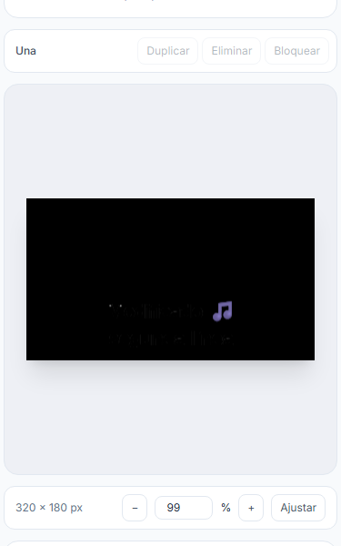
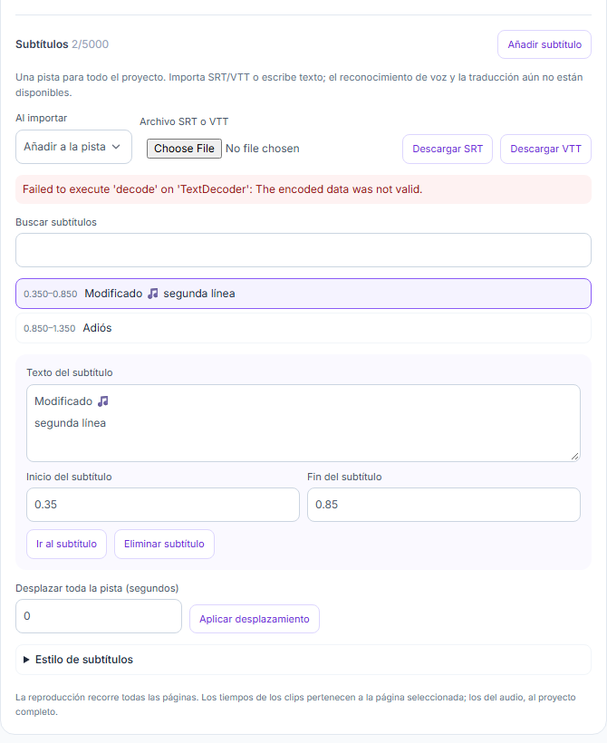
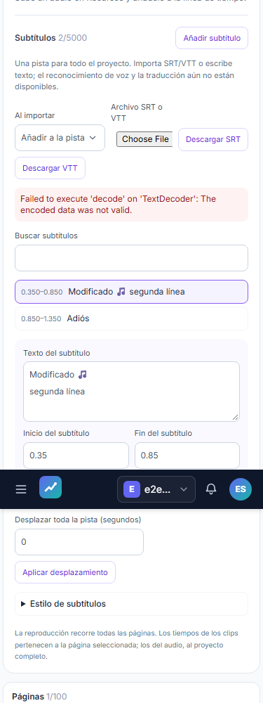
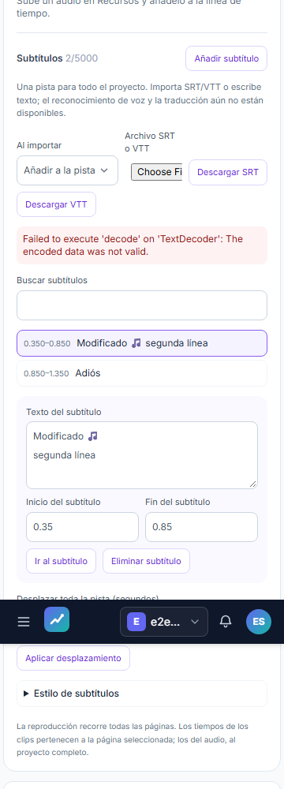

# QA independiente T11 — intento 2

| Campo | Resultado |
|---|---|
| Fecha | 2026-11-05 |
| Veredicto de qa-gate | **VERDE**, exit 0 |
| Evaluación del alcance local | **NO ACEPTADO: QA2-V01 Important de legibilidad** |
| Resultado real | 72/72 correctos; 0 fallos |
| Fuentes | 838 SHA antes/después; 0 cambios |
| Escenarios |12 archivos, 3 proyectos; conteo tomado del JSON, no supuesto |
| Sesión / PID |77306; helper 33672, Playwright 6096 |
| Raíz | `C:\laragon\www\metricool\storage\framework\testing\t43\run-general-48262984-4932-47db-90f6-7011cd33f5bb` |

## Veredicto y alcance

```json
{
  "verdict": "VERDE",
  "counts": {
    "passed": 72,
    "failed": 0,
    "flaky": 0,
    "skipped": 0,
    "interrupted": 0
  },
  "flaky_sin_justificar": [],
  "flaky_justificados": {},
  "threshold": "verde ⟺ 0 failed, 0 flaky sin justificar, 0 interrumpidos y ≥1 test ejecutado"
}
```

Exit Playwright 0; duración 1014.417s; errores de runner 0; reintentos 0. Desktop 1440×900, mobile 375×812 y mobile-360 360×740: {'desktop': 24, 'mobile': 24, 'mobile-360': 24}. Ejecución única, sin reiniciar por timeout de observación ni repetir casos. Las comprobaciones independientes de captions son 42/42 correctas; detalle y cualquier discrepancia en [caption-independent-checks.json](raw/caption-independent-checks.json).

Este informe aporta evidencia local para que el orquestador decida los estados de T07/T11. **QA no modifica ni cierra tareas, plan o spec**. El estado de entrada era 6/23 tareas completadas y T07/T11 en progreso; no se acepta el roadmap completo por superar estos recorridos. La [QA1 original](../final-qa/report.md) conserva su NO-VERDE 62/63 y no se altera. El diagnóstico SQLite y la regresión focal posteriores se documentan en [sqlite-concurrency](../sqlite-concurrency/review.md); la excepción del primer recorrido no se inventa retrospectivamente.

### QA2-V01 — Important: subtítulos casi ilegibles con ajuste permitido

El recorrido UI de captions importa texto, cambia el tamaño a22px y conserva el estilo por defecto: fill blanco, contorno negro de grosor2. Sobre el lienzo negro, las dos líneas son prácticamente ilegibles mientras el emoji púrpura permanece visible. QA y el orquestador inspeccionaron la misma evidencia nueva. Es una limitación funcional de lectura en un ajuste permitido, no una preferencia estética. El test automático puede pasar porque no comprueba legibilidad de ese estilo; los renders medidos con strokeWidth0 son otro escenario.

La causa raíz no se ha probado: que el contorno cubra el glifo por paint order sigue siendo hipótesis. No se afirma ratioWCAG ni se aplica un parche durante QA. T07/T11 permanecen abiertas; root hará reproducción RED, corrección y revisión afectada después de liberar el slot nativo. Se conserva la misma pasada, sin repetirla ni detenerla.

[Hallazgo estructurado](raw/visual-findings.json). Recorte fiel del original mobile 375, x0/y900/375×600; original completo conservado en raw/artifacts.



## Aislamiento, límite OS y estabilidad

URL http://localhost:8080 validada por el guardrail oficial. El puerto estaba libre; el runner exige servidor propio y `reuseExistingServer:false`. SQLite, storage y cuentas desechables pertenecen al UUID de esta pasada; sin reutilizar ni detener Node ajeno. Inicio 2026-11-05T21:52:50.750123+00:00, fin 2026-11-05T22:09:46.723363+00:00. Sin .env/MySQL/VPS, ONNX/test_background/imaging, bucket R2 real ni publicación social.

El helper QA2 y sus hijos están en un JobObject de **3 GiB de COMMIT agregado**, consultado al kernel: límite 3221225472 B, kill-on-close=True, breakaway=False, pico 1243049984B (1.158GiB). El observador posterior y sus procesos FFmpeg/Chromium/Python tienen un Job equivalente: pico 891523072B, límite 3221225472B. **No es RSS ni una reserva previa de 3 GiB.** El límite se impone al árbol, además de los supervisores nativos de fase de la aplicación. No se induce OOM.

Snapshot directo: 838 rutas, incluidos API OpenAPI, guía API/MCP, README, módulo MCP, deploy, document-contract, matriz, contrato captions, ledger/test-plan, renderer estático/vector/fuentes, fixtures reales `tests/Fixtures/fonts`, soporte `.mjs`/`.d.mts` y public/build completo. Los hashes de [sources-before](raw/sources-before.json) y [sources-after](raw/sources-after.json) coinciden. T12 estuvo congelada y no se excluyó.

Adicionalmente se comprobaron las39 fuentes revisadas,76 generados y siete descriptores tanto antes del arranque como al terminar: [pre](raw/freeze-input-check.json), [post](raw/freeze-output-check.json). Cuatro fuentes del freeze están fuera de los árboles generales: test_caption_archive.py y tres helpers de storage. Su baseline adicional es el [manifiesto revisado](raw/reviewed-freeze-manifest.json), verificado antes; no se modificó el archivo sources-before para fingir que esas cuatro estaban en el snapshot directo. No hay exenciones de integridad.

## Cobertura, ledger y trazabilidad

Ledger-lint exit0:0 incoherencias/18 avisos,16 Changelog y dos cabeceras de revisión no canónicas. No se editaron durante QA. Coverage-check exit0: 0 referencias rotas, 0 tests sin referencia y ningún GWT huérfano. T11 incluye E2E-11–25 y M03; T07 comparte exportaciones estáticas y multipágina. Sin bloques API-xx/A11Y-xx definidos ni mínimo unitario configurado; no se inventa porcentaje de cobertura de código o auditoría axe.

La puerta sigue mostrando tareas fuera del alcance sin mapeo: **T-01, T-02, T-12, T-13, T-14, T-15, T-16, T-17, T-18, T-19, T-20**. No reciben exención ni verde global. T10/E2E09–10 siguen sin ejecución por la restricción de memoria/ONNX. Salidas y códigos literales: [gates.json](raw/gates.json).

| Criterio T11/T07 | Evidencia actual | Resultado / límite |
|---|---|---|
| v2, corte, pistas, ventanas, página2, undo/reapertura | E2E-11–19 y regresiones Studio | Resultado individual del JSON en tabla inferior |
| Compuesto vídeo/audio/overlays/fade, MP4/GIF, revisión y borrador | E2E-21; recálculo de MP4/GIF descargados | Muestras nuevas por viewport, sin reutilizar resultados QA1 |
| Cola, cancel/retry, historial paginado, orden/escala | E2E-20/22 | Worker real local y55 exportaciones para paginar |
| Importar/editar/estilo/offset/eliminar/undo/reabrir y exportSRT/VTT/error | E2E-23 | Unicode y tiempos observados; no ASR/traducción |
| Ventana `[start,end)` y opacidad en fade | E2E-24 + observador independiente | Decode antes/inicio/dentro/fin/después, ratios y máscaras |
| A sola, C→A y A→C | E2E-24 + frames decodificados | Ventanas de origen/cue y orden de páginas observables |
| Fuente privada y SVG/PNG/PDF reales multipágina | E2E-24 + XML/ZIP/SHA/raster independiente | Texto/fuente portable y contenido, no solo firma o DTO |
| Revisión fijada tras limpiar subtítulos actuales | E2E-24,25 | Outputs revisión 1 y documento actual revisión 2 |
| UI/API/MCP abilities, propietario y conflicto | E2E-25 + revisión backend previa | Canales compartidos; no publicación externa |
| Bordes LF, separadores, importappend e IDs globales | A2/B2/C2 y tests PHP/JS previos fijados en freeze | Revisados antes de QA; no se suman como tests de esta pasada |
| Presupuesto OS | Job QA/observador y runtime de fases | Windows COMMIT medido; no RSS/multimedia Linux/VPS |

## Medición propia de vídeo y audio compuesto

Los MP4/GIF descargados de **esta QA2** se decodificaron nuevamente, sin generar más exportaciones. MP4 H264100×80,42 frames/3,5 s,AAC 48000 Hz/estéreo; GIF50×40,42 frames/3,5 s y sin audio. Se contrastan píxeles de overlays/fade, movimiento RMS, revisión 1 frente a actual 2 y borrador con marca/medio exactos. Detalle completo: [composite-audit.json](raw/composite-audit.json) y samples/desktop,mobile,mobile-360.

El recálculo Python del PCM es independiente del helper JS del test. Mesetas440/880 deben estar 0,04–0,06; rampas 0,015–0,025; marcador 1760 fuera del trim<0,003, cola RMS<0,002 y diferencia L/R<0,001. Ambos canales se comprueban. El 880 posterior al fin del vídeo acredita continuidad de música; no es una valoración musical humana.

| Viewport | 440 L/R | 880 L/R | Ataque L/R | Salida L/R | Marcador1760 L/R | ColaRMS L/R |
|---|---|---|---|---|---|---|
| desktop | 0.049847/0.049847 | 0.049994/0.049994 | 0.019968/0.019968 | 0.019963/0.019963 | 0.000025/0.000025 | 0.000000/0.000000 |
| mobile | 0.049847/0.049847 | 0.049994/0.049994 | 0.019968/0.019968 | 0.019963/0.019963 | 0.000025/0.000025 | 0.000000/0.000000 |
| mobile-360 | 0.049847/0.049847 | 0.049994/0.049994 | 0.019968/0.019968 | 0.019963/0.019963 | 0.000025/0.000025 | 0.000000/0.000000 |

## Medición propia de subtítulos

El observador no importa captions.js, captions-renderer.js ni sus asserts. Trabaja sobre los bytes descargados: ffprobe/FFmpeg, ZIP/XML, SHA, Pillow y PyMuPDF; Chromium sin red para volver a rasterizar el SVG portable. El perfil de observación registra archivos, índices y ventanas esperadas; no deduce PASS del nombre del caso. SVG contiene texto y la fuente WOFF2 embebida, cuyo SHA se contrasta con el snapshot privado validado. Los PNG y cada página PDF se rasterizan realmente; una firma PDF o tamaño ZIP no basta.

La fixture de ventana es 160×120/FPS12, cue «Hola» global[0,25,1,25), con transición entre 0,5 y 1 s. Frames0/2 anteriores,3 en inicio,4/6/9/14 activos,15 en fin exacto y17 posterior. Se cuentan múltiples umbrales16/64/128/200/240, bbox, luminancia y diferencias RGB. Se compara luminancia de la máscara de glifos muy brillantes antes y durante el fade; ratio aceptado 0,94–1,06, con tolerancia a codec. No se afirma inferir el número interno de llamadas de dibujo cuando dos composiciones producen píxeles matemáticamente idénticos.

| Viewport/formato | Frames decodificados | Píxeles>200 por índice | Ratio máscara brillante entre frames |
|---|---|---|---|
| desktop/mp4 | 18 | {0: 0, 2: 0, 3: 181, 4: 181, 6: 181, 9: 181, 14: 181, 15: 0, 17: 0} | [4, 9]: 1.000000, [4, 14]: 1.000000 |
| desktop/gif | 18 | {0: 0, 2: 0, 3: 181, 4: 181, 6: 181, 9: 181, 14: 181, 15: 0, 17: 0} | [4, 9]: 1.000000, [4, 14]: 1.000000 |
| mobile/mp4 | 18 | {0: 0, 2: 0, 3: 181, 4: 181, 6: 181, 9: 181, 14: 181, 15: 0, 17: 0} | [4, 9]: 1.000000, [4, 14]: 1.000000 |
| mobile/gif | 18 | {0: 0, 2: 0, 3: 181, 4: 181, 6: 181, 9: 181, 14: 181, 15: 0, 17: 0} | [4, 9]: 1.000000, [4, 14]: 1.000000 |
| mobile-360/mp4 | 18 | {0: 0, 2: 0, 3: 181, 4: 181, 6: 181, 9: 181, 14: 181, 15: 0, 17: 0} | [4, 9]: 1.000000, [4, 14]: 1.000000 |
| mobile-360/gif | 18 | {0: 0, 2: 0, 3: 181, 4: 181, 6: 181, 9: 181, 14: 181, 15: 0, 17: 0} | [4, 9]: 1.000000, [4, 14]: 1.000000 |

Selección fuente: A dura 2 s y tiene fade 0,5s; cue AA 1,8–1,95. C contiene cue CCCCCCCC 3,8–4 global. A sola conserva el cue completo; C→A lo remapea tras C; A→C cambia propiedad de ventana en el midpoint para conservar la cue de C sin duplicar la de A. El contenido de las cues y los fondos permiten distinguir fase y orden. No se reusa el compilador de selección del producto para calcular estos índices.

| Viewport/selección | Frames reales | Píxeles>200 por índice |
|---|---|---|
| desktop/a | 60 | {0: 0, 53: 0, 54: 139, 55: 139, 58: 139, 59: 0} |
| desktop/c-a | 120 | {0: 0, 8: 0, 9: 466, 10: 466, 14: 466, 15: 0, 113: 0, 114: 139, 115: 139, 117: 139, 118: 139, 119: 0} |
| desktop/a-c | 105 | {0: 0, 50: 0, 52: 0, 53: 0, 54: 464, 55: 469, 56: 468, 59: 465, 60: 0, 104: 0} |
| mobile/a | 60 | {0: 0, 53: 0, 54: 139, 55: 139, 58: 139, 59: 0} |
| mobile/c-a | 120 | {0: 0, 8: 0, 9: 466, 10: 466, 14: 466, 15: 0, 113: 0, 114: 139, 115: 139, 117: 139, 118: 139, 119: 0} |
| mobile/a-c | 105 | {0: 0, 50: 0, 52: 0, 53: 0, 54: 464, 55: 469, 56: 468, 59: 465, 60: 0, 104: 0} |
| mobile-360/a | 60 | {0: 0, 53: 0, 54: 139, 55: 139, 58: 139, 59: 0} |
| mobile-360/c-a | 120 | {0: 0, 8: 0, 9: 466, 10: 466, 14: 466, 15: 0, 113: 0, 114: 139, 115: 139, 117: 139, 118: 139, 119: 0} |
| mobile-360/a-c | 105 | {0: 0, 50: 0, 52: 0, 53: 0, 54: 464, 55: 469, 56: 468, 59: 465, 60: 0, 104: 0} |

| SVG/página | Texto vectorial | SHA WOFF2 embebido | Coincide fuente privada |
|---|---|---|---|
| desktop/page-001.svg | ['Hola'] | 7b1431f0b4369904db5ab319b0c925b8b306d443f03a5e9fc996ed76e843f544 | True |
| desktop/page-002.svg | ['Hola'] | 7b1431f0b4369904db5ab319b0c925b8b306d443f03a5e9fc996ed76e843f544 | True |
| mobile/page-001.svg | ['Hola'] | 2243f6c6fdd446824bf5fad41825d5fa8f49596185757bc654f757ee601dc66b | True |
| mobile/page-002.svg | ['Hola'] | 2243f6c6fdd446824bf5fad41825d5fa8f49596185757bc654f757ee601dc66b | True |
| mobile-360/page-001.svg | ['Hola'] | d691633f54e9a5ca332fdce266afbac7cfcef07b08cbe2d05620386246bab0cb | True |
| mobile-360/page-002.svg | ['Hola'] | d691633f54e9a5ca332fdce266afbac7cfcef07b08cbe2d05620386246bab0cb | True |

Artefactos: [observaciones](raw/caption-independent/observations.json), [checks](raw/caption-independent-checks.json), [estáticos](raw/caption-static-observations.json), [raster SVG](raw/svg-independent-pixel-observations.json). Los PNG extraídos, PDF, SVG extraídos/rasterizados y MP4/GIF/selecciones están en samples/captions/<viewport>/. El SRT/VTT descargado se conserva en raw/artifacts, con Unicode y tiempos del recorrido UI.

## Resultados por escenario

Cada caso se ejecutó una vez por proyecto; [test-index.json](raw/test-index.json) conserva todos los resultados/retries/errores. La tabla no sustituye el JSON original.

| Archivo/caso | Desktop | Mobile375 | Mobile360 |
|---|---|---|---|
| all-brands.spec.ts — E2E-04 · Todas las marcas: totales, tabla por marca, gráfica y cambio de periodo | PASA | PASA | PASA |
| brand-reporting.spec.ts — Ads and reports retain the selected brand across navigation and report creation | PASA | PASA | PASA |
| metrics-quality.spec.ts — Metrics: zero activity retains partial coverage, stale dates and suppressed unequal comparison | PASA | PASA | PASA |
| studio-audio-editor.spec.ts — Studio audio editor: upload, add, trim, split, undo, play, persist and reopen a private brand track | PASA | PASA | PASA |
| studio-audio-editor.spec.ts — Studio audio editor: decimal page duration uses document bounds rather than rounded frame bounds | PASA | PASA | PASA |
| studio-audio-resources.spec.ts — Studio audio resources API: private binary upload, byte ranges and native browser playback | PASA | PASA | PASA |
| studio-automation.spec.ts — Studio automation: own template substitutes literal fields in an independent branded design and exports | PASA | PASA | PASA |
| studio-automation.spec.ts — Studio automation: brand styles, proportional resize and independent variants persist and export | PASA | PASA | PASA |
| studio-av-composite.spec.ts — Studio composite export: public uploads and revision preserve moving video overlays transition and measured two-tone audio through download and draft | PASA | PASA | PASA |
| studio-captions.spec.ts — Captions UI: import edit style offset delete undo reopen and download SRT VTT with clear file errors | PASA | PASA | PASA |
| studio-captions.spec.ts — Captions render: private font pinned MP4 GIF and SVG retain opaque cues across page fade | PASA | PASA | PASA |
| studio-captions.spec.ts — Captions access: revision pinned API MCP abilities ownership and optimistic conflicts | PASA | PASA | PASA |
| studio-frame-export.spec.ts — Studio frame export: choose a local page time, export real pixels and retain it with the private brand output | PASA | PASA | PASA |
| studio-native-export.spec.ts — Studio native export: order pages, resume history, cancel retry and download real MP4 GIF before a brand draft | PASA | PASA | PASA |
| studio-native-export.spec.ts — Studio native history: paginate real exports in one request per page and reopen without creating work | PASA | PASA | PASA |
| studio-timeline.spec.ts — Timeline: edit windows, split, persist and run a common playhead without changing the document | PASA | PASA | PASA |
| studio-timeline.spec.ts — Timeline: an uploaded real video with an open source end can be split and previewed | PASA | PASA | PASA |
| studio-timeline.spec.ts — Timeline: splitting the second page uses local clip time and survives undo and redo | PASA | PASA | PASA |
| studio-timeline.spec.ts — Timeline: buffering never consumes a short clip before playback starts | PASA | PASA | PASA |
| studio-timeline.spec.ts — Timeline: closing while media buffers cancels the pending playback | PASA | PASA | PASA |
| studio.spec.ts — fractional exports round to 21 pixels and register PNG JPEG WebP in the brand library | PASA | PASA | PASA |
| studio.spec.ts — design persists, exports real PNG and starts a publication in its brand | PASA | PASA | PASA |
| studio.spec.ts — undo, page ordering and portable JPEG/WebP/SVG/PDF exports retain the design | PASA | PASA | PASA |
| studio.spec.ts — a stale revision preserves local edits and can recover the server version | PASA | PASA | PASA |

## Inspección visual y manuales

Las capturas del editor de captions, diálogo y medios se inspeccionan por viewport. Se conservan originales completos; en PDF se puede mostrar un detalle superior explícitamente identificado para mantener legibles controles. Los frames de ventana/fade/selección y raster SVG/PDF se inspeccionan aparte. El resultado exacto de la revisión visual y del PDF real se conserva en raw/pdf-validation.json.

Las tres imágenes siguientes son detalles recortados del panel para conservar legibilidad en PDF; `raw/caption-screenshot-crops.json` registra las coordenadas. Los originales completos se conservan en screenshots/captions-<viewport>-full.png y raw/artifacts, sin alterar sus píxeles.

### Captions — desktop



### Captions — mobile 375



### Captions — mobile360



Linux cgroup previo con procesos Python no es multimedia Linux/VPS. R2 simulado no certifica bucket real. Permanecen:

- [ ] **M01 — Usuario:** scheduler/worker/heartbeat y muestras del VPS, sin volver a pedir SSH.
- [ ] **M02 — Usuario:** smokes reales Bluesky/Threads y publicación por red; sin resultados comunicados.
- [ ] **M03 — Desarrollo + usuario:** Node/Chromium/fuentes/cola y medios/R2 reales del servidor, multimedia Linux y políticas OS efectivas.
- [ ] **M04 — Usuario:** Claude Desktop aplazado; no se reabre su autorización.
- [ ] Revisión audiovisual humana de los archivos descargados; las medidas no sustituyen apreciación de producto.

ASR/traducción sigue en T14, ONNX/T10 bloqueado y Claude CLI final después de todo el roadmap. Sin Jira/Confluence, knowledge, commits ni cierre de estados. No se declara paridad Metricool/Canva.

## Evidencias e informe PDF

[Manifiesto](manifest.json) · [Ejecución/PID/límite](raw/execution.json) · [JSON real](raw/results.json) · [stdout](raw/playwright.stdout.txt) · [stderr](raw/playwright.stderr.txt). QA1 se preserva íntegra.

PDF por el adaptador existente de to-pdf: CommonMark instalado → HTML/tema CSS → Chromium instalado; sin instalaciones. Rasterización de las páginas del PDF real con PyMuPDF y revisión visual; no se confunde una captura HTML con ese PDF.
