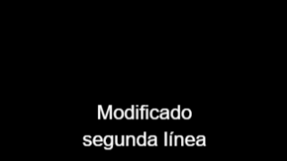
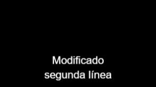

# QA independiente T07/T11 — intento 3

| Campo | Resultado |
|---|---|
| Fecha local de finalización | 2026-11-06, Europe/Madrid (CET) |
| Gate automático | **VERDE**, exit 0 |
| Aceptación del alcance | **ACEPTABLES LOCALMENTE T07/T11; cierre a decisión del orquestador** |
| Casos reales | 72/72 pasan; 0 fallos |
| Observación independiente | Privados/ventanas/selección 42/42; DEFAULT/CONTROL 24/24 |
| Integridad | 842 SHA directos, 0 cambios; unión39/76/7 comprobada |
| Sesión / PID |36509; helper 27628, Playwright 34356 |
| Raíz propia | `C:\laragon\www\metricool\storage\framework\testing\t43\run-general-7ed017ac-ba2c-4710-87e1-dc109e3846f3` |

## Veredicto determinista

```json
{
  "verdict": "VERDE",
  "counts": {
    "passed": 72,
    "failed": 0,
    "flaky": 0,
    "skipped": 0,
    "interrupted": 0
  },
  "flaky_sin_justificar": [],
  "flaky_justificados": {},
  "threshold": "verde ⟺ 0 failed, 0 flaky sin justificar, 0 interrumpidos y ≥1 test ejecutado"
}
```

Una única pasada de12 specs en desktop 1440×900, mobile 375×812 y mobile-360 360×740. Conteo obtenido del JSON original: {'desktop': 24, 'mobile': 24, 'mobile-360': 24}. Exit Playwright 0; duración 735.503s; errores de runner 0; resultados con retry>0: 0. No se reinició el proceso por timeout de observación ni se excluyeron resultados del gate. [JSON real](raw/results.json) · [checks adicionales](raw/extra-checks.json).

La aceptación local se basa conjuntamente en gate, medios nuevos, inspección visual e integridad. QA no cambia estados del ledger/spec/plan ni cierra el roadmap de23 tareas. T07/T11 entraron en progreso, con 6/23 completadas; root decide su cierre. VPS/R2/social real, T10/ONNX y otros requisitos externos no se aceptan por esta pasada.

## QA2-V01: verificación de legibilidad con DEFAULT y CONTROL

El Important de QA2 era reproducible: Arial 22 normal blanco, contorno negro 2 sobre negro dejaba las letras casi ilegibles. Root aisló el orden de pintura y cambió únicamente paintFirst a stroke en textos temporales de captions. No se cambiaron JSON de estilo, tamaños admitidos ni defaults globales de Fabric. A3/B3 sin gaps; C2/D1 preservadas, C/Ddelta3=false. Los dos focales históricos fallidos siguen siendo fallos de fixture/comparador; no se reetiquetan como PASS ni se atribuyen a QA3.

E2E23/24 actuales y la observación propia verifican el estilo por defecto, además de mantener la fixture privada con strokeWidth0. La serie nueva no tiene emoji:320×180, Arial 22 normal, texto «Modificado\nsegunda línea»,fill blanco,stroke negro 2(DEFAULT) y control stroke 0(CONTROL). Cue[0,25,1,25),FPS12. Se observan archivos PNG/MP4/GIF descargados de esta ejecución, sin crear otras exportaciones. PNG estático 0,5s; MP4/GIF frame 6 activo y frame 0 anterior,18 frames completos.

Métrica fijada antes de ejecutar: **min(R,G,B)>=200**, energía=sum(minRGB/255), umbrales inclusivos 16/64/128/199/200/201/240 y recuento de píxeles exactamente 200. Control PNG sin escala>1000 blancos; controles de codec>500; DEFAULT≥50% de blancos y energía del CONTROL. El frame anterior al cue exige 0 blancos. No se cambió comparador ni umbral según los resultados nuevos. La serie privada conserva su propio comparador>200 y sus 42 checks, sin mezclar definiciones.

| Viewport/formato | CONTROL blancos | DEFAULT blancos | Razón blancos | Razón energía | Antes cue DEFAULT |
|---|---|---|---|---|---|
| desktop/png | 1007 | 1007 | 1.000000 | 1.000000 | — |
| desktop/mp4 | 1004 | 1003 | 0.999004 | 0.999911 | 0 |
| desktop/gif | 1007 | 1007 | 1.000000 | 1.000000 | 0 |
| desktop/preview | 1007 | 1007 | 1.000000 | 1.000000 | — |
| mobile/png | 1007 | 1007 | 1.000000 | 1.000000 | — |
| mobile/mp4 | 1004 | 1003 | 0.999004 | 0.999911 | 0 |
| mobile/gif | 1007 | 1007 | 1.000000 | 1.000000 | 0 |
| mobile/preview | 809 | 798 | 0.986403 | 0.998676 | — |
| mobile-360/png | 1007 | 1007 | 1.000000 | 1.000000 | — |
| mobile-360/mp4 | 1004 | 1003 | 0.999004 | 0.999911 | 0 |
| mobile-360/gif | 1007 | 1007 | 1.000000 | 1.000000 | 0 |
| mobile-360/preview | 722 | 715 | 0.990305 | 1.001655 | — |

El preview se mide sobre el screenshot real, sin tomar el DTO del test como único oráculo. Se aísla una única ROI negra con aspecto 320:180,ancho 200–360,alto 100–205,desviación <0,03 y componente negra >85% de bbox. Una ROI ambigua/ausente falla. Se guardan coordenadas, dimensiones y SHA del original: [observaciones](raw/default-contrast/observations.json). HTML blanco y headers no satisfacen ese perfil. La razón se calcula bajo la misma escala CSS; el control físico exige >500 blancos y la calibración absoluta>1000 se contrasta en PNG 320×180 sin redimensionar.

### Preview375 nuevo: DEFAULT frente a CONTROL

| DEFAULT22/contorno2 | CONTROL22/contorno0 |
|---|---|
|  |  |

### Referencia histórica QA2, sin usarla como esperado


La referencia antigua incluye el emoji y pertenece a otro snapshot; se presenta para mostrar el defecto, no para fijar los umbrales de QA3 ni como comparación numérica del mismo documento. QA1 y QA2 conservan sus resultados originales. La decisión visual actual consta en [visual-review.json](raw/visual-review.json). No se afirma un ratioWCAG no medido.

## Medios, fuente privada y selección: conservar la aceptación previa

Las 42 comprobaciones independientes de QA2 se ejecutaron sobre nuevos archivos QA3, sin importar captions.js/captions-renderer.js ni sus asserts. Se decodifican MP4/GIF con ffprobe/FFmpeg, ZIP/XML y SHA; se rasterizan PNG/PDF reales y SVG portable con Chromium sin red. Se contrasta la WOFF2 embebida con la fuente privada validada y se comprueba su carga real. SRT/VTT preserva Unicode, dos líneas y tiempos desplazados 0,350–0,850/0,850–1,350.

Fixture privada 160×120/FPS12,«Hola»,cue [0,25,1,25) con transición0,5–1s. Columnas de blancos>200 corresponden a frames 0,2,3,4,9,14,15,17; se compara luminancia de máscara de glifos entre 4→9 y 4→14,ratio permitido 0,94–1,06. El fin exacto es exclusivo. No se infiere el número interno de llamadas de dibujo cuando dos operaciones producen los mismos píxeles.

| Viewport/formato | Frames | Blancos por índice | Razones de luminancia |
|---|---|---|---|
| desktop/mp4 | 18 | 0,0,181,181,181,181,0,0 | 1.000000/1.000000 |
| desktop/gif | 18 | 0,0,181,181,181,181,0,0 | 1.000000/1.000000 |
| mobile/mp4 | 18 | 0,0,181,181,181,181,0,0 | 1.000000/1.000000 |
| mobile/gif | 18 | 0,0,181,181,181,181,0,0 | 1.000000/1.000000 |
| mobile-360/mp4 | 18 | 0,0,181,181,181,181,0,0 | 1.000000/1.000000 |
| mobile-360/gif | 18 | 0,0,181,181,181,181,0,0 | 1.000000/1.000000 |

Selección fuente: A 2 s/fade 0,5s con cue AA 1,8–1,95; cue CCCCCCCC en C 3,8–4 global. A sola conserva la ventana completa, C→A remapea las dos fuentes y A→C cambia propiedad en el midpoint de salida sin duplicar la cue. Los índices esperados se deducen de ese contrato, sin llamar al compilador del producto.

| Viewport/selección | Frames reales | Blancos por frame observado |
|---|---|---|
| desktop/a | 60 | {0: 0, 53: 0, 54: 139, 55: 139, 58: 139, 59: 0} |
| desktop/c-a | 120 | {0: 0, 8: 0, 9: 466, 10: 466, 14: 466, 15: 0, 113: 0, 114: 139, 115: 139, 117: 139, 118: 139, 119: 0} |
| desktop/a-c | 105 | {0: 0, 50: 0, 52: 0, 53: 0, 54: 464, 55: 469, 56: 468, 59: 465, 60: 0, 104: 0} |
| mobile/a | 60 | {0: 0, 53: 0, 54: 139, 55: 139, 58: 139, 59: 0} |
| mobile/c-a | 120 | {0: 0, 8: 0, 9: 466, 10: 466, 14: 466, 15: 0, 113: 0, 114: 139, 115: 139, 117: 139, 118: 139, 119: 0} |
| mobile/a-c | 105 | {0: 0, 50: 0, 52: 0, 53: 0, 54: 464, 55: 469, 56: 468, 59: 465, 60: 0, 104: 0} |
| mobile-360/a | 60 | {0: 0, 53: 0, 54: 139, 55: 139, 58: 139, 59: 0} |
| mobile-360/c-a | 120 | {0: 0, 8: 0, 9: 466, 10: 466, 14: 466, 15: 0, 113: 0, 114: 139, 115: 139, 117: 139, 118: 139, 119: 0} |
| mobile-360/a-c | 105 | {0: 0, 50: 0, 52: 0, 53: 0, 54: 464, 55: 469, 56: 468, 59: 465, 60: 0, 104: 0} |

Detalle: [42checks](raw/caption-independent-checks.json), [24checks DEFAULT/CONTROL](raw/default-contrast/checks.json), [frames/probes](raw/caption-independent/observations.json), [estáticos](raw/caption-static-observations.json), [SVG rasterizado](raw/svg-independent-pixel-observations.json), [SRT/VTT](raw/caption-text-observations.json). Los archivos y PNG decodificados están en samples/ y raw/. La métrica numérica se complementa con inspección de imágenes actuales legibles.

## Compuesto audiovisual y flujos conservados

Se vuelve a decodificar la descarga de E2E21: MP4 H264100×80,42 frames/3,5 s,AAC 48 k estéreo; GIF50×40,42 frames/3,5 s sin pista de audio. Se comprueban overlays/fade/movimiento, revisión 1 frente a edición actual 2 y borrador con brand_id/media_ids exactos. La mezcla 440/880 mantiene rampas, recorte/loop, música tras terminar el vídeo y cola silenciosa en ambos canales. El recálculo Python del PCM no importa el helper JS de test.

| Viewport | 440 L/R | 880 L/R | Ataque L/R | Salida L/R | Cola RMS L/R |
|---|---|---|---|---|---|
| desktop | 0.049847/0.049847 | 0.049994/0.049994 | 0.019968/0.019968 | 0.019963/0.019963 | 0.000000/0.000000 |
| mobile | 0.049847/0.049847 | 0.049994/0.049994 | 0.019968/0.019968 | 0.019963/0.019963 | 0.000000/0.000000 |
| mobile-360 | 0.049847/0.049847 | 0.049994/0.049994 | 0.019968/0.019968 | 0.019963/0.019963 | 0.000000/0.000000 |

No se confunden esos tonos sintéticos con aceptación musical humana. Las mediciones completas incluyen marcador 1760 fuera del trim y diferencia L/R en [composite-audit.json](raw/composite-audit.json). Los recorridos de timeline/audio, estáticos multipágina, conflicto, plantillas, métricas y marca se mantienen en los12 specs actuales.

## Integridad, guardrails y memoria OS

URL http://localhost:8080 validada por guardrail oficial y puerto libre al arrancar. Runtime local con SQLite/storage/usuarios UUID propios y `reuseExistingServer:false`; no servidor ni Node ajeno. Inicio 2026-11-05T22:53:46.125165+00:00; fin 2026-11-05T23:06:02.010938+00:00. No se leyó .env para este servidor ni se usó MySQL, VPS, ONNX/imaging/test_background, bucket real o publicación social.

Snapshot directo 842 rutas antes/después con 0 cambios: código/UI/renderer/fuentes/fixtures, API, guías/README/móduloMCP/deploy/document-contract, matriz, contratos, ledger/test-plan, `.mjs`/`.d.mts` y public/build. Las cuatro rutas adicionales de QA2 se integran ahora directamente desde la unión revisada. T12 estuvo congelada y no se excluyó. [SHA antes](raw/sources-before.json) · [después](raw/sources-after.json). La unión 39 fuentes +76 generados +7 descriptores nueva coincide antes y después, sin usar legacy freeze ni ajustar el esperado posterior: [pre](raw/freeze-input-check.json), [post](raw/freeze-output-check.json).

JobObject del runner/hijos: límite 3221225472B de **COMMIT agregado**, kill-on-close=True, breakaway=False, pico 1240743936B. Observador posterior: límite 3221225472B,pico 892448768B. Cada árbol está protegido por 3 GiB; **no es RSS ni reserva previa**. PDF usa también el wrapper protegido y conserva su registro en raw/observer-memory-render-pdf.json. No se induce OOM. Linux cgroup previo con Python no acredita multimedia Linux/VPS.

## Cobertura y resultado por escenario

Ledger-lint exit0:0 incoherencias/16 avisos Changelog. Coverage-check exit0: 0 referencias rotas y 0 tests sin referencia; ningún GWT huérfano. T07/T11 están mapeadas. Tareas sin mapeo fuera de este alcance: **T-01, T-02, T-12, T-13, T-14, T-15, T-16, T-17, T-18, T-19, T-20**; no tienen exención ni aceptación global. T10/E2E09–10 no ejecutados por la restricción ONNX/memoria. Sin bloques API-xx/A11Y-xx ni mínimo unitario configurado, no se inventa cobertura de código ni auditoría axe. [gates.json](raw/gates.json).

| Archivo/caso | Desktop | Mobile375 | Mobile360 |
|---|---|---|---|
| all-brands.spec.ts — E2E-04 · Todas las marcas: totales, tabla por marca, gráfica y cambio de periodo | PASA | PASA | PASA |
| brand-reporting.spec.ts — Ads and reports retain the selected brand across navigation and report creation | PASA | PASA | PASA |
| metrics-quality.spec.ts — Metrics: zero activity retains partial coverage, stale dates and suppressed unequal comparison | PASA | PASA | PASA |
| studio-audio-editor.spec.ts — Studio audio editor: upload, add, trim, split, undo, play, persist and reopen a private brand track | PASA | PASA | PASA |
| studio-audio-editor.spec.ts — Studio audio editor: decimal page duration uses document bounds rather than rounded frame bounds | PASA | PASA | PASA |
| studio-audio-resources.spec.ts — Studio audio resources API: private binary upload, byte ranges and native browser playback | PASA | PASA | PASA |
| studio-automation.spec.ts — Studio automation: own template substitutes literal fields in an independent branded design and exports | PASA | PASA | PASA |
| studio-automation.spec.ts — Studio automation: brand styles, proportional resize and independent variants persist and export | PASA | PASA | PASA |
| studio-av-composite.spec.ts — Studio composite export: public uploads and revision preserve moving video overlays transition and measured two-tone audio through download and draft | PASA | PASA | PASA |
| studio-captions.spec.ts — Captions UI: import edit style offset delete undo reopen and download SRT VTT with clear file errors | PASA | PASA | PASA |
| studio-captions.spec.ts — Captions render: private font pinned MP4 GIF and SVG retain opaque cues across page fade | PASA | PASA | PASA |
| studio-captions.spec.ts — Captions access: revision pinned API MCP abilities ownership and optimistic conflicts | PASA | PASA | PASA |
| studio-frame-export.spec.ts — Studio frame export: choose a local page time, export real pixels and retain it with the private brand output | PASA | PASA | PASA |
| studio-native-export.spec.ts — Studio native export: order pages, resume history, cancel retry and download real MP4 GIF before a brand draft | PASA | PASA | PASA |
| studio-native-export.spec.ts — Studio native history: paginate real exports in one request per page and reopen without creating work | PASA | PASA | PASA |
| studio-timeline.spec.ts — Timeline: edit windows, split, persist and run a common playhead without changing the document | PASA | PASA | PASA |
| studio-timeline.spec.ts — Timeline: an uploaded real video with an open source end can be split and previewed | PASA | PASA | PASA |
| studio-timeline.spec.ts — Timeline: splitting the second page uses local clip time and survives undo and redo | PASA | PASA | PASA |
| studio-timeline.spec.ts — Timeline: buffering never consumes a short clip before playback starts | PASA | PASA | PASA |
| studio-timeline.spec.ts — Timeline: closing while media buffers cancels the pending playback | PASA | PASA | PASA |
| studio.spec.ts — fractional exports round to 21 pixels and register PNG JPEG WebP in the brand library | PASA | PASA | PASA |
| studio.spec.ts — design persists, exports real PNG and starts a publication in its brand | PASA | PASA | PASA |
| studio.spec.ts — undo, page ordering and portable JPEG/WebP/SVG/PDF exports retain the design | PASA | PASA | PASA |
| studio.spec.ts — a stale revision preserves local edits and can recover the server version | PASA | PASA | PASA |

## Manuales y decisión de cierre

- [ ] **M01 — Usuario:** scheduler/worker/heartbeat y muestras de VPS; no se solicita SSH de nuevo.
- [ ] **M02 — Usuario:** smokes Bluesky/Threads y publicación real por red; resultados aún no comunicados.
- [ ] **M03 — Desarrollo + usuario:** renderer Node/Chromium/fuentes/colas y R2 reales del servidor; multimedia Linux/políticas OS efectivas.
- [ ] **M04 — Usuario:** Claude Desktop aplazado; no se reabre autorización.
- [ ] Revisión audiovisual humana de los medios descargados.

ASR/traducción sigue en T14 y Claude CLI final después de TODO el roadmap. No se declara paridad Metricool/Canva ni aceptación de las23 tareas. No commits, Jira/Confluence, knowledge ni handoff documenter por QA. Root recibe el resultado local y decide estados T07/T11 sin cerrar por ello plan/spec globales.

## Artefactos

[Manifiesto](manifest.json) · [Ejecución/PID/pico ](raw/execution.json) · [JSON original](raw/results.json) · [stdout](raw/playwright.stdout.txt) · [stderr](raw/playwright.stderr.txt). PDF mediante CommonMark → HTML/tema de to-pdf → Chromium ya instalado; rasterización del PDF real con PyMuPDF e inspección de sus páginas, sin instalaciones. La revisión visual y los recortes documentados no alteran los PNG originales.
