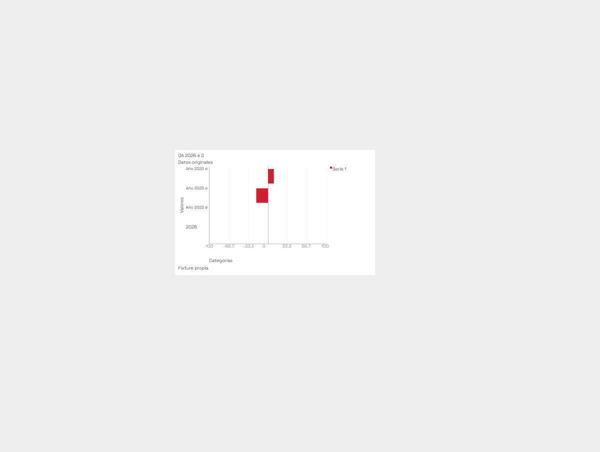
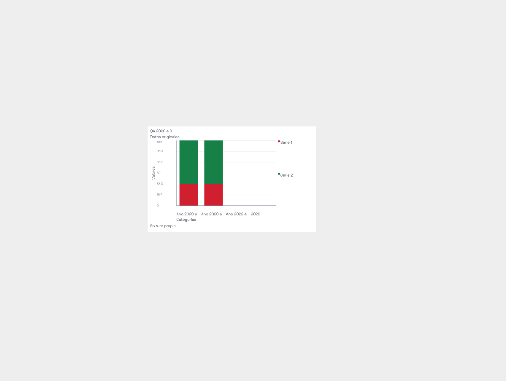
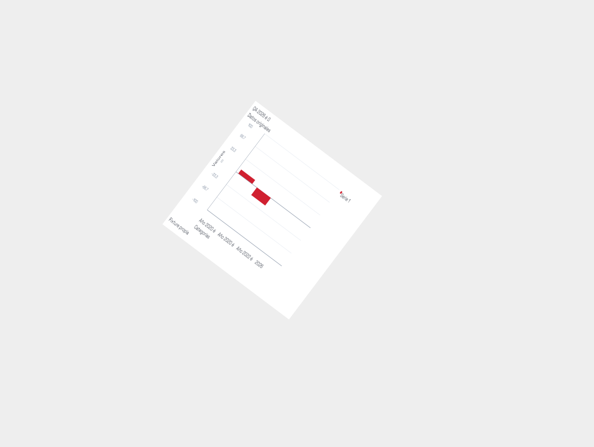
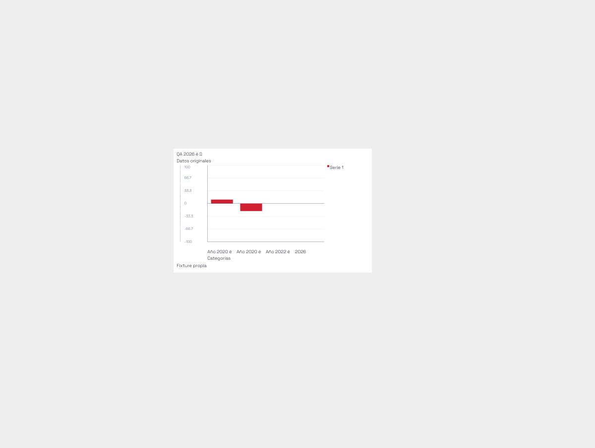
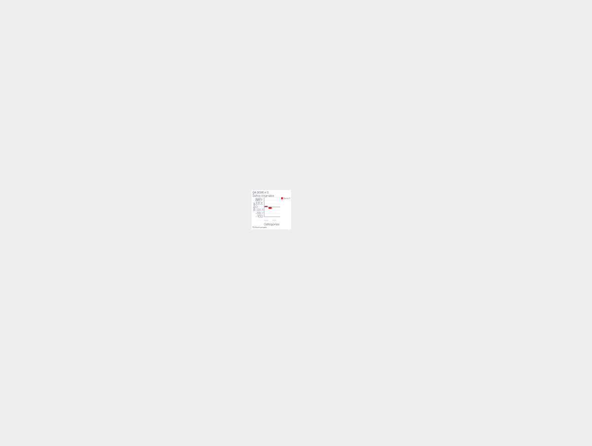

# T12: título vertical, verificación nativa focal

**6/6 casos superan los criterios del título.** Renderer, escena y Fabric reales, fuente TTF local original cargada con FontFace. Un bundle privado de Vite usa las mismas fuentes verificadas de build7; no modifica public/build. La tabla y escena se validan antes de llegar al renderer. No son resultados de un mock ni del diagnóstico histórico anterior.

| Caso | Fuente efectiva en escena(px) | Píxeles de tinta | Fuera de caja | Solapamiento título/otro texto |
|---|---:|---:|---:|---:|
| column | 18.000000 | 396 | 0 | 0 |
| bar | 18.000000 | 396 | 0 | 0 |
| proportional | 18.000000 | 396 | 0 | 0 |
| root-transform | 18.000335 | 585 | 0 | 0 |
| long-private-font | 2.892600 | 937 | 0 | 0 |
| tiny160 | 9.855001 | 183 | 0 | 0 |

Columna, barra, proporcional y transformación raíz conservan18px en la escena,−90° local y ajuste uniforme. La transformación raíz37°/escala0,8×1,25 compone su matriz; se retira para medir el tamaño local. SVGgetBBox se guarda como envelope de layout, separado de la tinta real de Canvas2D. La máscara alfa del título no se recorta a su caja: cada píxel se transforma por la inversa raíz y se contrasta con la caja semántica. Tolerancia de cuantización de un píxel raster diagonal:1,414px de escena en identidad,1,484px en raíz transformada. No hay píxeles en el borde del canvas2400×1800, ni solapamiento con otros textos para alfa>16. Las seis SVG contienen el mismo TTF SHAacad6de1…fbd79f72 y se inspeccionaron sus grupos/matrices/textos.

El título largo se ajusta a2,8926px y el de160×160a9,855px. Estos dos casos prueban contención y escala finita, no legibilidad mínima universal. La captura pequeña muestra ticks apretados: este resultado no acepta la legibilidad completa del gráfico pequeño ni todos los pares de etiquetas. Los diez hashes previos de geometría ajena al título se conservan en la evidencia de implementación; la comparación escena/renderer del probe es de consistencia y no sustituye esos hashes independientes.

## Recursos, privacidad y cierre

JobWindows3GiB COMMIT agregado, preflight6GiB/piso3GiB cada100ms,Node512,deadlineinterno90s yexterno120s para bundle+Chromium. Duración1.6619493s,picoCOMMIT704012288B,mínimofísico8528797696B. PID38580/27580muertos,owned[]/8080IPv4+IPv6libres. 159SHA actuales sin deriva al publicar. Config ViteconfigFile:false/publicDir:false/write:false/envDirprivado vacío, sinLaravelplugin ni.env. EntornoOS filtrado antes de Vite; navegador bloquea red, sin servidor/PHP/DB/proveedor/modelo/PDF.

Antes del nativo se corrigieron fixtures: category2026 requiere datasetNumber, y el descriptor público fontWeight admite normal/bold; el registry del recurso privado aporta300. El control puro de entrada exacta confirma6/6alcanzanrenderer y el control inválido0/6. Esos controles no cuentan como casos nativos. Fuentes anteriores/errores editoriales Unicode se conservaron privadamente y se repinaron antes de ejecutar.

## Alcance

Aceptación focal de orientación, fuente y tinta del título con este TTF y seis fixtures. No prueba carga por marca/API, conversiónwoff, exports.js, descargasHTTP, PDF, otras tipografías ni el roadmap. T12 sigue abierta; gráficas densas y exportaciones de los bundles actualizados continúan pendientes. Root inspeccionó12PNG y la estructura/fontTTF de6SVG. Los originales completos están junto al informe.

## Capturas

### column

[PNG original](column.png) · [SVG original](column.svg)

### bar

[PNG original](bar.png) · [SVG original](bar.svg)

### proportional

[PNG original](proportional.png) · [SVG original](proportional.svg)

### root-transform

[PNG original](root-transform.png) · [SVG original](root-transform.svg)

### long-private-font

[PNG original](long-private-font.png) · [SVG original](long-private-font.svg)

### tiny160

[PNG original](tiny160.png) · [SVG original](tiny160.svg)

