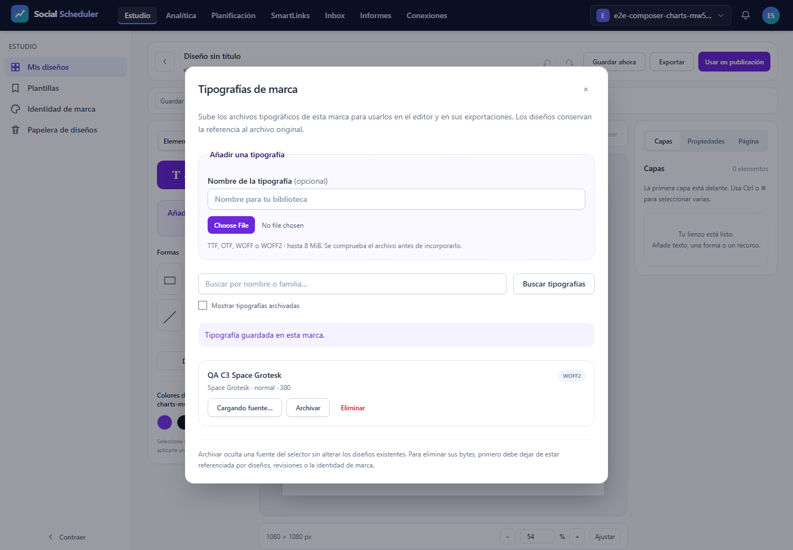

# T12 C3charts — QA local

Resultado automático de esta ejecución: **NO-PASS**. Casos realmente ejecutados: **1 de 12 previstos**. Inspección de figuras/PDF: **pendiente**, nunca inferida por colección, render o hash. No se cierra T12 ni el plan.

## Ejecución y límites

Cuatro escenarios × 375/768/1440, un worker, cero reintentos y fail-fast1. Las ramas no alcanzadas no quedan acreditadas. SQLite, almacenamiento, cachés, rutas y usuarios ficticios aislados antes de Kernel; proof de rutas antes de usuarios. Sólo loopback. InterCSS externo tiene fixture vacía exacta; ninguna otra red externa está autorizada. Fuentes privadas SpaceGrotesk TTF y WOFF2 reales por UI de marca.

Job agregado COMMIT3GiB, killOnClose y sin breakaway; default del worker av-runtime3GiB intacto. Preflight físico6GiB anterior al UUID/servidor, piso3GiB cada100ms y plazo900s; capacidad desconocida o bajo presupuesto produce REFUSED. PHP CLI/servidor256M, Node512M. No se confunden COMMIT, RSS y memoria PHP; no se anuncia estrés52MB. Cualquier aborto invalida un verde anterior. PDF del informe en Job separado después del cierre real de procesos y puerto8080 IPv4/IPv6.

## Resultados reales

| Proyecto | Escenario | Outcome |
|---|---|---|
| desktop | E2E28.01 ten real variants pinned saved dataset controls shared preview save reopen undo SVG PNG private font | unexpected |
| desktop | E2E28.02 server static SVG PNG PDF pinned archived historical selected pages actor brand boundary | skipped |
| desktop | E2E28.03 invalid precision negative proportions cancel original typed table keyboard Inspector focus accessibility | skipped |
| desktop | E2E28.04 real 1000 rows twelve series twelve thousand bars shared SVG PNG semantic independent oracle guarded | skipped |
| mobile | E2E28.01 ten real variants pinned saved dataset controls shared preview save reopen undo SVG PNG private font | skipped |
| mobile | E2E28.02 server static SVG PNG PDF pinned archived historical selected pages actor brand boundary | skipped |
| mobile | E2E28.03 invalid precision negative proportions cancel original typed table keyboard Inspector focus accessibility | skipped |
| mobile | E2E28.04 real 1000 rows twelve series twelve thousand bars shared SVG PNG semantic independent oracle guarded | skipped |
| mobile-360 | E2E28.01 ten real variants pinned saved dataset controls shared preview save reopen undo SVG PNG private font | skipped |
| mobile-360 | E2E28.02 server static SVG PNG PDF pinned archived historical selected pages actor brand boundary | skipped |
| mobile-360 | E2E28.03 invalid precision negative proportions cancel original typed table keyboard Inspector focus accessibility | skipped |
| mobile-360 | E2E28.04 real 1000 rows twelve series twelve thousand bars shared SVG PNG semantic independent oracle guarded | skipped |

## qa-gate literal

```json
{
  "verdict": "NO-VERDE",
  "reason": "el runner reportó errores de ejecución",
  "errors": [
    "\u001b[31mTesting stopped early after 1 maximum allowed failures.\u001b[39m"
  ]
}
```

El recount exige 12 resultados sin skip/flaky/retry y todos los observadores, axe, red, materialización, deriva y cierre de procesos. El gate aislado no sustituye esa evidencia.

## Observadores y alcance

XML y matrices SVG se leen con DOM nativo y un segundo parser independiente stdlib. IDs de barras, línea cero, categorías/series, colores y signos/null/cero/apilado/proporciones se contrastan con álgebra de fixtures propias, sin importar escena/geometría/renderer del producto. Tolerancia de coordenadas0,75px contempla el centro de ejes de1px; escala de amplitud0,012. PNG valida firma/CRC/filtros y píxeles/longitudes frente a SVG+fixture. Barras subpixel de la tanda12.000 se cuentan individualmente en SVG; PNG se contrasta además con cobertura fraccional/source-over independiente, error medio≤6/p95≤18 y centros de ejes/rejilla±2px excluidos. No se afirman12.000 píxeles separables.

El preview real se compara con el recorte correspondiente del PNG final: error RGB máximo4 y medio0,25. Glifos privados se contrastan después de exportar con Canvas2D cargado desde TTF original bajo otra familia eliminada al terminar: IoU≥0,80 y margen≥0,03 frente a Arial. SVG debe contener los bytes WOFF2 cuyo SHA/tamaño se observaron por HTTP200/MIME real. Los umbrales anteriores son criterios fijados antes de ejecutar, no resultados asumidos.

PDF del diseño es raster: una página y un XObject RGB realmente dibujado a tamaño correcto. Su RGB debe coincidir píxel a píxel con el PNG entregado, donde se verifican los glifos; no se presenta como texto extraíble/vectorial. La entrada real de Node y sus archivos materializados se observan pasivamente, sin reescritura: referencias seleccionadas, revisión antigua archivada y SHA original. Cancelación retiene una respuesta PHP200 real y conserva sus bytes; cierre del cliente y ausencia de aplicación tardía son aserciones explícitas.

Descargas reales guardan bytes, SHA y URL privada; las URLs publicables se reducen a ruta. Las cabeceras nativas se observan en el frontend propio; los Blob del cliente declaran que sus cabeceras no son observables, sin GET adicional. Errores HTTP sólo admiten método/ruta/status predeclarados y afirmados, y abortos exactos confirmados. Axe exige cero violaciones e incomplete, sin exclusiones.

## Checklist manual pendiente

- [ ] Root inspecciona cada figura y cada página del PDF y registra su SHA actual en visual-inspection.json.
- [ ] Persona confirma legibilidad/densidad y calidad de diseño en375/768/1440 con sus datos reales.
- [ ] Otras22configuraciones, AV, Linux/VPS/R2 y datos52MB necesitan fases/pruebas propias; esta tanda no los acredita.

## Evidencias visuales


## Primer fallo observado

Un caso falló y once no se ejecutaron. Se alcanzó la subida de tipografía (POST201 y metadata ready/woff2), antes de crear un gráfico. La captura muestra «Cargando fuente…» cuando la prueba exige inmediatamente una FontFace cargada después del clic; el código de preview espera una operación asíncrona. Esto sustenta una carrera del harness y requiere esperar el estado real, sin relajar la comprobación ni cambiar la aplicación. No hay aceptación de gráficos, fuentes, exportaciones o accesibilidad en esta pasada.

El cierre real quedó probado: cero PIDs propios vivos y8080 IPv4/IPv6 libres. Guard core22,843s/COMMIT674.881.536B; mínimo físico10.038.841.344B. Guard finalize separado0,110s/32.055.296B, sin fallo. No confundir con RSS. Las295fuentes verificadas al terminar permanecieron intactas.

El reportador congelado no admite el estado finalization_failed introducido por su controlador. Root generó este informe con un adaptador externo exclusivo de intentos fallidos: exige core_exit_code yexit_code no cero, recount NO-PASS, proceso muerto ypuerto libre. No altera resultados, fuentes del harness ni métricas core; esta incompatibilidad se corregirá antes del siguiente intento. PDF generado bajo el guard separado original.


