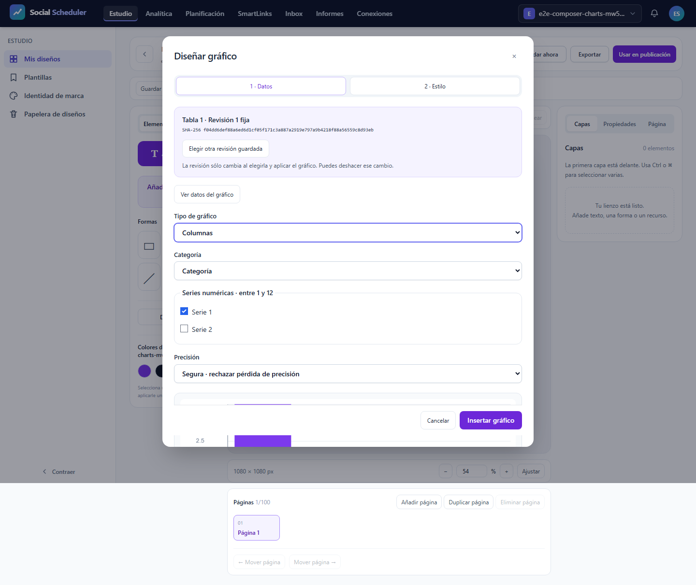
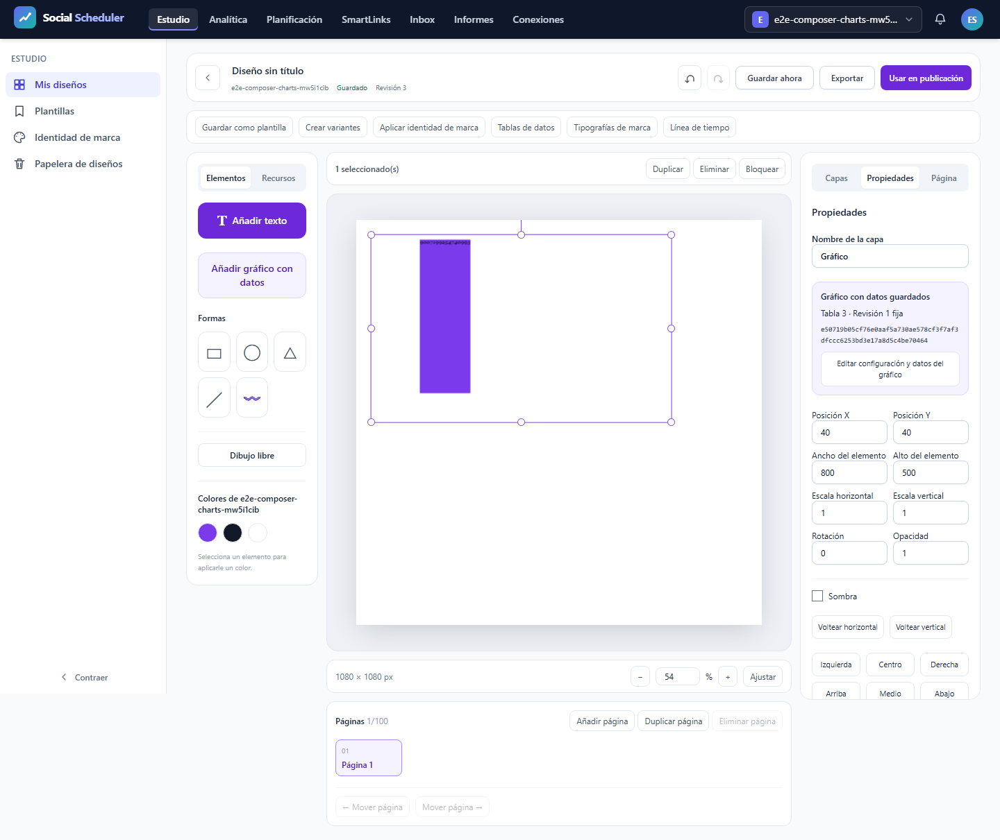
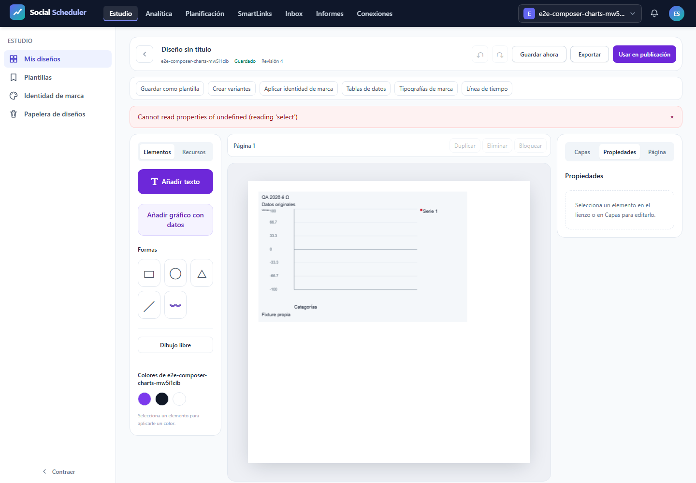

# T12: consumidor local, errores y accesibilidad

**NO-PASS**. Casos realmente ejecutados: 1/3; registros del JSON original: 3, incluidos los no ejecutados. E2E28.03 previsto íntegro a375/768/1440px, un worker, cero reintentos y fail-fast1. T12 sigue abierta. La revisión de figuras/PDF no sustituye el resultado automático.

## Contrato y comprobaciones

El consumidor cancela su espera al cerrar el modal; el transporte compartido continúa y puede llenar la caché. La prueba exige modal cerrado, foco restaurado y documento vacío antes de liberar la respuesta. Después verifica el cuerpo original del mismo GET/export?format=json&revision=1, finished,200,MIME,bytes ySHA, y de nuevo cierre/foco/documento/capas vacíos. Reabre la misma tabla, comprueba preview y ocho celdas tipadas originales sin segundo GET. No hay GET auxiliar ni éxito HTTP simulado. El aborto físico por registry.dispose tiene diagnóstico independiente; no se atribuye al cierre de UI.

Además exige tabla DOM original, negativos bloqueados, precisión safe/approximate, estilo e Inspector, teclado/foco y revisión histórica vacíaB4. El grupo completo requiere9recibos axe sin violations/incomplete,9capturas,3recibos de foco/hold/B4/viewports,6eventos pasivos capture/release con cancelled_delivery=false/deadline_release=false, red sin issues/expected_http/abortos y font-responses vacío. El contador independiente contrasta bytes/query/UI/caché/cleanup y rechaza faltantes, sobrantes o incoherencias. Los pasos no alcanzados permanecen pendientes.

## Recursos y cierre

Runtime ficticio aislado y loopback, sin .env/DB/proveedor real. Build5 actual62inputs/77assets. Job3GiB COMMIT agregado, preflight físico6GiB, piso3GiB cada100ms, PHP256MiB/Node512MiB;900s incluyendo cierre. Núcleo 259.782s, pico COMMIT 707796992B, mínimo físico 8789098496B; fallo de recursos None. Plazo global 259.95507929997984s. Clausura registrada por separado; procesos propios cerrados y8080IPv4/IPv6libres. PDF posterior en Job separado. 494fuentes verificadas antes/después y trasPDF.

## Resultado y alcance pendiente

```text
desktop: Test timeout of 240000ms exceeded.
```

```text
desktop: Error: locator.click: Test timeout of 240000ms exceeded.
Call log:
  - waiting for getByRole('button', { name: 'Editar configuración y datos del gráfico', exact: true })


   at support\studio-chart-ui.ts:28

  26 | export async function dataset(page:Page,brand:number,table:any,name='Analítica é 2026'){const result=await web(page,'POST',`/brands/${brand}/studio/datasets`,{name,table});expect(result.status).toBe(201);return JSON.parse(result.text).dataset;}
  27 | export async function choose(page:Page,id:number){await page.getByRole('button',{name:'Tablas de datos',exact:true}).click();const d=datasetsDialog(page);await d.getByTestId(`dataset-open-${id}`).click();const select=d.getByRole('button',{name:'Usar revisión guardada para gráfico',exact:true});await expect(select).toBeEnabled();await select.click();await expect(chartDialog(page)).toBeVisible();}
> 28 | export async function edit(page:Page){await page.getByRole('button',{name:'Propiedades',exact:true}).click();await page.getByRole('button',{name:'Editar configuración y datos del gráfico',exact:true}).click();await expect(chartDialog(page)).toBeVisible();}
     |                                                                                                                                                                                                          ^
  29 | export async function configure(page:Page,kind:string,series:string[],font?:any){const d=chartDialog(page);await expect(d.getByRole('button',{name:/^(Insertar|Aplicar) gráfico$/})).toBeEnabled();const tableReads:string[]=[];const observer=(request:any)=>{if(request.method()==='GET'&&/^\/brands\/\d+\/studio\/datasets\/\d+\/table$/.test(new URL(request.url()).pathname))tableReads.push(new URL(request.url()).pathname);};page.on('request',observer);await d.getByRole('button',{name:'1 · Datos',exact:true}).click();await chartSelect(d,'Tipo de gráfico').selectOption(kind);await chartSelect(d,'Categoría').selectOption('category');for(const [index] of series.entries())await d.getByLabel(`Serie ${index+1}`,{exact:true}).setChecked(true);await d.getByRole('button',{name:'2 · Estilo',exact:true}).click();for(const [label,value] of Object.entries({'Título':'QA 2026 é Ω','Subtítulo':'Datos originales','Fuente de datos':'Fixture propia','Título del eje X':'Categorías','Título del eje Y':'Valores','Paleta propia · hex separados por comas':fixtures.pal
```

Los errores1/2/3 y las matrices anteriores permanecen inmutables. Este resultado no acredita exportaciones SVG/PNG/PDF, fuente privada, densidad, otras variantes/familias, AV ni el roadmap completo. Servidor tiene informe independiente; no se mezclan JSON para inventar una matriz completa. TítuloY pequeño, otras funciones T12, resto del roadmap y auditoría final ClaudeCLI pendientes.

## Evidencias visuales

### images/1440-errors-table-modal.png



### images/1440-inspector.png



### images/1440-test-failed-1.png



