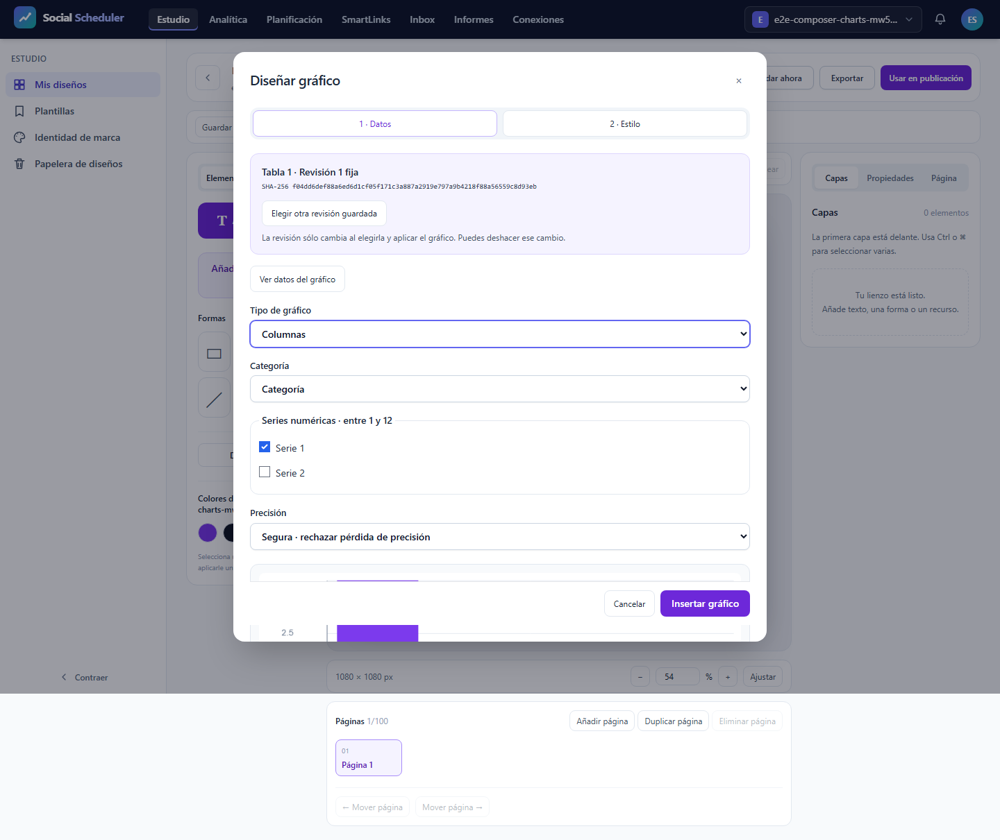
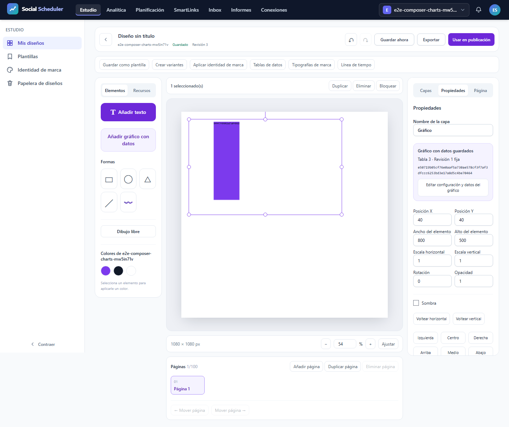
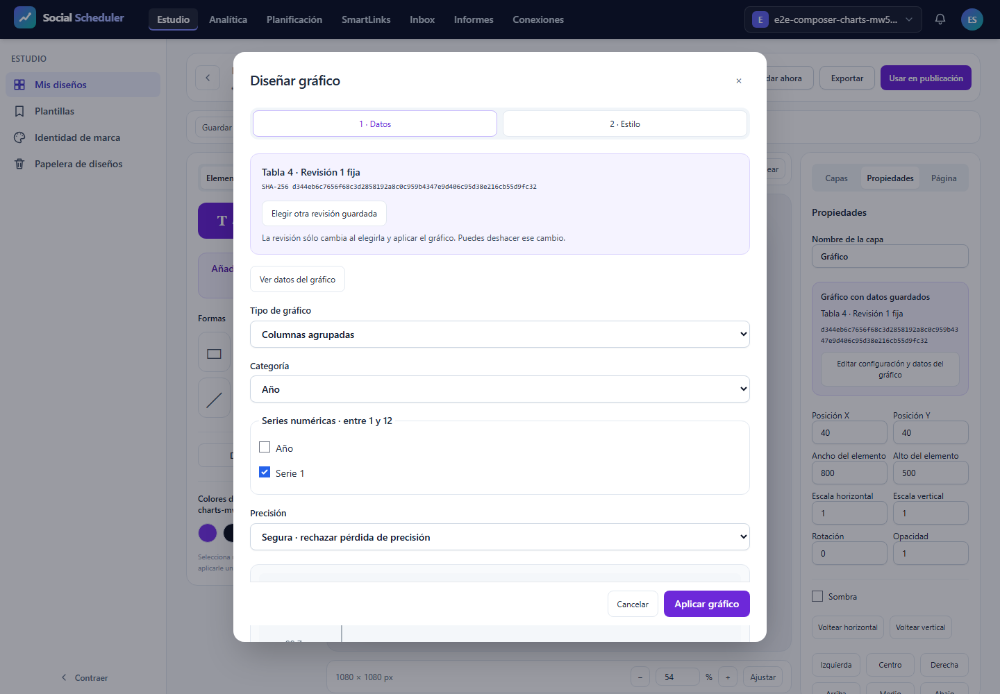

# T12: consumidor local, errores y accesibilidad

**NO-PASS**. Casos realmente ejecutados: 1/3; registros del JSON original: 3, incluidos los no ejecutados. E2E28.03 previsto íntegro a375/768/1440px, un worker, cero reintentos y fail-fast1. T12 sigue abierta. La revisión de figuras/PDF no sustituye el resultado automático.

## Contrato y comprobaciones

El consumidor cancela su espera al cerrar el modal; el transporte compartido continúa y puede llenar la caché. La prueba exige modal cerrado, foco restaurado y documento vacío antes de liberar la respuesta. Después verifica el cuerpo original del mismo GET/export?format=json&revision=1, finished,200,MIME,bytes ySHA, y de nuevo cierre/foco/documento/capas vacíos. Reabre la misma tabla, comprueba preview y ocho celdas tipadas originales sin segundo GET. No hay GET auxiliar ni éxito HTTP simulado. El aborto físico por registry.dispose tiene diagnóstico independiente; no se atribuye al cierre de UI.

Además exige tabla DOM original, negativos bloqueados, precisión safe/approximate, estilo e Inspector, teclado/foco y revisión histórica vacíaB4. El grupo completo requiere9recibos axe sin violations/incomplete,9capturas,3recibos de foco/hold/B4/viewports,6eventos pasivos capture/release con cancelled_delivery=false/deadline_release=false, red sin issues/expected_http/abortos y font-responses vacío. El contador independiente contrasta bytes/query/UI/caché/cleanup y rechaza faltantes, sobrantes o incoherencias. Los pasos no alcanzados permanecen pendientes.

## Recursos y cierre

Runtime ficticio aislado y loopback, sin .env/DB/proveedor real. Build6 actual62inputs/77assets. Job3GiB COMMIT agregado, preflight físico6GiB, piso3GiB cada100ms, PHP256MiB/Node512MiB;900s incluyendo cierre. Núcleo 31.340s, pico COMMIT 760582144B, mínimo físico 7117832192B; fallo de recursos None. Plazo global 31.519682799989823s. Clausura registrada por separado; procesos propios cerrados y8080IPv4/IPv6libres. PDF posterior en Job separado. 567fuentes verificadas antes/después y trasPDF.

## Resultado y alcance pendiente

```text
desktop: Error: expect(received).toEqual(expected) // deep equality

- Expected  -  1
+ Received  + 49

- Array []
+ Array [
+   Object {
+     "description": "Ensure that <th> elements and elements with role=columnheader/rowheader have data cells they describe",
+     "help": "Table headers in a data table must refer to data cells",
+     "helpUrl": "https://dequeuniversity.com/rules/axe/4.10/th-has-data-cells?application=playwright",
+     "id": "th-has-data-cells",
+     "impact": "serious",
+     "nodes": Array [
+       Object {
+         "all": Array [
+           Object {
+             "data": null,
+             "id": "th-has-data-cells",
+             "impact": "serious",
+             "message": "Table data cells are missing or empty",
+             "relatedNodes": Array [
+               Object {
+                 "html": "<th data-v-a61ea03b=\"\" scope=\"col\" class=\"p-2\">Serie 1</th>",
+                 "target": Array [
+                   "th:nth-child(3)",
+                 ],
+               },
+             ],
+           },
+         ],
+         "any": Array [],
+         "failureSummary": "Fix all of the following:
+   Table data cells are missing or empty",
+         "html": "<table data-v-a61ea03b=\"\" class=\"w-full text-left text-xs\">",
+         "impact": "serious",
+         "none": Array [],
+         "target": Array [
+           "table",
+         ],
+       },
+     ],
+     "tags": Array [
+       "cat.tables",
+       "wcag2a",
+       "wcag131",
+       "section508",
+       "section508.22.g",
+       "TTv5",
+       "TT14.b",
+       "EN-301-549",
+       "EN-9.1.3.1",
+     ],
+   },
+ ]

   at support\studio-chart-ui.ts:32

  30 | export async function apply(page:Page){await chartDialog(page).getByRole('button',{name:/^(Insertar|Aplicar) gráfico$/}).click();await expect(chartDialog(page)).not.toBeVisible();await save(page);}
  31 | export async function capture(page:Page,info:TestInfo,name:string){await expectNoOverflow(page);await page.screenshot({path:info.outputPath(name),fullPage:true});}
> 32 | export async function audit(page:Page,info:TestInfo,name:string,selector:string){const report=await new AxeBuilder({page}).include(selector).analyze();fs.writeFileSync(info.outputPath(`axe-${name}.json`),JSON.stringify(report,null,2));expect(report.violations).toEqual([]);expect(report.incomplete).toEqual([]);}
     |               
```

Los errores1/2/3, consumer1 y las matrices anteriores permanecen inmutables. Este resultado no acredita exportaciones SVG/PNG/PDF, fuente privada, densidad, otras variantes/familias, AV ni el roadmap completo. Servidor tiene informe independiente; no se mezclan JSON para inventar una matriz completa. TítuloY pequeño, otras funciones T12, resto del roadmap y auditoría final ClaudeCLI pendientes.

## Evidencias visuales

### images/1440-errors-table-modal.png



### images/1440-inspector.png



### images/1440-test-failed-1.png



