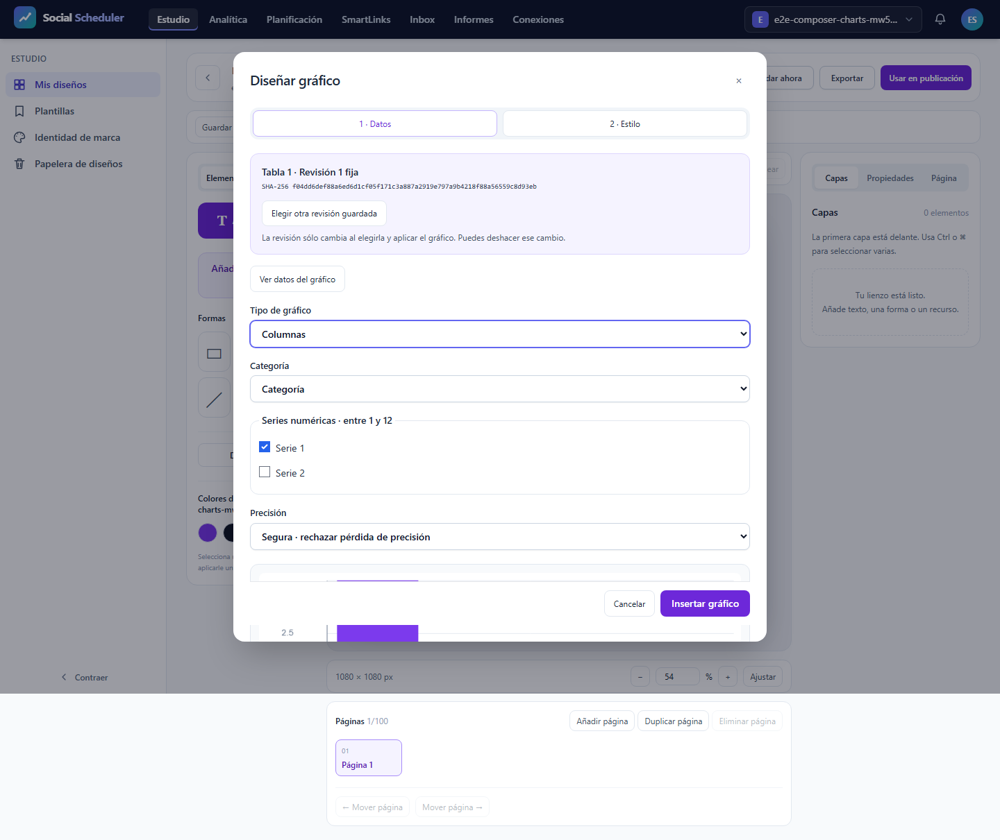
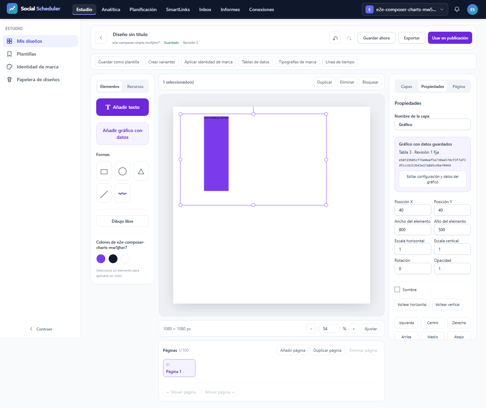
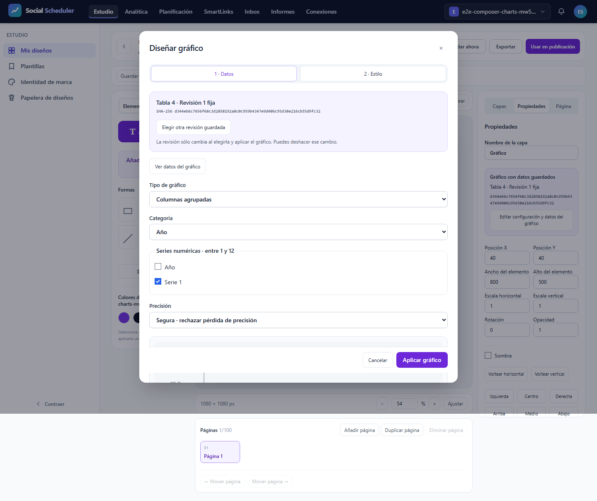
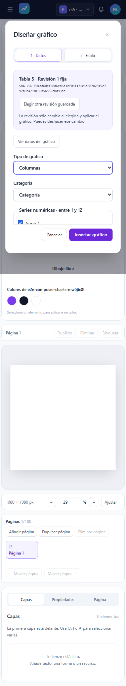
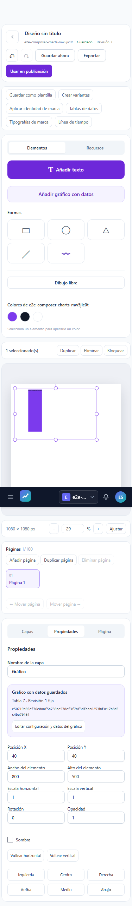
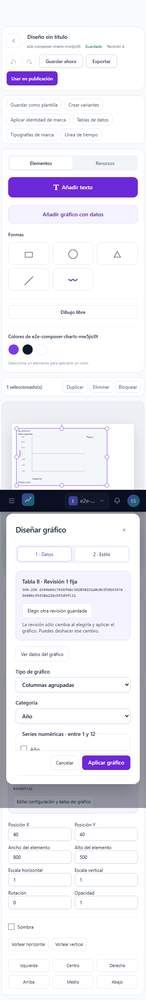
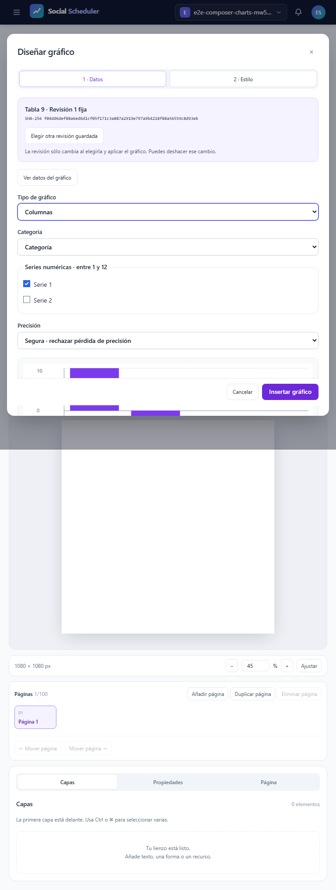
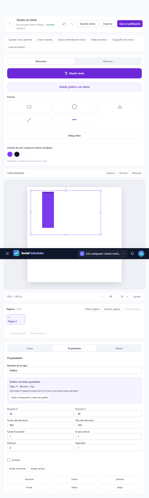
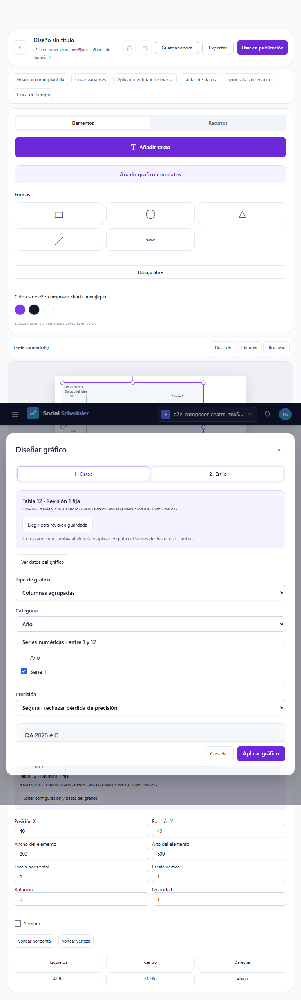

# T12: consumidor local, errores y accesibilidad

**FOCAL-PASS**. Casos realmente ejecutados: 3/3; registros del JSON original: 3, incluidos los no ejecutados. E2E28.03 previsto íntegro a375/768/1440px, un worker, cero reintentos y fail-fast1. T12 sigue abierta. La revisión de figuras/PDF no sustituye el resultado automático.

## Contrato y comprobaciones

El consumidor cancela su espera al cerrar el modal; el transporte compartido continúa y puede llenar la caché. La prueba exige modal cerrado, foco restaurado y documento vacío antes de liberar la respuesta. Después verifica el cuerpo original del mismo GET/export?format=json&revision=1, finished,200,MIME,bytes ySHA, y de nuevo cierre/foco/documento/capas vacíos. Reabre la misma tabla, comprueba preview y ocho celdas tipadas originales sin segundo GET. No hay GET auxiliar ni éxito HTTP simulado. El aborto físico por registry.dispose tiene diagnóstico independiente; no se atribuye al cierre de UI.

Además exige tabla DOM original, negativos bloqueados, precisión safe/approximate, estilo e Inspector, teclado/foco y revisión histórica vacíaB4. El grupo completo requiere9recibos axe sin violations/incomplete,9capturas,3recibos de foco/hold/B4/viewports,6eventos pasivos capture/release con cancelled_delivery=false/deadline_release=false, red sin issues/expected_http/abortos y font-responses vacío. El contador independiente contrasta bytes/query/UI/caché/cleanup y rechaza faltantes, sobrantes o incoherencias. Los pasos no alcanzados permanecen pendientes.

## Recursos y cierre

Runtime ficticio aislado y loopback, sin .env/DB/proveedor real. Build7 actual62inputs/77assets. Job3GiB COMMIT agregado, preflight físico6GiB, piso3GiB cada100ms, PHP256MiB/Node512MiB;900s incluyendo cierre. Núcleo 63.225s, pico COMMIT 739360768B, mínimo físico 8467832832B; fallo de recursos None. Plazo global 63.495983700006036s. Clausura registrada por separado; procesos propios cerrados y8080IPv4/IPv6libres. PDF posterior en Job separado. 691fuentes verificadas antes/después y trasPDF.

## Resultado y alcance pendiente

Los tres casos completos han pasado con recibos coherentes. La revisión de preparación A+B y las pruebas puras no se suman como casos nativos.

Los errores1/2/3, consumer1/2 y las matrices anteriores permanecen inmutables. Este resultado no acredita exportaciones SVG/PNG/PDF, fuente privada, densidad, otras variantes/familias, AV ni el roadmap completo. Servidor tiene informe independiente; no se mezclan JSON para inventar una matriz completa. TítuloY pequeño, otras funciones T12, resto del roadmap y auditoría final ClaudeCLI pendientes.

## Evidencias visuales

### images/1440-errors-table-modal.png

### images/1440-inspector.png

### images/1440-empty-historic.png

### images/375-errors-table-modal.png

### images/375-inspector.png

### images/375-empty-historic.png

### images/768-errors-table-modal.png

### images/768-inspector.png

### images/768-empty-historic.png

