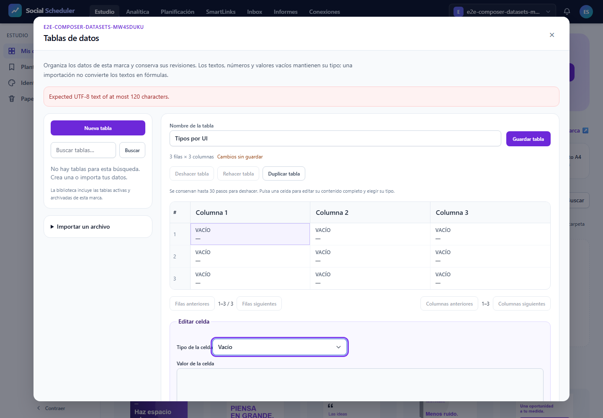

# E2E27 — intento1 interrumpido

**NO-VERDE. Sin aceptación de UI ni PASS acreditado.** Root indicó detener este intento después de un fallo real. No se fabricaron `results.json`, estadísticas ni recuentos de ejecución.

## Qué se ejecutó y qué quedó pendiente

Playwright anunció 15 recorridos previstos: cinco escenarios en 375/768/1440. El log emitió un FAIL completado: **E2E27.01 desktop, timeout de 180.000 ms**. El resto no tiene resultado final fiable; esto no equivale a 15 tests ejecutados ni a 15 fallos.

Ctrl-C sobre el handle23601 terminó el supervisor8756 y su Job. No se alcanzó `finally` ni el cleanup del reporter. No existe JSON de resultados en el runtime ni en raw. El registro original `execution.json` conserva `state=started`; `interruption.json` documenta por separado la observación terminal. No hubo reinicio ni reintentos.

La cadena se detuvo antes de guardar/reabrir/descargar y antes de axe. **Cero archivos axe y cero descargas acreditadas.** Edición numérica, estructura, 409, historial, archivo, marcas, respuestas tardías, contraste y los otros anchos siguen pendientes de una nueva pasada autorizada después de corregir y revisar. El 13/13 previo de transporte mantiene su alcance independiente.

## Hallazgos de este intento

1. **Selector/harness por confirmar.** Timeout en `getByLabel('Tipo de la celda', exact:true).selectOption`. La captura accesible y visual muestra un combobox «Tipo de la celda» activo. Apunta a la coincidencia exacta de una etiqueta implícita con opciones, pero no prueba un defecto del control. No se cambió la spec ni se probó un selector alternativo.
2. **Listado HTTP real con 422.** `GET /brands/2/studio/datasets` devolvió 422; la UI muestra «Expected UTF-8 text of at most 120 characters». La sonda pura posterior de root confirma que `query` vacía se convierte en `null` y se rechaza como texto; omitirla o proporcionar texto válido funciona. La sonda no carga aplicación, `.env`, DB ni HTTP y es diagnóstico adicional, no un PASS de UI.
3. **Diagnóstico de red.** El guard de las páginas de test registró intentos hacia `fonts.googleapis.com` y los abortó antes del egreso. Se conservan separados los mensajes de recurso fallido de Chromium y el posible error de aplicación. No se permitió red para ocultarlos. El setup canónico previo no dispone de inventario de solicitudes externas en esta evidencia; no se extrapola una garantía de egreso que no se midió.

## Aislamiento, recursos y fuentes

Servidor localhost8080 propio, SQLite/storage/config ficticios UUID `f1e17ba4-5e86-473d-92a8-cb63a5072422`. Proof de rutas antes de usuarios. Perfil PHP512M/post192M/upload64M. Job Windows3GiB **COMMIT agregado**, killOnClose/noBreakaway comprobados al iniciar. El pico final COMMIT no pudo recuperarse tras cerrar el handle. Pico asignador PHP disponible: **39.845.888 B**, separado; no se presenta como RSS.

Supervisor y listener8080 confirmados terminales antes del informe. No se detuvieron procesos ajenos. No se ejecutaron ONNX, FFmpeg, MySQL, VPS, R2, publicación ni solicitudes adicionales para diagnosticar el servidor.

El manifiesto contiene **515 fingerprints**: nueve UI/core revisados y el resto contexto congelado, sin aprobación global. Snapshot inicial de **613 fuentes/assets/harness**. Postcheck externo después de la interrupción: **0 cambios, 0 faltantes y 0 assets añadidos**. Se consumió build4 de77assets, sin reconstruirlo. Se conserva otro postcheck después del PDF.

## Gate sobre evidencia ausente

```json
{
  "verdict": "NO-VERDE",
  "reason": "sin resultados: results.json no existe (la ausencia de evidencia es rojo)"
}
```

Salida literal de `qa-gate.py`, exit1. No es un gate válido de ejecución completa ni permite calcular porcentaje de éxito. Recount no se ejecuta sobre datos inexistentes. Ledger, cobertura y guardrail previos permanecen conservados; no revierten este resultado.

## Captura real inspeccionada

Sólo se dispone de una captura desktop: muestra la alerta422, tabla3×3 y selector de tipo activo. No acredita por sí sola responsive, teclado o accesibilidad. El inventario visual del PDF se registra después de rasterizarlo.



## Manuales y continuidad

- [ ] M-01 — Scheduler/workerVPS y heartbeat del usuario.
- [ ] M-02 — Publicación real porred y smokes externos.
- [ ] M-03 — RendererLinux, colas, fuentes, medios y R2 reales.
- [ ] M-04 — ClaudeDesktop aplazado, sin nueva autorización.

**T12 y el total8/23 permanecen sin cierre.** No se modificaron fuentes, spec, templates, documentos ni ledger durante el intento. Informe sólo local; PDF después del servidor cerrado, bajo Job3GiB separado y con dependencias existentes. No publicar auth, SQLite, configcache, cookies, headers de request ni traces. Root seleccionará la evidencia saneada.
