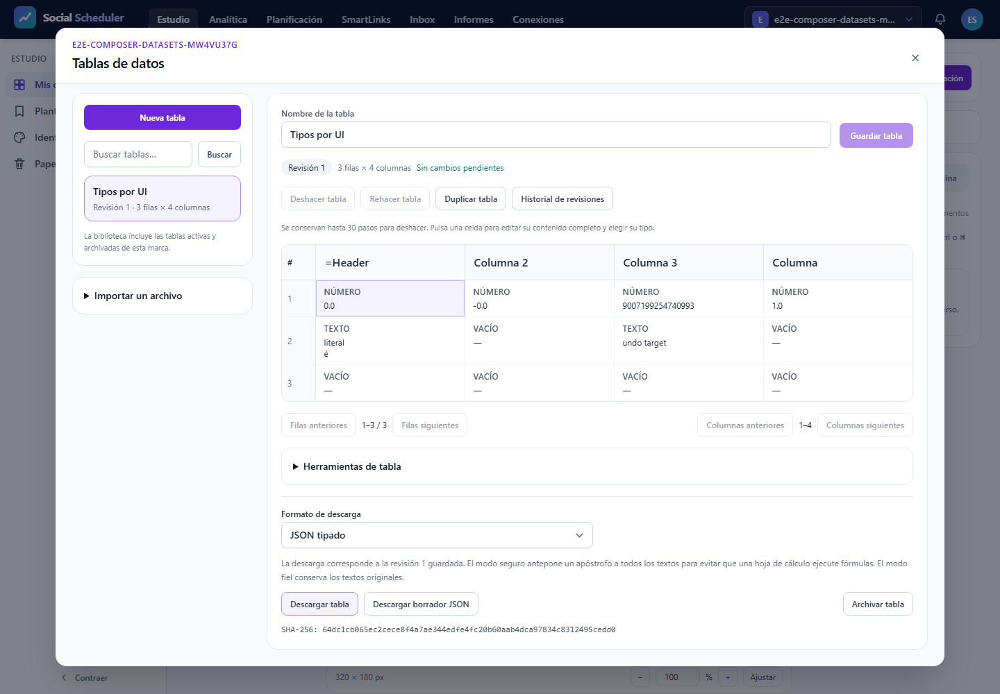

# T12 — biblioteca/editor de datasets, QA UI

Veredicto canónico y recuento real: **NO-PASS**, 1 casos observados. No se arrastran PASS de transporte. La aceptación visual de capturas/PDF requiere registro explícito posterior en pdf-validation.json y visual-review.json; no se infiere del gate automático.

## Fallo medido y parada

Se ejecutó **un caso desktop (1440×1000)**: falló en axe. Los otros catorce quedaron sin ejecutar por maxFailures1. No hay evidencia de móvil/tablet ni aceptación de E2E27.02–05. Cero reintentos y ningún reinicio.

Axe: una violación color-contrast, texto `#64748b` sobre `#f5f3ff`, 12px normal, contraste **4,33:1 < 4,5:1**. Nodo: `span.mt-1.block.text-xs.text-slate-500` dentro de `button[data-testid="dataset-open-1"][aria-pressed="true"]`; texto «Revisión 1 · 3 filas × 4 columnas». Además hay dos resultados incomplete, conservados íntegros en diagnostic-details.json: no se excluyen ni se convierten en verde. Uno es aria-prohibited-attr en el div de desplazamiento horizontal, aria-label sin rol válido. El otro es color-contrast en el selector de descarga: axe no pudo determinar el fondo por background-image. Ambos quedan pendientes, sin excluir reglas ni advertencias.

El error global literal del JSON es `Testing stopped early after 1 maximum allowed failures.` (incluye escapes ANSI en el original). Describe la parada configurada; no se observó otro error global en results.json. Recount termina exit1 y el supervisor propaga CalledProcessError tras guardar finally; no se perdió el JSON.

Tres descargas JSON reales de303B cada una coinciden con sus hashes/observación pasiva; ningún caso entero queda acreditado por esas comprobaciones parciales. Red observada sin issues, cuatro usos de fixtureCSSIntervacía: no se probó Inter real.

## Alcance y aislamiento

E2E27.01–05 en375/768/1440; servidorlocalhost propio,SQLite/storage/usuarios/configcache ficticiosUUID. Config antesKernel y proof de rutas antes de usuarios. Sin .env real, MySQL, proveedores, redes sociales, VPS, R2 ni ONNX. Build de root previamente terminado/congelado; no rebuild. WindowsJob3GiB COMMIT/killOnClose/noBreakaway ydeadline, un worker y cero retries. COMMIT agregado medido: 741699584B; asignadorPHP separado: 39845888B. No se presentan comoRSS ni medidaLinux.

## Resultados

| Escenario | Proyecto | Outcome real |
|---|---|---|
| E2E27.01 | desktop | unexpected |
| E2E27.02 | desktop | skipped |
| E2E27.03 | desktop | skipped |
| E2E27.04 | desktop | skipped |
| E2E27.05 | desktop | skipped |
| E2E27.01 | mobile | skipped |
| E2E27.02 | mobile | skipped |
| E2E27.03 | mobile | skipped |
| E2E27.04 | mobile | skipped |
| E2E27.05 | mobile | skipped |
| E2E27.01 | mobile-360 | skipped |
| E2E27.02 | mobile-360 | skipped |
| E2E27.03 | mobile-360 | skipped |
| E2E27.04 | mobile-360 | skipped |
| E2E27.05 | mobile-360 | skipped |

Recount exige IDs/proyectos completos, stats reales, viewport efectivo y cero errores/retries/skips/flaky/interrupted. Este intento no cumple: sólo un caso ejecutado y catorce skipped por fail-fast. El snapshot al terminar no presenta deriva de fuentes/assets. Puertas ledger-lint/coverage-check/guardrail en raw privado; criterios futuros fuera del subbloque siguen declarados. Expected browser network diagnostics de404/409/422 se conservan aparte; ninguna excepción JavaScript o console.error de aplicación se omite.

## Gate literal

```json
{
  "verdict": "NO-VERDE",
  "reason": "el runner reportó errores de ejecución",
  "errors": [
    "\u001b[31mTesting stopped early after 1 maximum allowed failures.\u001b[39m"
  ]
}
```

## Observación independiente

En este intento sólo se alcanzaron tres descargas JSON tipadas, observadas mediante parser independiente de codecs/producto. El caso comprobó lexemas0.0/1.0/-0.0/9007199254740993, strings/multilínea/null/IDs, bytes y SHA/headers privados antes del fallo axe. CSV/TSV seguros/fieles y los restantes escenarios no se ejecutaron. Los oráculos previstos cubren UICRUD/estructura/conversión,409/borrador/historial/biblioteca,archivo/marca/respuestas tardías mediante HTTP real; sólo un caso completo con outcome expected acredita su cadena. Un caso fallido puede haberse detenido antes de alguna comprobación. route.fetch sólo demora entrega; no finge éxito. Inventario saneado de 3 descargas y1 capturas; raw de resultados con config/auth no es publicable.

## Manuales y alcance abierto

- [ ] M-01 VPS scheduler/worker/heartbeat del usuario.
- [ ] M-02 publicación real porred y smokes externos pendientes.
- [ ] M-03 rendererLinux/colas/fuentes/medios/R2 reales.
- [ ] M-04 ClaudeDesktop aplazado, sin nueva autorización.

T12 integral y23tareas no se cierran por este subbloque. Gráficos/capas, XLSX/conectores, documentos/presentaciones/pizarras y despliegue conservan sus criterios. No se publica este informe enConfluence. No copiar configcache/SQLite/auth/tokens/cookies/traces/requestheaders.

## Capturas reales para inspección

### desktop — E2E27.01


