# T12 — biblioteca/editor de datasets, QA UI

Veredicto canónico y recuento real: **PASS**, 15 casos observados. No se arrastran PASS de transporte. La aceptación visual de capturas/PDF requiere registro explícito posterior en pdf-validation.json y visual-review.json; no se infiere del gate automático.

## Alcance y aislamiento

E2E27.01–05 en375/768/1440; servidorlocalhost propio,SQLite/storage/usuarios/configcache ficticiosUUID. Config antesKernel y proof de rutas antes de usuarios. Sin .env real, MySQL, proveedores, redes sociales, VPS, R2 ni ONNX. Build de root previamente terminado/congelado; no rebuild. WindowsJob3GiB COMMIT/killOnClose/noBreakaway ydeadline, un worker y cero retries. COMMIT agregado medido: 761221120B; asignadorPHP: **No disponible en esta pasada**. No se presentan comoRSS ni medidaLinux.

El proceso PHP propio mostró argumentos reales512M/post192M/upload64M y router público tests/e2e/isolated/server.php. Se pasó auto_prepend_file, pero no se observó su log del asignador: no se atribuye una causa ni se inventa una cifra. summary.json conserva null. Portabilidad acreditada para imports/colección y servidor público utilizado en esta QA; no acredita CI global, Linux ni VPS.

## Resultados

| Escenario | Proyecto | Outcome real |
|---|---|---|
| E2E27.01 | desktop | expected |
| E2E27.02 | desktop | expected |
| E2E27.03 | desktop | expected |
| E2E27.04 | desktop | expected |
| E2E27.05 | desktop | expected |
| E2E27.01 | mobile | expected |
| E2E27.02 | mobile | expected |
| E2E27.03 | mobile | expected |
| E2E27.04 | mobile | expected |
| E2E27.05 | mobile | expected |
| E2E27.01 | mobile-360 | expected |
| E2E27.02 | mobile-360 | expected |
| E2E27.03 | mobile-360 | expected |
| E2E27.04 | mobile-360 | expected |
| E2E27.05 | mobile-360 | expected |

Recount exige IDs/proyectos completos, stats reales, viewport efectivo y cero errores/retries/skips/flaky/interrupted; su veredicto anterior declara si este intento cumple. Puertas ledger-lint/coverage-check/guardrail en raw privado; criterios futuros fuera del subbloque siguen declarados. Expected browser network diagnostics de404/409/422 se conservan aparte; ninguna excepción JavaScript o console.error de aplicación se omite.

## Gate literal

```json
{
  "verdict": "VERDE",
  "counts": {
    "passed": 15,
    "failed": 0,
    "flaky": 0,
    "skipped": 0,
    "interrupted": 0
  },
  "flaky_sin_justificar": [],
  "flaky_justificados": {},
  "threshold": "verde ⟺ 0 failed, 0 flaky sin justificar, 0 interrumpidos y ≥1 test ejecutado"
}
```

## Observación independiente

Los oráculos previstos de CSV/TSV seguros/fieles y JSON tipado usan parsers independientes de codecs/producto para lexemas0.0/1.0/-0.0/9007199254740993, strings/multilínea/null/IDs, bytes y SHA/headers privados. Sólo las entradas del inventario de este intento acreditan comprobaciones alcanzadas; no se atribuyen ejecuciones a formatos ausentes. Los oráculos previstos cubren UICRUD/estructura/conversión,409/borrador/historial/biblioteca,archivo/marca/respuestas tardías mediante HTTP real; sólo un caso completo con outcome expected acredita su cadena. Un caso fallido puede haberse detenido antes de alguna comprobación. route.fetch sólo demora entrega; no finge éxito. Inventario saneado de **48 descargas HTTP snapshot +39 borradores Blob =87 archivos** y18 capturas; raw de resultados con config/auth no es publicable.

## Manuales y alcance abierto

- [ ] M-01 VPS scheduler/worker/heartbeat del usuario.
- [ ] M-02 publicación real porred y smokes externos pendientes.
- [ ] M-03 rendererLinux/colas/fuentes/medios/R2 reales.
- [ ] M-04 ClaudeDesktop aplazado, sin nueva autorización.

T12 integral y23tareas no se cierran por este subbloque. Gráficos/capas, XLSX/conectores, documentos/presentaciones/pizarras y despliegue conservan sus criterios. No se publica este informe enConfluence. No copiar configcache/SQLite/auth/tokens/cookies/traces/requestheaders.

## Capturas reales para inspección

### desktop — E2E27.01

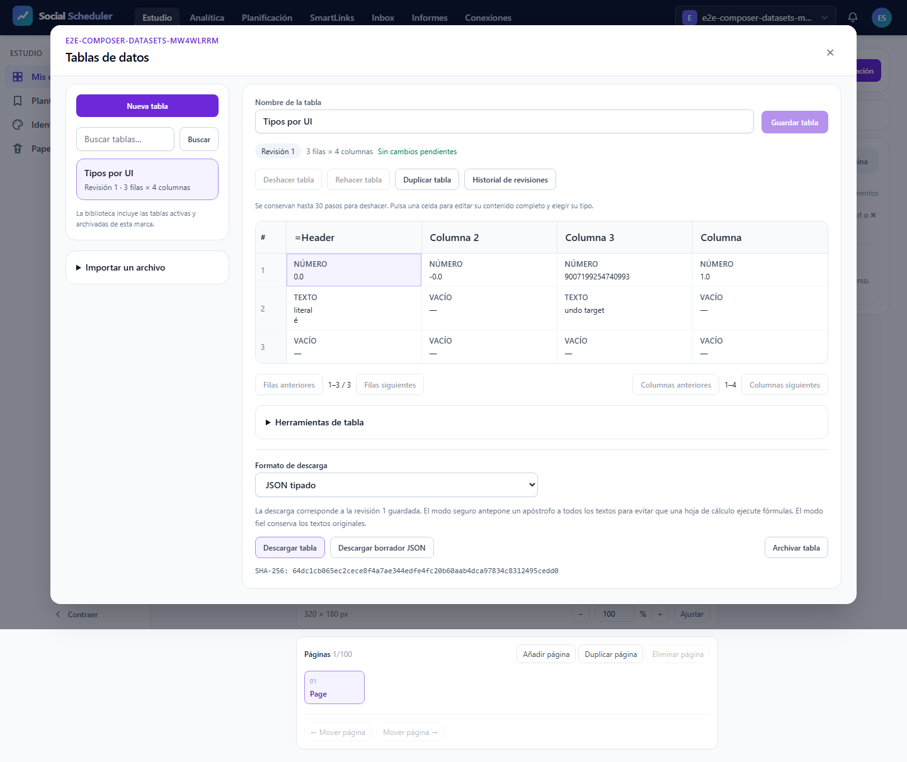

### mobile — E2E27.01

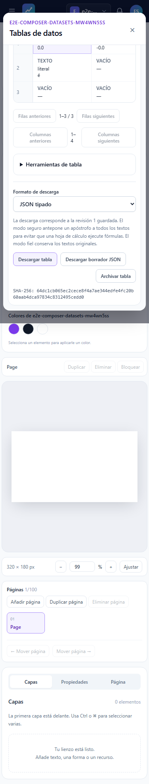

### mobile-360 — E2E27.01

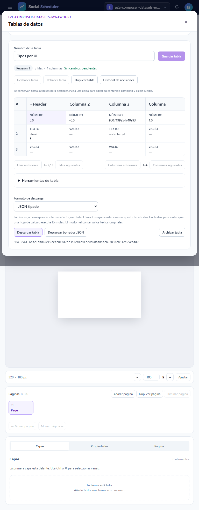

### desktop — E2E27.02

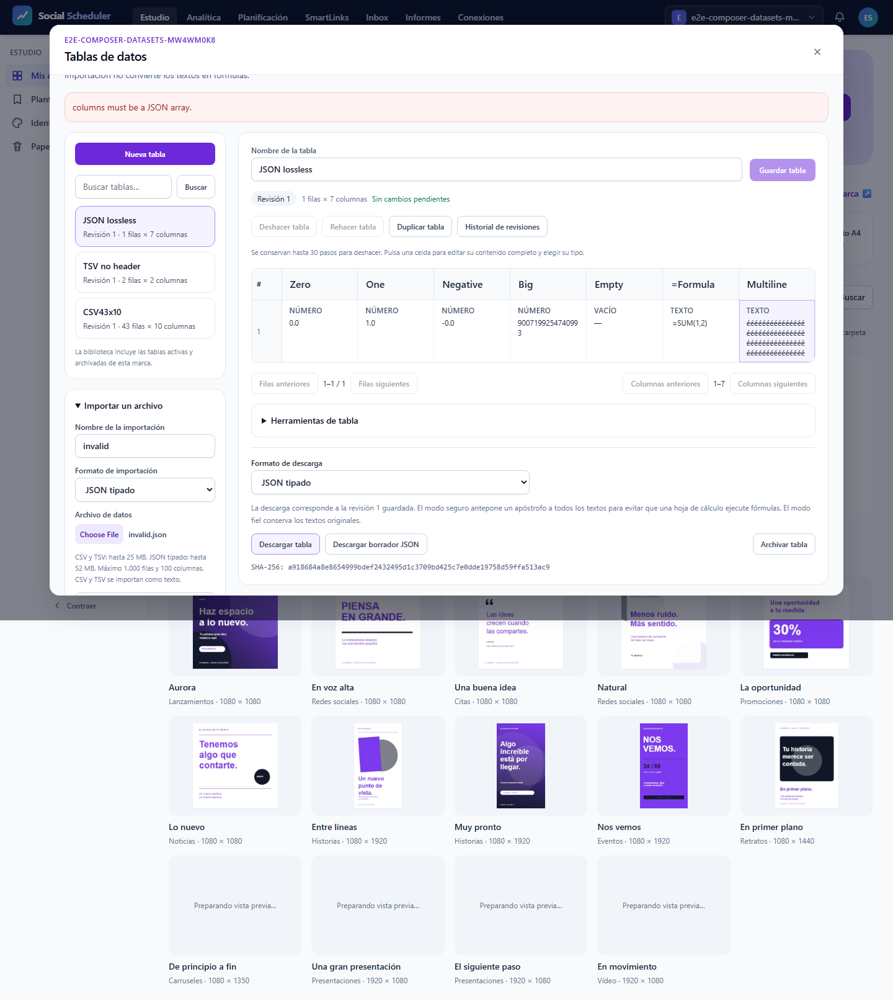

### mobile — E2E27.02

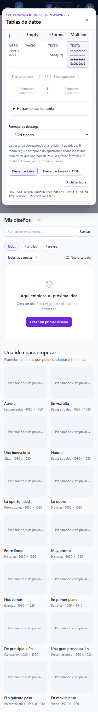

### mobile-360 — E2E27.02

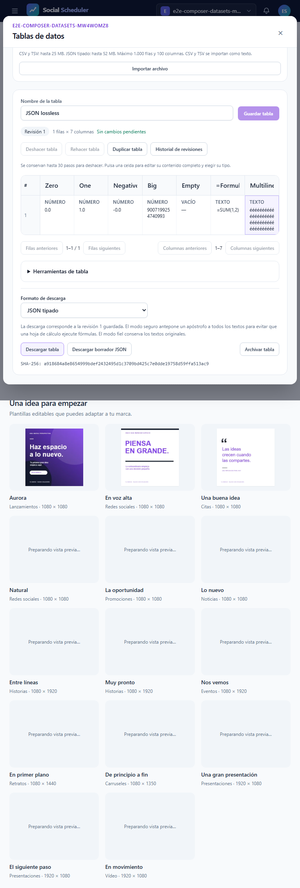

### desktop — E2E27.03

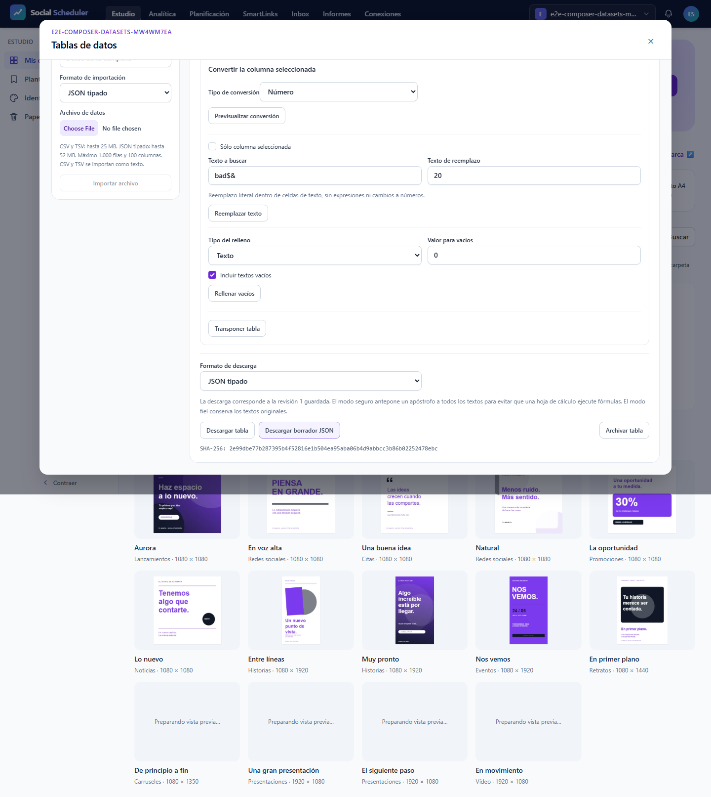

### desktop — E2E27.03

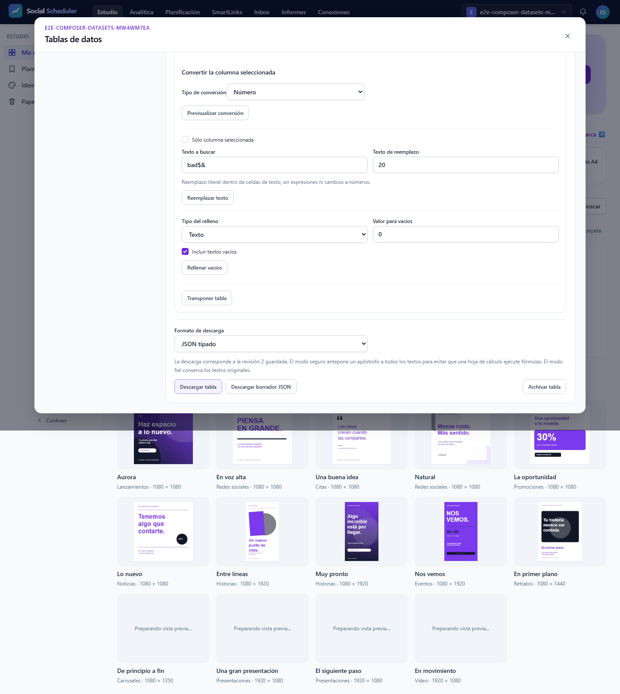

### mobile — E2E27.03

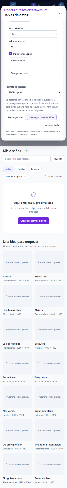

### mobile — E2E27.03

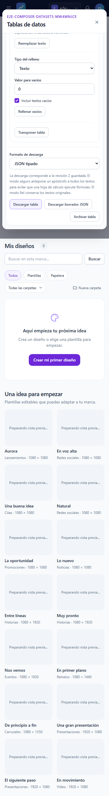

### mobile-360 — E2E27.03

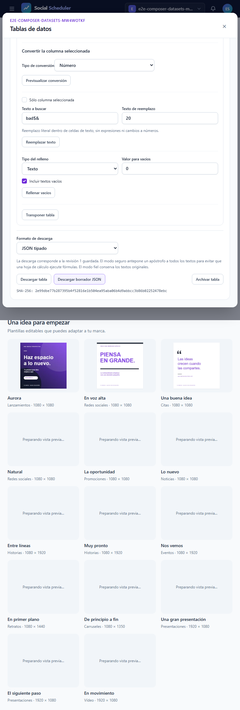

### mobile-360 — E2E27.03

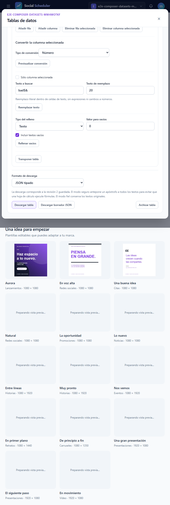

### desktop — E2E27.04

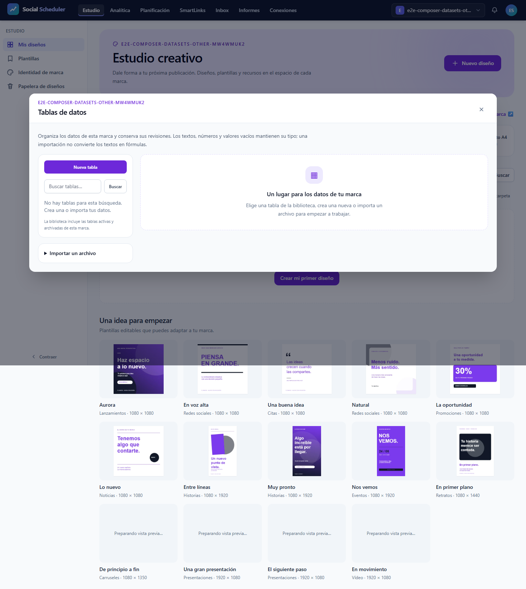

### mobile — E2E27.04

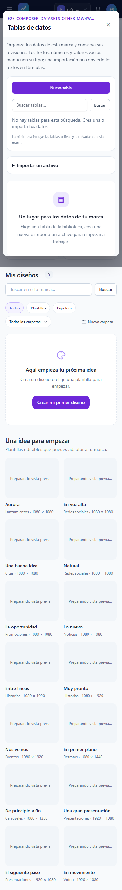

### mobile-360 — E2E27.04

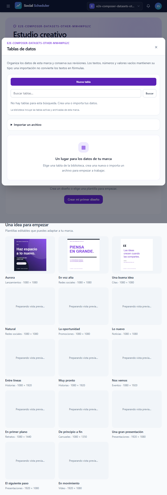

### desktop — E2E27.05

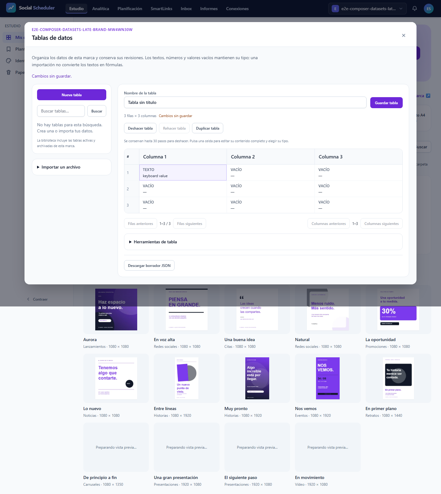

### mobile — E2E27.05

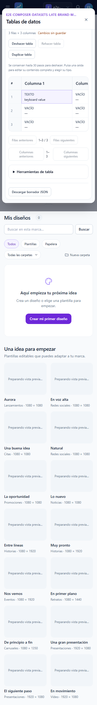

### mobile-360 — E2E27.05

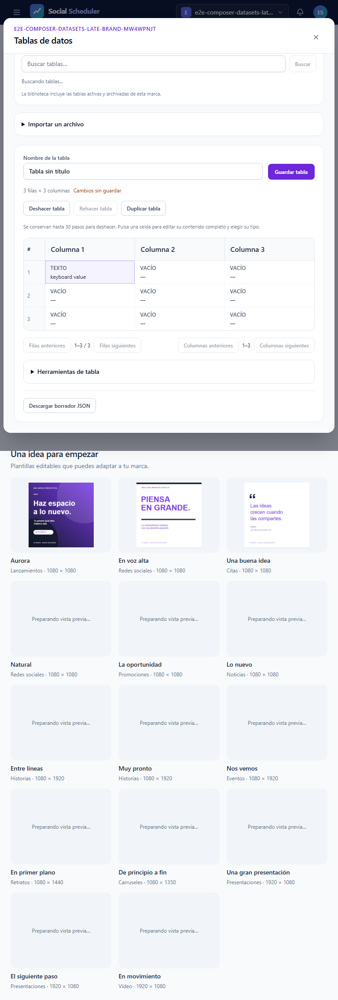
