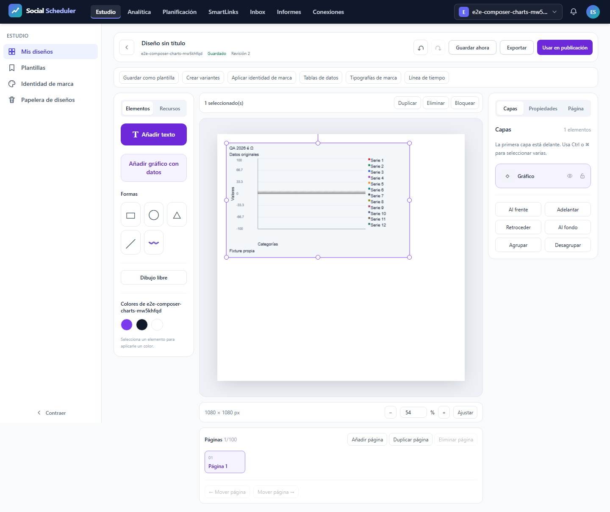
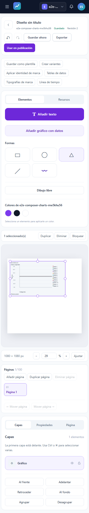
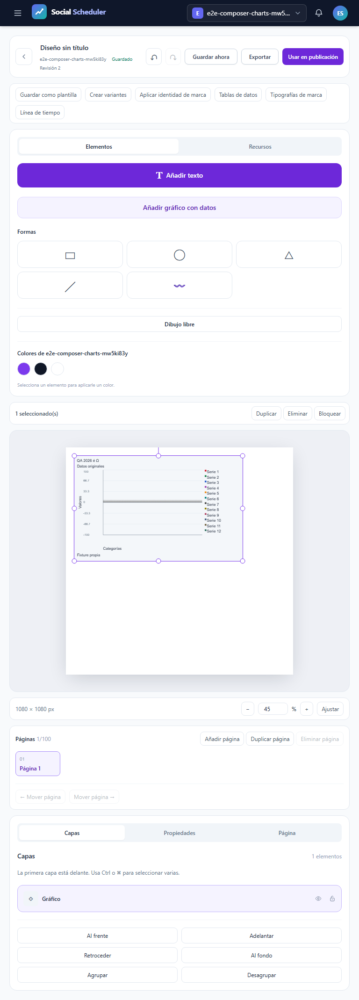
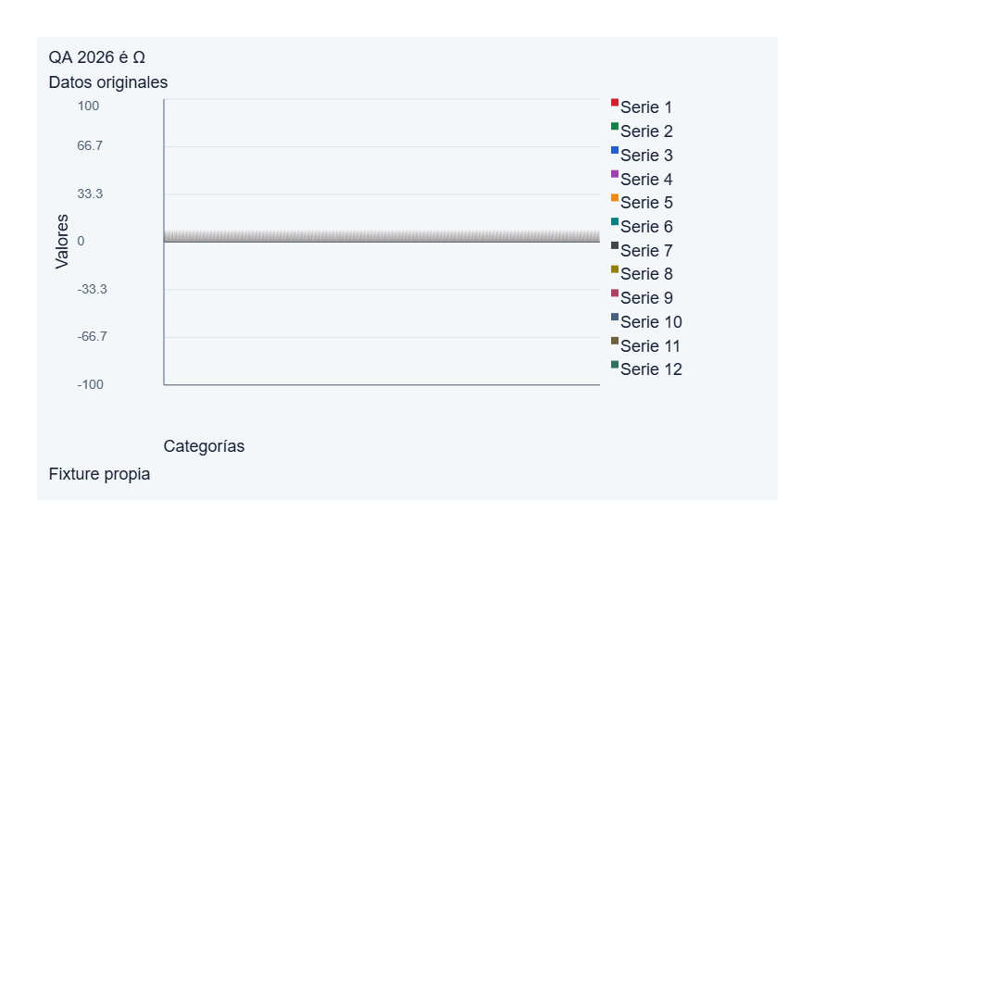

# T12: gráficos densos, validación focal

**FOCAL-PASS, 3/3 casos reales** a 1440, 375 y 768 px. Cada caso conserva 12.000 barras semánticas: 36.000 en total. Cero fallos, omitidos, flaky, reintentos, interrupciones o errores del runner. T12 sigue abierta y el roadmap mantiene 8/23 tareas cerradas.

## Qué acredita esta ejecución

E2E28.04 completo, un worker, cero retries, fail-fast 1. Tres descargas SVG y tres PNG reales del navegador; bytes y SHA contrastados con sus recibos. Cada SVG conserva 12.000 barras más tres formas de ejes, y el XML independiente coincide con las matrices del observador DOM. No se simulan cabeceras HTTP en entregas Blob ni se hace un GET auxiliar.

Los tres PNG son idénticos byte a byte: 75.550 bytes y 1080 por 1080 px. Se conserva cada original, pero se presenta una sola figura representativa. El verificador PNG usa cobertura fraccional de rectángulos y composición source-over sobre el fondo configurado. Por caso compara 18.408 canales; error medio 4,496686 y percentil 95 de 11, dentro de los límites originales de 6 y 18. Hay 4.895 píxeles de color predichos y 672 coincidencias exactas de paleta. A esta densidad las barras subpíxel no son distinguibles individualmente: el recuento semántico corresponde al SVG, y la imagen acredita cobertura raster agregada.

Se rechazan seis entradas por presupuesto con HTTP 422 (dos por viewport), preservando documento y capas. Red, fuentes, alcance, viewport y limpieza se contrastan con los recibos originales. Los observadores independientes se ejecutaron una sola vez; el cierre y este informe leen sus resultados y SHA, sin rerasterizar ni reconstruir JSON.

## Recursos y cierre

Datos ficticios, runtime aislado y loopback; sin .env ni servicios reales. Build7 vigente, 62 fuentes y 77 assets, sin recompilar. Job Windows de 3 GiB COMMIT agregado, preflight físico de 6 GiB y piso de 3 GiB cada 100 ms; Node 512 MiB y PHP 256 MiB. Presupuesto de 900 segundos incluyendo inicio, observadores y cierre.

Núcleo: 67.176 s; pico COMMIT 2380132352 bytes; mínimo físico 6874886144 bytes. Clausura: 0.782 s; pico 107319296 bytes. Tiempo global: 68.126 s. Sin fallos de recursos. PID 20344 terminado, lista de procesos propios vacía y puerto 8080 libre en IPv4 e IPv6. 837 fuentes protegidas comprobadas antes y después, con control adicional tras el PDF y su inspección. El informe PDF se genera después en un Job separado.

## Límites y evidencia conservada

Esta ejecución acredita únicamente el escenario denso. No se atribuyen comprobaciones de preview píxel, fuentes privadas, axe, PDF de diseño, materialización de datos, otras familias o configuraciones, audiovisual ni el producto completo. El PDF adjunto es el informe de QA, distinto de una exportación PDF del diseño. Los resultados anteriores permanecen inmutables. La revisión completa con Claude Code y la entrega Git siguen pendientes.

Se conservan los cuatro inputs originales de cada oráculo (SVG, PNG, observador DOM y recibo de entregas), sus SHA, capturas, presupuestos, red, resultados independientes y procedencia del JSON/blob original. La inspección visual posterior acredita las figuras mostradas y las páginas del informe; no convierte las 12.000 barras en elementos separables en pantalla.

## Evidencias visuales

### images/1440-dense-screen.png

### images/375-dense-screen.png

### images/768-dense-screen.png

### images/dense-export-identical-three-viewports.png

