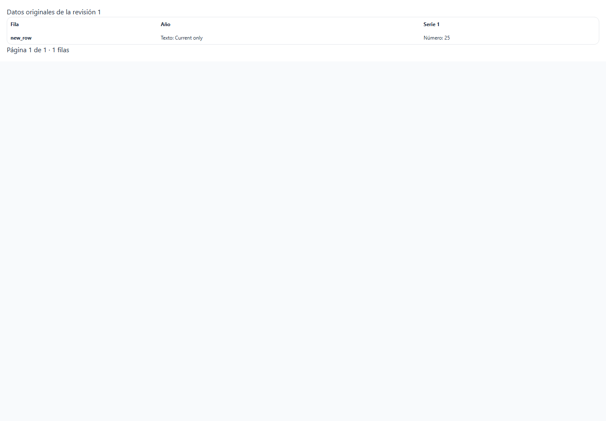

# T12: diagnóstico de cabeceras en una tabla vacía

**3/3 diagnósticos confirmados.** Fixture explícitamente reconstruida desde el template real y las etiquetas históricas, con CSS compilado build6. El artefacto anterior sólo guardaba el tag de apertura de la tabla, no outerHTML completo; no se presenta esta reconstrucción como captura del DOM de la aplicación.

| Estado | Filas tbody | Footer | Violaciones | Incomplete th-has-data-cells | Regla PASS |
|---|---:|---:|---:|---:|---|
| Baseline sin datos | 0 | 0 | 0 | 1 | no |
| Estado vacío con footer | 0 | 1 | 0 | 0 | sí |
| Control con una fila real | 1 | 0 | 0 | 0 | sí |

Las tres cabeceras Fila/Año/Serie1 conservan scope=col; la tabla sigue siendo tabla, sin ocultarla ni cambiar su role. El footer visible tiene una celda colspan3 que informa «Esta revisión no contiene filas.». No añade filas de datos al tbody ni altera el valor0filas. El algoritmo instalado axe4.10.3 busca celdas asociadas en todas las secciones; sin ellas devuelve undefined/incomplete. Con el footer la regla se ejecuta y pasa, no queda inapplicable. Las observaciones DOM y resultados originales permiten contrastarlo.

Esto prueba una sola regla en tablas aisladas, no axe completo, B4 ni la aplicación. No se excluye ninguna regla en las pruebas públicas. La implementación funcional, su RED/GREEN, revisión y validación del escenario entero siguen pendientes.

Chromium offline/about:blank,0requests, sin servidor; navegador desconectado al terminar. Job3GiB COMMIT,6GiB preflight/piso3GiB cada100ms,Node512 y90s: duración0.8232131s, pico269385728B, mínimo físico8995942400B.24SHA iguales antes/después y al publicar. PID35860/35068muertos,8080IPv4/IPv6libres. Sin PHP/DB/proveedores/red externa ni PDF. Root inspeccionó las tres capturas.

## Capturas reales del diagnóstico

