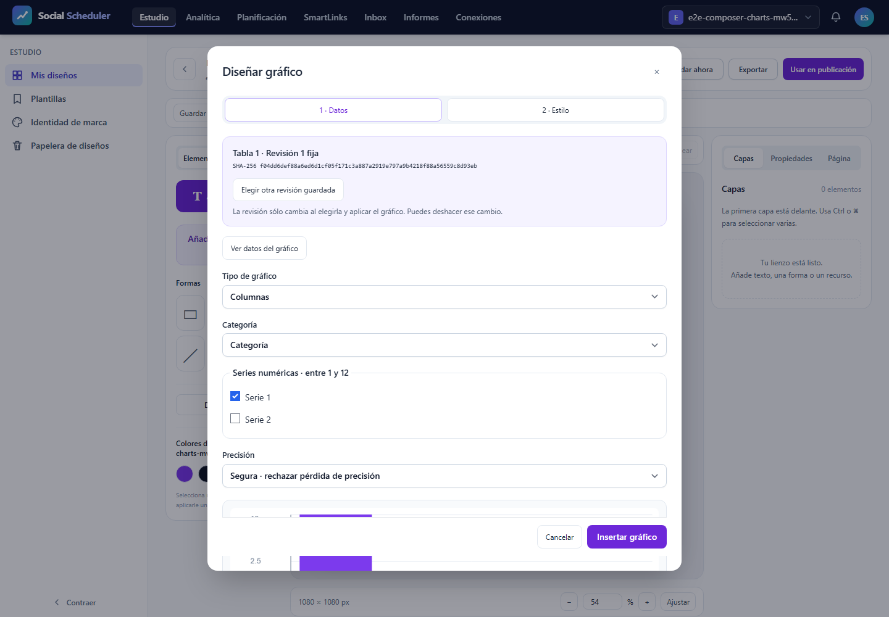

# T12: errores y accesibilidad, validación focal

**NO-PASS**. Casos realmente ejecutados: 1/3; registros del JSON: 3, incluidos los no ejecutados. E2E28.03 previsto íntegro a375/768/1440px, un worker, cero reintentos y fail-fast1. T12 sigue abierta. La inspección de estas figuras/PDF se registra por SHA; no sustituye el resultado automático.

## Comprobaciones del escenario

Tabla DOM con tipos y lexemas originales; proporciones negativas bloqueadas; safe/approximate para9007199254740993; estilo guardado/editado e Inspector; teclado, foco visible y restaurado; revisión histórica vacíaB4 fijada a1 mientras la actual2 tiene filas. El test exige ausencia de aplicación tardía tras cancelar una respuesta HTTP real retenida; captura200, bytes/SHA, cancelación y liberación se contrastan con el journal pasivo. No se simula éxito HTTP ni se amplían abortos permitidos.

En un grupo completo se exigen9recibos axe sin violations/incomplete,9capturas,3pruebas de foco/holds/B4/red/viewports y font-responses vacío. El recuento independiente rechaza evidencia faltante, adicional o incoherente. Los campos originales y el gate están junto al informe. Si este intento falla, los pasos no alcanzados continúan pendientes; no se completan con registros ficticios.

## Recursos y cierre

Runtime ficticio aislado y sólo loopback, sin .env/DB/proveedor real. Build3 actual antes de ejecutar. Job3GiB COMMIT agregado, preflight físico6GiB, piso3GiB cada100ms, PHP256MiB/Node512MiB; plazo único900s incluyendo clausura. Pico del núcleo 669831168B, duración 17.549s, mínimo físico 8928854016B. Fallo de recursos: None. Clausura registrada por separado; plazo global 17.71626339998329s. Procesos propios cerrados y8080IPv4/IPv6libres. PDF posterior en Job separado. 394fuentes comprobadas antes/después y trasPDF.

## Alcance pendiente

Este resultado no acredita SVG/PNG/PDF exportados, fuente privada, densidad, otras variantes o familias, AV o el roadmap completo. Servidor tiene su informe independiente; no se agregan JSON con huellas distintas para inventar12casos. El títuloY pequeño sigue como corrección visual pendiente. La aceptación funcional de este escenario no equivale a aprobación visual de toda la interfaz.

## Fallos originales

```text
desktop: Error: expect(locator).toContainText(expected) failed

Locator: getByRole('dialog', { name: 'Diseñar gráfico', exact: true }).getByRole('table', { name: 'Categorías y series seleccionadas, tipos y valores originales', exact: true })
Expected substring: "Texto: Año 2020 é"
Timeout: 5000ms
Error: element(s) not found

Call log:
  - Expect "toContainText" getByRole('dialog', { name: 'Diseñar gráfico', exact: true }).getByRole('table', { name: 'Categorías y series seleccionadas, tipos y valores originales', exact: true }) with timeout 5000ms
  - waiting for getByRole('dialog', { name: 'Diseñar gráfico', exact: true }).getByRole('table', { name: 'Categorías y series seleccionadas, tipos y valores originales', exact: true })
```

```text
desktop: Error: expect(received).toHaveLength(expected)

Expected length: 1
Received length: 0
Received array:  []
```

El primer fallo ocurre antes de completar el escenario. La tabla accesible esperada no se localiza tras pulsar Ver datos; la comprobación posterior del aborto esperado también falla porque ese paso todavía no se alcanzó. Los otros dos proyectos no se ejecutaron. No se ha establecido aún la causa ni se relaja la aserción. Se conservarán estos bytes antes de cualquier corrección.

## Evidencias visuales

### images/1440-test-failed-1.png



