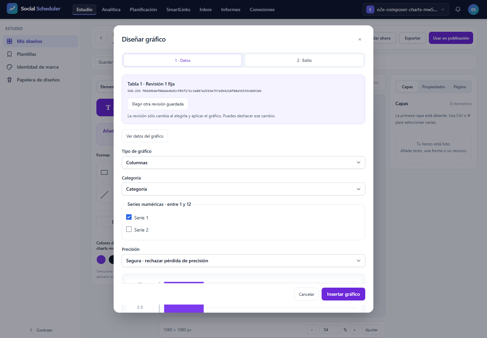

# T12: errores y accesibilidad, validación focal

**NO-PASS**. Casos realmente ejecutados: 1/3; registros del JSON: 3, incluidos los no ejecutados. E2E28.03 previsto íntegro a375/768/1440px, un worker, cero reintentos y fail-fast1. T12 sigue abierta. La inspección de estas figuras/PDF se registra por SHA; no sustituye el resultado automático.

## Comprobaciones del escenario

Tabla DOM con tipos y lexemas originales; proporciones negativas bloqueadas; safe/approximate para9007199254740993; estilo guardado/editado e Inspector; teclado, foco visible y restaurado; revisión histórica vacíaB4 fijada a1 mientras la actual2 tiene filas. El test exige ausencia de aplicación tardía tras cancelar una respuesta HTTP real retenida; captura200, bytes/SHA, cancelación y liberación se contrastan con el journal pasivo. No se simula éxito HTTP ni se amplían abortos permitidos.

En un grupo completo se exigen9recibos axe sin violations/incomplete,9capturas,3pruebas de foco/holds/B4/red/viewports y font-responses vacío. El recuento independiente rechaza evidencia faltante, adicional o incoherente. Los campos originales y el gate están junto al informe. Si este intento falla, los pasos no alcanzados continúan pendientes; no se completan con registros ficticios.

## Recursos y cierre

Runtime ficticio aislado y sólo loopback, sin .env/DB/proveedor real. Build4 actual antes de ejecutar. Job3GiB COMMIT agregado, preflight físico6GiB, piso3GiB cada100ms, PHP256MiB/Node512MiB; plazo único900s incluyendo clausura. Pico del núcleo 737357824B, duración 16.033s, mínimo físico 7535910912B. Fallo de recursos: None. Clausura registrada por separado; plazo global 16.275761099997908s. Procesos propios cerrados y8080IPv4/IPv6libres. PDF posterior en Job separado. 417fuentes comprobadas antes/después y trasPDF.

## Alcance pendiente

Este resultado no acredita SVG/PNG/PDF exportados, fuente privada, densidad, otras variantes o familias, AV o el roadmap completo. Servidor tiene su informe independiente; no se agregan JSON con huellas distintas para inventar12casos. El títuloY pequeño sigue como corrección visual pendiente. La aceptación funcional de este escenario no equivale a aprobación visual de toda la interfaz.

## Resultado y antecedentes

```text
desktop: Error: expect(received).toEqual(expected) // deep equality

- Expected  -   1
+ Received  + 549

- Array []
+ Array [
+   Object {
+     "description": "Ensure the contrast between foreground and background colors meets WCAG 2 AA minimum contrast ratio thresholds",
+     "help": "Elements must meet minimum color contrast ratio thresholds",
+     "helpUrl": "https://dequeuniversity.com/rules/axe/4.10/color-contrast?application=playwright",
+     "id": "color-contrast",
+     "impact": "serious",
+     "nodes": Array [
+       Object {
+         "all": Array [],
+         "any": Array [
+           Object {
+             "data": Object {
+               "contrastRatio": 0,
+               "expectedContrastRatio": "4.5:1",
+               "fontSize": "10.5pt (14px)",
+               "fontWeight": "normal",
+               "messageKey": "bgImage",
+             },
+             "id": "color-contrast",
+             "impact": "serious",
+             "message": "Element's background color could not be determined due to a background image",
+             "relatedNodes": Array [
+               Object {
+                 "html": "<select data-v-d7a4d025=\"\" class=\"field\">",
+                 "target": Array [
+                   ".chart-label:nth-child(3) > select",
+                 ],
+               },
+             ],
+           },
+         ],
+         "failureSummary": "Fix any of the following:
+   Element's background color could not be determined due to a background image",
+         "html": "<select data-v-d7a4d025=\"\" class=\"field\">",
+         "impact": "serious",
+         "none": Array [],
+         "target": Array [
+           ".chart-label:nth-child(3) > select",
+         ],
+       },
+       Object {
+         "all": Array [],
+         "any": Array [
+           Object {
+             "data": Object {
+               "contrastRatio": 0,
+               "expectedContrastRatio": "4.5:1",
+               "fontSize": "10.5pt (14px)",
+             
```

```text
desktop: Error: expect(received).toHaveLength(expected)

Expected length: 1
Received length: 0
Received array:  []
```

El intento conserva sus fallos originales y los pasos no alcanzados; no se relajan las aserciones.


## Evidencias visuales

### images/1440-test-failed-1.png



