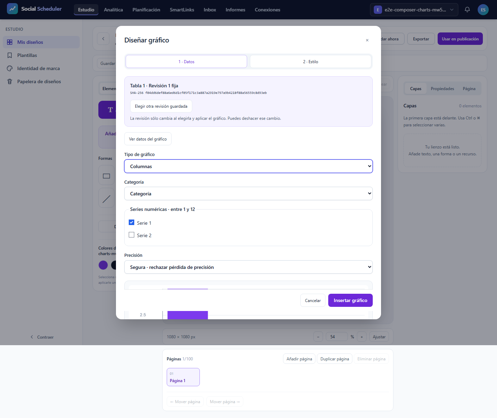
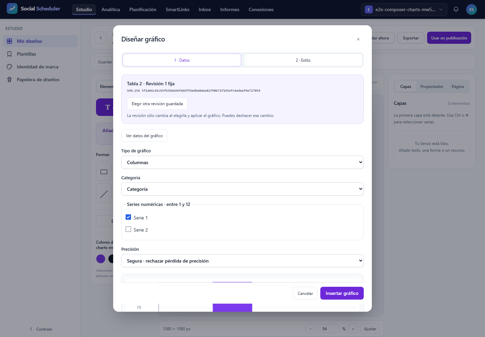

# T12: errores y accesibilidad, validación focal

**NO-PASS**. Casos realmente ejecutados: 1/3; registros del JSON: 3, incluidos los no ejecutados. E2E28.03 previsto íntegro a375/768/1440px, un worker, cero reintentos y fail-fast1. T12 sigue abierta. La inspección de estas figuras/PDF se registra por SHA; no sustituye el resultado automático.

## Comprobaciones del escenario

Tabla DOM con tipos y lexemas originales; proporciones negativas bloqueadas; safe/approximate para9007199254740993; estilo guardado/editado e Inspector; teclado, foco visible y restaurado; revisión histórica vacíaB4 fijada a1 mientras la actual2 tiene filas. El test exige ausencia de aplicación tardía tras cancelar una respuesta HTTP real retenida; captura200, bytes/SHA, cancelación y liberación se contrastan con el journal pasivo. No se simula éxito HTTP ni se amplían abortos permitidos.

En un grupo completo se exigen9recibos axe sin violations/incomplete,9capturas,3pruebas de foco/holds/B4/red/viewports y font-responses vacío. El recuento independiente rechaza evidencia faltante, adicional o incoherente. Los campos originales y el gate están junto al informe. Si este intento falla, los pasos no alcanzados continúan pendientes; no se completan con registros ficticios.

## Recursos y cierre

Runtime ficticio aislado y sólo loopback, sin .env/DB/proveedor real. Build5 actual antes de ejecutar. Job3GiB COMMIT agregado, preflight físico6GiB, piso3GiB cada100ms, PHP256MiB/Node512MiB; plazo único900s incluyendo clausura. Pico del núcleo 711835648B, duración 25.646s, mínimo físico 8134578176B. Fallo de recursos: None. Clausura registrada por separado; plazo global 25.84030260000145s. Procesos propios cerrados y8080IPv4/IPv6libres. PDF posterior en Job separado. 462fuentes comprobadas antes/después y trasPDF.

## Alcance pendiente

Este resultado no acredita SVG/PNG/PDF exportados, fuente privada, densidad, otras variantes o familias, AV o el roadmap completo. Servidor tiene su informe independiente; no se agregan JSON con huellas distintas para inventar12casos. El títuloY pequeño sigue como corrección visual pendiente. La aceptación funcional de este escenario no equivale a aprobación visual de toda la interfaz.

## Resultado y antecedentes

```text
desktop: Error: expect(received).toBe(expected) // Object.is equality

Expected: 1
Received: 0

Call Log:
- Timeout 5000ms exceeded while waiting on the predicate

   at support\studio-chart-delay.ts:10

   8 |  const offset=fs.existsSync(log)?fs.statSync(log).size:0;fs.writeFileSync(file,JSON.stringify({method,path:route,token}));
   9 |  const rows=()=>fs.existsSync(log)?fs.readFileSync(log).subarray(offset).toString('utf8').split('\n').filter(Boolean).map(line=>JSON.parse(line)).filter(row=>row.token===token):[];
> 10 |  return {async captured(){await expect.poll(()=>rows().filter(r=>r.kind==='hold-captured-real-response').length).toBe(1);const row=rows().find(r=>r.kind==='hold-captured-real-response');expect(row.status).toBe(200);expect(row.upstream_status).toBe(200);expect(row.bytes).toBeGreaterThan(0);expect(row.sha256).toMatch(/^[a-f0-9]{64}$/);return row;},async cancelled(){await expect.poll(()=>rows().filter(r=>r.kind==='hold-client-cancelled').length).toBe(1);},async release(){fs.writeFileSync(path.join(runRoot,`hold-${token}.release`),'release');await expect.poll(()=>rows().filter(r=>r.kind==='hold-released').length).toBe(1);const released=rows().find(r=>r.kind==='hold-released');expect(released.deadline_release).toBe(false);return rows();}};
     |                                                                                                                  ^
  11 | }
  12 |
    at Object.captured (C:\laragon\www\metricool\tests\e2e\support\studio-chart-delay.ts:10:114)
    at C:\laragon\www\metricool\tests\e2e\studio-charts.spec.ts:41:672
```

```text
desktop: Error: expect(received).toBe(expected) // Object.is equality

Expected: 1
Received: 0

Call Log:
- Timeout 5000ms exceeded while waiting on the predicate

   at support\studio-chart-delay.ts:10

   8 |  const offset=fs.existsSync(log)?fs.statSync(log).size:0;fs.writeFileSync(file,JSON.stringify({method,path:route,token}));
   9 |  const rows=()=>fs.existsSync(log)?fs.readFileSync(log).subarray(offset).toString('utf8').split('\n').filter(Boolean).map(line=>JSON.parse(line)).filter(row=>row.token===token):[];
> 10 |  return {async captured(){await expect.poll(()=>rows().filter(r=>r.kind==='hold-captured-real-response').length).toBe(1);const row=rows().find(r=>r.kind==='hold-captured-real-response');expect(row.status).toBe(200);expect(row.upstream_status).toBe(200);expect(row.bytes).toBeGreaterThan(0);expect(row.sha256).toMatch(/^[a-f0-9]{64}$/);return row;},async cancelled(){await expect.poll(()=>rows().filter(r=>r.kind==='hold-client-cancelled').length).toBe(1);},async release(){fs.writeFileSync(path.join(runRoot,`hold-${token}.release`),'release');await expect.poll(()=>rows().filter(r=>r.kind==='hold-released').length).toBe(1);const released=rows().find(r=>r.kind==='hold-released');expect(released.deadline_release).toBe(false);return rows();}};
     |                                                                                                                                                                                                                                                                                                                                                                                                                                                                                                                                                                                                                                          ^
  11 | }
  12 |
    at Object.release (C:\laragon\www\metricool\tests\e2e\support\studio-chart-delay.ts:10:61
```

El intento conserva sus fallos originales y los pasos no alcanzados; no se relajan las aserciones.


## Evidencias visuales

### images/desktop-no-viewport-receipt-errors-table-modal.png



### images/desktop-no-viewport-receipt-test-failed-1.png



