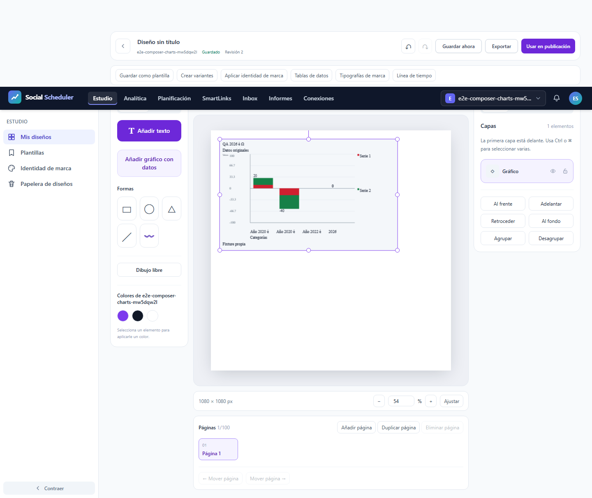
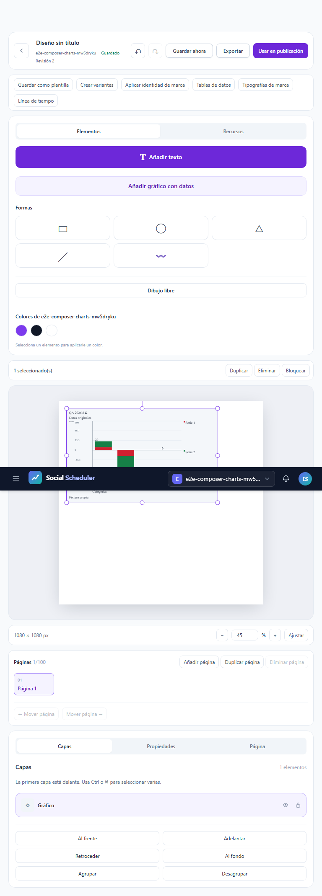
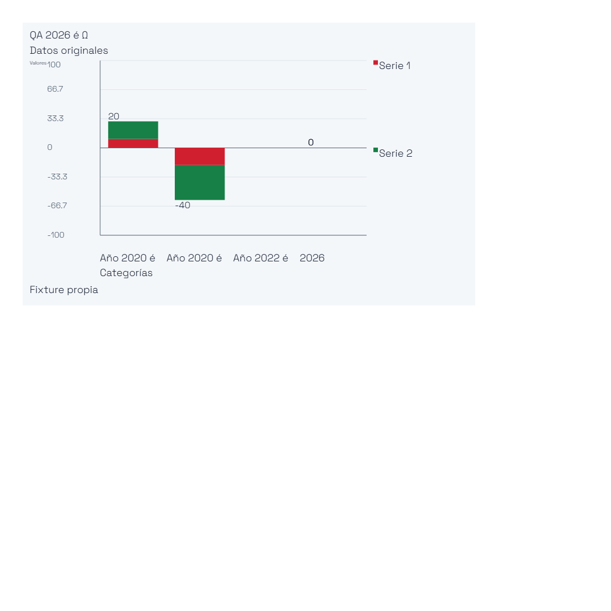

# T12: exportación en servidor, validación focal

**FOCAL-PASS: 3/3 casos reales, nueve descargas SVG/PNG/PDF.** Se ejecutó E2E28.02 íntegro a375,768 y1440px. Cero fallos, skips, flaky, interrupciones o reintentos. No se cierra T12 ni se acepta una matriz global. Inspección de las cuatro figuras y las páginas de este PDF registrada por separado con sus SHA.

## Resultado y alcance

| Proyecto | Ancho real | Resultado |
|---|---|---|
| desktop | 1440 px | PASS |
| mobile | 375 px | PASS |
| mobile-360 | 768 px | PASS |

El nombre histórico mobile-360 corresponde realmente a768px; viewport.json conserva las dimensiones observadas. Se verificaron revisión archivada fijada, página seleccionada y otra excluida, fuente privada, materialización del renderer real y permisos entre actores/marcas. Son los resultados de este único grupo; no se suman a JSON de intentos anteriores.

Los observadores independientes pasaron3SVG/XML,3PNG,3comparaciones de glifos,3PDF y3procedencias raster. Cada SVG contiene la fuente WOFF2 realmente servida. IoU del glifo original=1,0 frente a Arial=0,2825. Cada PDF tiene una página de810×810pt y un raster1080×1080, cuyos RGB coinciden exactamente con el PNG entregado. No se declara texto vectorial o extraíble. Los tres PNG descargados tienen los mismos55608bytes y SHA; una figura representa esos bytes idénticos. Los PDF conservan sus propios SHA.

El helper espera tanto el evento nativo como saveAs/failure=null. Las nueve descargas completas se publican con tamaño/SHA; el evento inicial por sí solo no acredita una descarga. No se fabricaron eventos response ni resultados. JSON original y blob oficial quedan privados e inmutables; sus SHA están en original-results-provenance.json.

## Aislamiento y recursos

Runtime ficticio SQLite/almacenamiento/cachés propios, rutas comprobadas antes de seed, sólo loopback, sin .env ni proveedores reales. Un worker, cero reintentos y fail-fast1. Job COMMIT agregado3GiB, killOnClose, sin breakaway; PHP256MiB/Node512MiB. Preflight físico6GiB, piso3GiB cada100ms y plazo900s incluyendo cierre.

Core92,049s, pico COMMIT934830080B, mínimo físico7373107200B. Cierre0,051s/14544896B; plazo global174,923s. Sin fallo de recursos. Supervisor24172 y procesos propios muertos,8080IPv4/IPv6libres. PDF del informe en Job separado tras ese cierre. 370fuentes verificadas antes/después y tras PDF; la publicación administrativa se hace después del sellado.

## Límites y continuación

Los escenarios E2E28.03 de errores/accesibilidad y E2E28.04 de densidad todavía necesitan su propia ejecución. No se aceptan otras variantes, AV, datos52MB, Linux/VPS/R2 ni el resto del roadmap. La legibilidad adicional del títuloY se mantiene como seguimiento conocido, independiente de esta comprobación de exportación. Los seis intentos completos anteriores conservan sus fallos e informes originales.

## Figuras observadas

### images/1440-server-static.png

### images/375-server-static.png

### images/768-server-static.png

### images/exported-server.png

